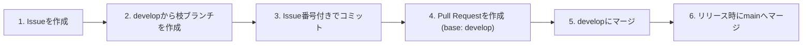
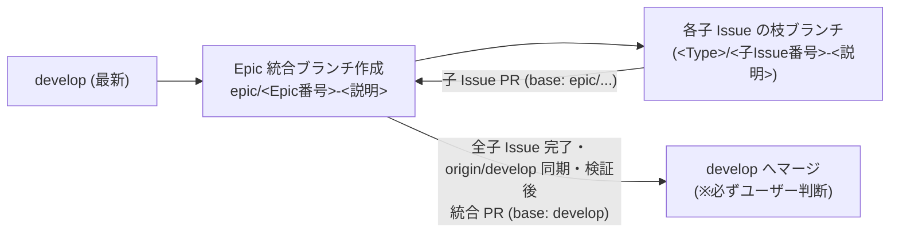

# ブランチ運用ルール

本プロジェクト（Audio Effector）におけるブランチ運用の統一ルールを定めます。

---

## 1. 開発ワークフロー

開発規模に応じて、**単一 Issue 開発フロー** と **Epic 開発フロー（統合ブランチ経由）** を使い分けます。

### 1.1 単一 Issue 開発フロー（通常）

単発の機能追加・バグ修正・ドキュメント更新など、Epic に属さない Issue は `develop` から直接枝ブランチを派生し、`develop` へマージします。



### 1.2 Epic 開発フロー（複数子 Issue を束ねる場合）

複数の子 Issue を束ねる Epic Issue では、実装途上の未結合変更が `develop` に直接流入するのを防ぐため、**`develop` から先に Epic 統合用ブランチ（`epic/<Epic番号>-<簡潔な説明>`）を作成し、各子 Issue の枝ブランチを統合ブランチから派生・マージ**します。全子 Issue 完了後、統合ブランチから `develop` へ統合 PR を作成し、**最終的な `develop` マージは必ずユーザー判断（手動確認・承認）**で行います。



### Step 1: Issueを作成する

- **作業開始前に必ずIssueを作成する**
- Issueには目的（Why）・作業内容（What）・完了条件を記載する
- Issue番号はコミットメッセージとブランチ名で使用する

### Step 2: ベースブランチから枝ブランチを作成する

#### 単一 Issue の場合（`develop` から派生）
```bash
git checkout develop
git pull origin develop
git checkout -b feat/12-effect-switching
```

#### Epic 配下の子 Issue の場合（Epic 統合ブランチから派生）
```bash
# Epic 着手時に 1 度だけ統合ブランチを作成・Push
git checkout develop
git pull origin develop
git checkout -b epic/401-lyrics-display
git push -u origin epic/401-lyrics-display

# 各子 Issue の枝ブランチは最新の Epic 統合ブランチから作成
git fetch origin epic/401-lyrics-display
git checkout -b feat/402-lyrics-parser origin/epic/401-lyrics-display
```

- 単一 Issue は必ず **最新の `develop` ブランチ** から、Epic 子 Issue は必ず **最新の Epic 統合ブランチ（`epic/<Epic番号>-<説明>`）** から作成する
- 枝ブランチの命名規則は「2. ブランチ命名規則」に従う

### Step 3: Issue番号を含めてコミットする

```bash
git add <ファイル>
git commit -m "feat: #12 エフェクト切替機能を追加する"
```

- コミットメッセージには **必ずIssue番号を含める**
- `#<Issue番号>` を記載することでGitHub上でIssueと自動リンクされる
- コミットメッセージのフォーマットは [git_operation_rules.md](git_operation_rules.md) を参照

### Step 4: Pull Requestを作成する

- **単一 Issue PR / Epic 統合 PR**: マージ先は **必ず `develop` ブランチ** に指定する（デフォルトが `main` になっている場合があるため要注意）
- **Epic 子 Issue PR**: マージ先は **当該 Epic の統合ブランチ（`epic/<Epic番号>-<説明>`）** に指定する
- GitHub CLIを使用する場合は、`gh pr create --base develop` または `gh pr create --base epic/<Epic番号>-<説明>` のように `--base` オプションで明示的に指定する
- PRの説明にIssueへの参照を含める（例: `Closes #12`）

### Step 5: マージする

- 単一 Issue PR: レビュー完了後、`develop` にマージし、枝ブランチを削除する
- Epic 子 Issue PR: 独立レビュー完了後、Epic 統合ブランチへ直列マージし、子 Issue 枝ブランチを削除する
- Epic 統合 PR（`epic/<Epic番号>-<説明>` → `develop`）: 全子 Issue 完了・`origin/develop` 追従同期・全検証合格後、**ユーザー判断による確認・承認を経て `develop` へマージ**し、統合ブランチを削除する

### Step 6: リリース時に `main` へマージする

- リリースのタイミングで `develop` → `main` にマージする
- `main` へのマージ後、必要に応じてタグを付与する

---

## 2. ブランチ命名規則

```
<Type>/<Issue番号>-<簡潔な説明>
```

### 例

```
epic/401-lyrics-display
feat/12-effect-switching
fix/34-playback-noise
docs/56-update-readme
refactor/78-audio-engine-cleanup
test/90-add-unit-tests
```

---

## 3. ブランチの種類

| ブランチ | 用途 | 備考 |
|---------|------|------|
| `main` | リリース可能な安定版 | 直接コミット禁止。`develop` からのマージのみ |
| `develop` | 開発の統合ブランチ | 単一 Issue 枝ブランチおよび Epic 統合ブランチの派生元・最終マージ先 |
| `epic/*` | Epic 統合用ブランチ | `develop` から作成（`epic/<Epic番号>-<簡潔な説明>`）。Epic 配下の全子 Issue の派生元・マージ先となり、全子 Issue 完了後にユーザー判断で `develop` へ最終マージ |
| `feat/*` | 新機能の開発用 | 単一 Issue は `develop`、Epic 子 Issue は `epic/*` から作成 |
| `fix/*` | バグ修正用 | 単一 Issue は `develop`、Epic 子 Issue は `epic/*` から作成 |
| `docs/*` | ドキュメント修正用 | 単一 Issue は `develop`、Epic 子 Issue は `epic/*` から作成 |
| `refactor/*` | リファクタリング用 | 単一 Issue は `develop`、Epic 子 Issue は `epic/*` から作成 |
| `test/*` | テスト追加・拡充・安定化用 | 単一 Issue は `develop`、Epic 子 Issue は `epic/*` から作成 |
| `chore/*` | 設定変更・メンテナンス用 | 単一 Issue は `develop`、Epic 子 Issue は `epic/*` から作成 |

> **⚠️ 注意**: 枝ブランチおよび Epic 統合ブランチは必ず `develop`（または Epic 子 Issue の場合は `epic/*`）から作成してください。`main` から直接作成しないこと。

---

## 4. クイックリファレンス

```bash
# === 単一 Issue 開発フロー ===

# 1. Issueを作成（GitHub上で実施）

# 2. developから枝ブランチを作成
git checkout develop
git pull origin develop
git checkout -b feat/<Issue番号>-<説明>

# 3. 開発してIssue番号付きでコミット
git add <ファイル>
git commit -m "feat: #<Issue番号> 変更内容を記述する"

# 4. リモートにプッシュしてPRを作成（※マージ先をdevelopに指定）
git push origin feat/<Issue番号>-<説明>
gh pr create --base develop --title "..." --body "Closes #<Issue番号>"

# 5. PR承認後、developにマージ（GitHub上で実施）

# === Epic 開発フロー（統合ブランチ経由） ===

# 1. developからEpic統合ブランチを作成・Push
git checkout develop
git pull origin develop
git checkout -b epic/<Epic番号>-<説明>
git push -u origin epic/<Epic番号>-<説明>

# 2. 各子Issueの枝ブランチを統合ブランチから作成・開発・PR作成（base: epic/...）
git checkout -b feat/<子Issue番号>-<説明> origin/epic/<Epic番号>-<説明>
# ... 開発・コミット・Push ...
gh pr create --base epic/<Epic番号>-<説明> --title "..." --body "Closes #<子Issue番号>"

# 3. 全子Issue完了後、統合ブランチへorigin/developを同期・検証して統合PR作成（base: develop）
gh pr create --base develop --head epic/<Epic番号>-<説明> --title "[Epic] ..." --body "..."

# 4. ユーザー判断による承認後、developにマージし、リリース時にmainへマージ
```
