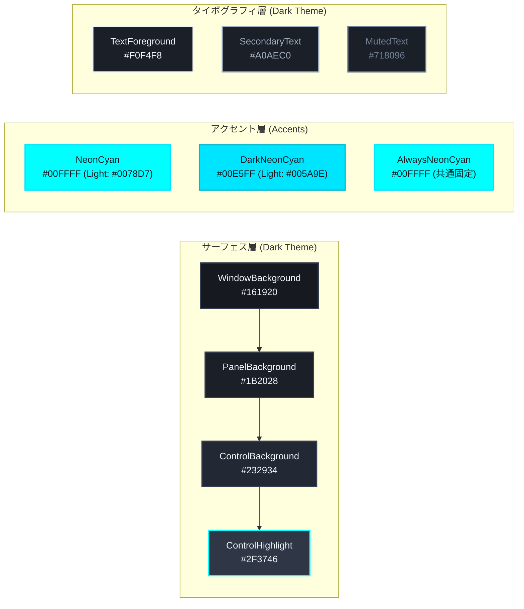

# デザイントークン仕様書 (Design Tokens Specification)

## 1. 概要

本仕様書は、Audio Effectorにおける視覚デザインの最小単位である「デザイントークン（Design Tokens）」を標準化・体系化した設計書です。
カラー、タイポグラフィ、スペーシング、角丸、エレベーション、モーションを名前付きのセマンティックトークンとして定義することで、コードおよびXAMLリソース間でのハードコードを排し、ダークテーマ・ライトテーマの双方で破綻のないビジュアル調和と高い保守性を保証します。
カラートークンの正本リソースは [`DarkTheme.xaml`](../../AudioEffector/Presentation/Themes/DarkTheme.xaml) および [`LightTheme.xaml`](../../AudioEffector/Presentation/Themes/LightTheme.xaml) です。

---

## 2. カラートークン (Color Tokens)

### 2.1 セマンティックカラーパレット構成

Audio Effectorは、音楽の鑑賞性とサイバー感を両立する「ディープスレート＆プレミアムチャコール（ダークテーマ）」と、明快な視認性を持つ「クリーンライト＆ロイヤルブルー（ライトテーマ）」の2テーマを提供します。

#### ① 背景・サーフェス・境界線トークン (`DarkTheme.xaml` / `LightTheme.xaml` 定義済み)
| トークン名 (Brush) | Dark 見本 (Preview) | Dark Hex | Light 見本 (Preview) | Light Hex | 用途と適用箇所 |
| :--- | :---: | :--- | :---: | :--- | :--- |
| `WindowBackgroundBrush` | ■ #161920 | `#161920` | ■ #F5F5F5 | `#F5F5F5` | アプリケーションウィンドウ・メインビューのベース背景 |
| `PanelBackgroundBrush` | ■ #1B2028 | `#1B2028` | ■ #EAEAEA | `#EAEAEA` | 左サイドバー、ツールバー、右スライドパネル、上部プレイヤーバー |
| `ControlBackgroundBrush` | ■ #232934 | `#232934` | ■ #FFFFFF | `#FFFFFF` | ボタン、テキスト入力欄、コンボボックス、カード背景 |
| `ControlBackgroundHighlightBrush` | ■ #2F3746 | `#2F3746` | ■ #F0F0F0 | `#F0F0F0` | ホバー・選択状態のコントロール背景、スライダー未再生トラック |
| `BorderBrush` | ■ #343E4E | `#343E4E` | ■ #CCCCCC | `#CCCCCC` | 標準の境界線（カード外枠、ペイン境界、入力欄ボーダー） |
| `ZebraOddBackgroundBrush` | ■ #12FFFFFF | `#12FFFFFF` | ■ #0C000000 | `#0C000000` | トラックリスト等の奇数行ゼブラストライプ背景（Dark約7%白 / Light約5%黒） |

#### ② テキスト・前景トークン (`DarkTheme.xaml` / `LightTheme.xaml` 定義済み)
| トークン名 (Brush) | Dark 見本 (Preview) | Dark Hex | Light 見本 (Preview) | Light Hex | 用途と適用箇所 |
| :--- | :---: | :--- | :---: | :--- | :--- |
| `TextForegroundBrush` | ■ #F0F4F8 | `#F0F4F8` | ■ #1E1E1E | `#1E1E1E` | 主要テキスト（楽曲名、見出し、アクティブラベル） |
| `SecondaryTextForegroundBrush` | ■ #A0AEC0 | `#A0AEC0` | ■ #404040 | `#404040` | 補足テキスト（アーティスト名、アルバム名、サブタイトル） |
| `MutedTextForegroundBrush` | ■ #718096 | `#718096` | ■ #606060 | `#606060` | 控えめなテキスト（再生時間、トラック番号、未選択アイコン、プレースホルダー） |
| `InverseTextForegroundBrush` | ■ #161920 | `#161920` | ■ #FFFFFF | `#FFFFFF` | 反転テキスト（`NeonCyanBrush` プライマリボタン上の文字・アイコン色） |

#### ③ アクセント・ブランドトークン (`DarkTheme.xaml` / `LightTheme.xaml` 定義済み)
| トークン名 (Brush) | Dark 見本 (Preview) | Dark Hex | Light 見本 (Preview) | Light Hex | 用途と適用箇所 |
| :--- | :---: | :--- | :---: | :--- | :--- |
| `NeonCyanBrush` | ■ #00FFFF | `#00FFFF` | ■ #0078D7 | `#0078D7` | テーマ連動アクセント（プライマリボタン、選択バー、フォーカス、アクティブアイコン） |
| `DarkNeonCyanBrush` | ■ #00E5FF | `#00E5FF` | ■ #005A9E | `#005A9E` | アクセントホバー・濃色アクセント |
| `AlwaysNeonCyanBrush` | ■ #00FFFF | `#00FFFF` | ■ #00FFFF | `#00FFFF` | **両テーマ共通の不変ネオンシアン**（アルバムアート暗幕オーバーレイ上の再生アイコン、アクティブタブ等） |

#### ④ カスタムタイトルバー・スクロールバー・メタリックトークン (`DarkTheme.xaml` / `LightTheme.xaml` 定義済み)
| カテゴリ | トークン名 (Brush) | Dark Hex | Light Hex | 用途 |
| :--- | :--- | :--- | :--- | :--- |
| **タイトルバー** | `TitleBarBackgroundBrush` | `#161920` | `#F5F5F5` | カスタムタイトルバー背景 |
| **タイトルバー** | `TitleBarForegroundBrush` | `#F0F4F8` | `#1E1E1E` | タイトルバー文字・アイコン色 |
| **タイトルバー** | `TitleBarBorderBrush` | `#2A323D` | `#E2E8F0` | ウィンドウ外枠（通常時 1px）およびタイトルバー下部境界線 |
| **タイトルバー** | `TitleBarButtonHoverBrush` | `#2A323D` | `#E5E5E5` | 最小化・最大化ボタンのホバー背景 |
| **タイトルバー** | `TitleBarButtonPressedBrush` | `#384454` | `#CCCCCC` | 最小化・最大化ボタンの押下背景 |
| **タイトルバー** | `TitleBarCloseButtonHoverBrush` | `#E81123` | `#E81123` | 閉じるボタンのホバー背景（赤） |
| **タイトルバー** | `TitleBarCloseButtonPressedBrush` | `#B2101E` | `#C4101E` | 閉じるボタンの押下背景 |
| **スクロールバー** | `ScrollBarTrackBrush` | `#00000000` | `#00000000` | スクロールバートラック背景（完全透明） |
| **スクロールバー** | `ScrollBarThumbBrush` | `#424C5E` | `#CBD5E1` | 通常時サム（Thumb）色 |
| **スクロールバー** | `ScrollBarThumbHoverBrush` | `#607088` | `#94A3B8` | ホバー時サム色 |
| **スクロールバー** | `ScrollBarThumbDraggingBrush` | `#00FFFF` | `#0078D7` | ドラッグ中サム色 |
| **メタリック** | `MetallicCardBackgroundBrush` | `#2C3545`→`#202734`→`#161A22` | `#FFFFFF`→`#F0F3F6`→`#DFE3E8` | 右側Player Podカードおよびアルバムアート7pxベゼルの斜めグラデーション背景 |
| **メタリック** | `MetallicCardBorderBrush` | `#687B99`→`#384556`→`#1A2028` | `#E2E8F0`→`#CBD5E1`→`#94A3B8` | メタリックカードの斜めグラデーション境界線 |
| **メタリック** | `MetallicFrameOuterEdgeBrush` | `#60FFFFFF` | `#FFFFFF` | アルバムアートベゼル外周ハイライトエッジ |
| **メタリック** | `MetallicFrameInnerEdgeBrush` | `#70FFFFFF` | `#FFFFFF` | アルバムアートベゼル内周ハイライトエッジ |

#### ⑤ 将来拡張候補トークン（テーマリソース未定義の設計ガイドライン色）
以下のトークンはテーマディクショナリには未登録であり、将来的な共通スタイル統合時の拡張候補として予約されています。
- **サーフェス・ボーダー補助**: `WorkspaceBackgroundBrush` (`#141A22`), `ControlBackgroundPressedBrush` (`#384454`), `DisabledTextForegroundBrush` (`#4A5568`), `NeonCyanPressedBrush` (`#00B8CC`), `AccentGlowBrush` (`#4000FFFF`), `SubtleBorderBrush` (`#232934`), `FocusBorderBrush` (`#00FFFF`)
- **セマンティック状態色**: `SuccessBrush` (`#10B981`), `WarningBrush` (`#F59E0B`), `DangerBrush` (`#EF4444`), `InfoBrush` (`#3B82F6`)

---

## 3. タイポグラフィトークン (Typography Tokens)

### 3.1 フォントファミリー
- **プライマリフォント**: `Segoe UI` (欧文・数値・システムUI)
- **和文フォールバック**: `Meiryo UI`, `Yu Gothic UI`, `sans-serif`
- **等幅フォント (ビットレート・タイムコード用)**: `Consolas`, `Cascadia Code`, `monospace`

### 3.2 スケール階層定義

| トークン名 | FontSize | FontWeight | LineHeight | 主な用途 |
| :--- | :---: | :---: | :---: | :--- |
| `Typography.Display` | 24pt (32px) | Bold | 1.25 | メインヒーロータイトル、アーティストドリルダウン大見出し |
| `Typography.Header1` | 20pt (26px) | Bold | 1.30 | 各ビューの最上位見出し、アルバム詳細タイトル |
| `Typography.Header2` | 16pt (21px) | SemiBold | 1.35 | セクション見出し（「Playlists」「Albums」）、ダイアログ表題 |
| `Typography.Subheader` | 14pt (18px) | SemiBold | 1.40 | トラック名、カードタイトル、パネルヘッダー |
| `Typography.Body` | 13pt (17px) | Regular | 1.45 | **標準本文**: 楽曲リスト行テキスト、設定項目、メニュー |
| `Typography.Caption` | 11pt (15px) | Regular | 1.40 | **補足情報**: 再生経過/総時間、アーティスト補足、列ヘッダー |
| `Typography.Micro` | 9pt (12px) | Bold | 1.20 | **タグ・バッジ**: ハイレゾ音源タグ (`FLAC 96/24`)、ステータスラベル |

---

## 4. スペーシング・サイジングトークン (Spacing Tokens)

レイアウトの破綻を防ぎ、均整の取れたリズムを生み出すため、**4pxベースのグリッドシステム**を採用します。

| トークン名 | ピクセル値 | 主な適用箇所 |
| :--- | :---: | :--- |
| `Spacing.XXS` | 2px | 極小オフセット、アイコンとインジケーターの微調整 |
| `Spacing.XS` | 4px | インラインアイコンとラベルの間隔、タイトなパディング |
| `Spacing.S` | 8px | ボタン内横パディング、リスト行の上下余白、コントロール間隔 |
| `Spacing.M` | 12px | カード内パディング、ツールバーアイテム間隔、パネルマージン |
| `Spacing.L` | 16px | 標準コンテナパディング、セクション間の垂直余白 |
| `Spacing.XL` | 24px | 大セクション間隔、ダイアログ内余白、グリッドカードのガター |
| `Spacing.XXL` | 32px | ウィンドウ境界からの大マージン、ヒーローセクション周囲 |

---

## 5. 角丸トークン (CornerRadius Tokens)

| トークン名 | CornerRadius | 適用対象オブジェクト・コンポーネント |
| :--- | :---: | :--- |
| `Radius.Sharp` | `0` | タイトルバー、ウィンドウ外枠、画面端に接する境界線 |
| `Radius.Small` | `4` | ボタン、テキスト入力欄、コンボボックス、タグバッジ、ミニアルバムアート |
| `Radius.Medium` | `8` | コンテンツカード、コンテキストメニュー、ダイアログ |
| `Radius.Large` | `12` | 右側Player Podカード、フローティングパネル |
| `Radius.Pill` | `9999` (円形/楕円) | 再生/一時停止ボタン、音量・シークバーのThumb、ステータスピル |

---

## 6. エレベーションと陰影トークン (Elevation Tokens)

パフォーマンス最適化方針に基づき、高負荷な動的ぼかしエフェクトの乱用を禁止し、**「ボーダー線（Border）による境界分離」を基本としつつ、テーマ定義された静的シャドウリソースのみを厳選適用**します。

| リソースキー / レベル | Dark Theme 定義 | Light Theme 定義 | 適用要素 |
| :--- | :--- | :--- | :--- |
| **Level 0 (Flat)** | 境界線なし | 境界線なし | メインワークスペース背景、プレイヤーバー |
| **Level 1 (Surface)** | `BorderThickness="1"` + `BorderBrush` (`#343E4E`) | `BorderThickness="1"` + `BorderBrush` (`#CCCCCC`) | アルバムカード、リストコンテナ、サイドバー区切り |
| **`CardDropShadowEffect`** | `Color="#000000" BlurRadius="22" ShadowDepth="5" Direction="270" Opacity="0.75"` | `Color="#000000" BlurRadius="16" ShadowDepth="3" Direction="270" Opacity="0.30"` | 右側Player Podカード等の主要カードコンテナ |
| **`AlbumArtDropShadowEffect`** | `Color="#000000" BlurRadius="30" ShadowDepth="8" Direction="270" Opacity="0.85"` | `Color="#000000" BlurRadius="20" ShadowDepth="5" Direction="270" Opacity="0.35"` | 右側メインアルバムアートのメタリックベゼル外周 |

> [!IMPORTANT]
> **パフォーマンス制約**: スペクトラムアナライザのバーやシークバー、常時スクロールするリスト行など、高頻度で描画更新される動的要素には `DropShadowEffect` を指定してはなりません。

---

## 7. モーション・トランジショントークン (Motion Tokens)

### 7.1 時間軸 (Duration)
| トークン名 | 時間 (ms) | 用途 |
| :--- | :---: | :--- |
| `Motion.Instant` | 0ms | 即時切り替え（チェック状態、フォーカス枠） |
| `Motion.Fast` | 100ms | マイクロインタラクション（ボタンホバー、押下時の色変化） |
| `Motion.Normal` | 200ms | フェードイン/アウト、タブ切り替え、ツールチップ |
| `Motion.Slide` | 250ms | 右スライドパネル開閉、ドロワー展開、アコーディオン開閉 |
| `Motion.Slow` | 400ms | 大規模な画面ビュー遷移、モーダルダイアログのポップアップ |

### 7.2 イージングカーブ (Easing Function)
- **標準イージング (`Easing.Standard`)**: `CubicEase EasingMode="EaseInOut"`
- **進入イージング (`Easing.Enter`)**: `CubicEase EasingMode="EaseOut"`
- **退出イージング (`Easing.Exit`)**: `CubicEase EasingMode="EaseIn"`
