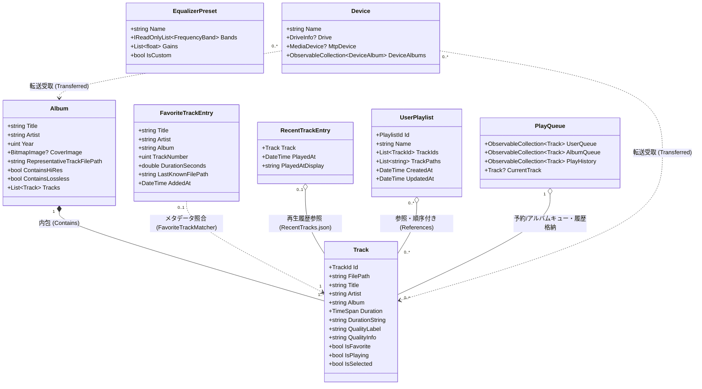

# 主要オブジェクト一覧とモデリング (Audio Effector)

本ディレクトリでは、Audio Effectorのコアオブジェクト（名詞）の定義、属性・操作仕様、および相互関係をまとめています。

---

## 1. コレクション / シングル対応表

| オブジェクト名 | 英名 | 分類 | コレクション表示 (一覧) | シングル表示 (詳細) | 拡張設計指針 | 詳細定義 |
| :--- | :--- | :--- | :--- | :--- | :--- | :---: |
| **楽曲** | Track | プライマリ | `AllSongsView.xaml`（全曲一覧）、`ArtistsView.xaml`（アーティスト別楽曲）、`LibraryView.xaml`（アルバム展開）、`PlaylistTracksView.xaml`（プレイリスト/お気に入り）、`PlayQueueSidePanel.xaml`（再生キュー/履歴）、`RecentView.xaml`（最近再生した曲）。 ※お気に入り永続化は `FavoriteTrackEntry`、再生履歴永続化は `RecentTrackEntry` が担う。 | 右側パネルの再生情報・Player Pod、およびプロパティダイアログ。 | 複数選択一括操作、プロパティ/タグ編集ビューの提供。 | [01_楽曲_Track.md](01_楽曲_Track.md) |
| **アルバム** | Album | プライマリ / コンテナ | `LibraryView.xaml`（グリッド表示・リスト表示）、`ArtistsView.xaml`（右ペイン所属アルバム一覧）。 | `LibraryView.xaml` 内のインライン展開（グリッド時ソケットトレイ、リスト時Expander）および右側パネルのアルバム情報。 | 独立したアルバム詳細シングルビュー（Issue #188）への展開。 | [02_アルバム_Album.md](02_アルバム_Album.md) |
| **プレイリスト** | UserPlaylist | プライマリ / コンテナ | `PlaylistSelectorView.xaml`（2×2分割サムネイル付きカード一覧）。 | `PlaylistTracksView.xaml`（ヘッダー＋所属曲一覧の独立画面）。 | 楽曲のD&D直接投入・インライン名称編集・スマートプレイリスト。 | [03_プレイリスト_UserPlaylist.md](03_プレイリスト_UserPlaylist.md) |
| **再生キュー** | PlayQueue | コンテナ / ワークスペース | `PlayQueueSidePanel.xaml`（2層セクション `UserQueue` + `AlbumQueue`、および `PlayHistory` タブ）、`MiniPlayerWindow.xaml`（下部連結キュー）。 | 右側パネルおよび上部バーの現在再生曲表示。 | 複数選択やミニプレイヤー側キュー操作の拡張。 | [04_再生キュー_PlayQueue.md](04_再生キュー_PlayQueue.md) |
| **エフェクトプリセット** | EqualizerPreset | セカンダリ / 設定 | プリセット選択コンボボックス（`EqualizerViewModel.Presets`）。 | `EqualizerView.xaml`（10バンドゲインスライダー＋マスター音量）。 | 再生画面と併用しやすいモードレス配置への拡張。 | [05_エフェクトプリセット_EqualizerPreset.md](05_エフェクトプリセット_EqualizerPreset.md) |
| **接続機器** | Device | セカンダリ / ロケーション | `DeviceSyncView.xaml` のデバイス選択コンボボックス（`MainViewModel.DeviceViewModel`）。 | `DeviceSyncView.xaml` のディレクトリブラウザおよび `DeviceManagerDialog.xaml`（`DeviceAlbum` / `DeviceTrack` 管理）。 | 既定フォルダ記憶、空き容量予測、差分・変換転送（Issue #96, #97, #169, #170）。 | [06_接続機器_Device.md](06_接続機器_Device.md) |

---

## 2. オブジェクト関係図 (Mermaid)

