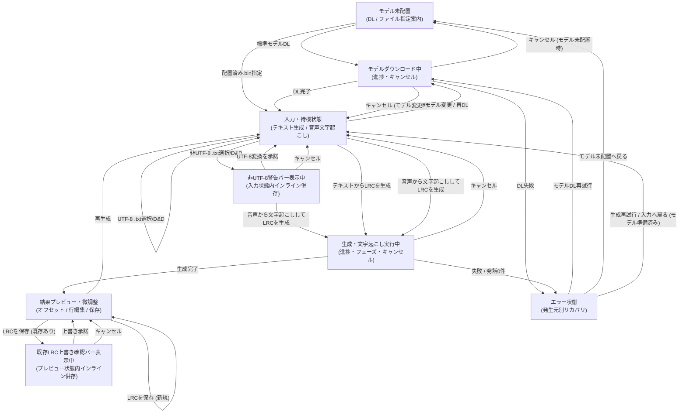

# LRC自動生成 UI仕様書

## 1. 概要 (Overview)

メイン画面右側タブの下部拡張領域（`MainWindow.xaml` 右カラム `Grid.Row="1"`）に配置し、対象楽曲の音声データからタイムタグ付き同期歌詞ファイル（`.lrc`）を自動生成・プレビュー確認・簡易微調整・保存するための専用 UI パネル（`LrcGeneratorView`）の画面仕様を定義する。

- **主要対象オブジェクト**: [楽曲 (`Track`)](../../主要オブジェクト/01_楽曲_Track.md)、歌詞データ（`LyricsDocument` / `LyricLine`）、入力テキストファイル（`.txt`）
- **2 つの独立した生成導線**:
  - **テキストファイル（`.txt`）から LRC を生成**: ユーザーが用意した歌詞テキストと楽曲音声をローカルモデルで強制アライメントする標準導線（UTF-8 標準、Shift-JIS 等の非 UTF-8 検出時は警告・ユーザー承諾後に UTF-8 変換して続行）。
  - **音声から直接文字起こしして LRC を生成**: テキストファイルを用意せずに楽曲音声からローカル Whisper モデルで直接文字起こしを行う独立した別ボタン導線。
- **外部機能との連携**: 右側タブ下部拡張領域は [歌詞表示 UI仕様書](../歌詞表示/歌詞表示UI仕様書.md)（`LyricsView`）および右側タブ拡張ウィジェット（#121）と共有し、排他切り替えで共存する。`.lrc` 保存完了後は歌詞表示機能へ更新通知を発火し、現在再生中楽曲であれば同期歌詞パネルへ即時反映する。

---

## 2. 実装イメージ（モックアップ）

### 2.1 ASCIIモックアップ

#### A. 入力・待機状態（通常：モデル準備済み / UTF-8 `.txt` 選択済み）

```text
+-----------------------------------------------------------------------------------------+
| [Art 50] Midnight City / M83                                           [♪] [🗖]        |
|          [Hi-Res] FLAC 96kHz/24bit                                     (OFF)(最大化)    |
|   [🔀] [|<] [ ▶ ] [>|] [🔁] [≡]   01:23 =======O========== 04:03        [+] [★]        |
+-----------------------------------------------------------------------------------------+
| ✨ LRC 自動生成   対象: Midnight City - M83                        [← 歌詞へ戻る] [✕]   |
+-----------------------------------------------------------------------------------------+
| モデル: Whisper (base) [準備完了]   言語: [自動判定 v]         [モデル設定 / 変更]      |
+-----------------------------------------------------------------------------------------+
| [ 1. テキストファイル (.txt) から生成 ]                                                 |
| +-------------------------------------------------------------------------------------+ |
| |   📄  midnight_city.txt  (UTF-8 / 32 行)                                [変更] [✕]  | |
| |       ※ .txt ファイルをここへドラッグ＆ドロップ、またはファイル選択                  | |
| +-------------------------------------------------------------------------------------+ |
| [ ✨ テキストから LRC を生成 ]                                                          |
|                                                                                         |
| --------------------------------------------------------------------------------------- |
| [ 2. 音声から直接文字起こし（.txt 不要） ]                                              |
| テキストを用意せずに楽曲音声から直接タイムタグ付き歌詞を作成します                       |
| [ 🎙 音声から文字起こしして LRC を生成 ]                                                |
+-----------------------------------------------------------------------------------------+
```

#### B. 非 UTF-8 文字コード検出時の警告・変換承諾バー（入力状態内のドロップゾーン直下にインライン表示）

```text
+-----------------------------------------------------------------------------------------+
| [ 1. テキストファイル (.txt) から生成 ]                                                 |
| +-------------------------------------------------------------------------------------+ |
| |   📄  midnight_city_sjis.txt  (Shift-JIS / 承諾待ち)                    [変更] [✕]  | |
| +-------------------------------------------------------------------------------------+ |
| +-------------------------------------------------------------------------------------+ |
| | ⚠  Shift-JIS (CP932) が検出されました                                               | |
| |    標準入力は UTF-8 です。内部処理用に UTF-8 へ変換して続行しますか？                | |
| |    ※ 元の .txt ファイル自体は上書きされません。                                     | |
| |                           [ UTF-8 に変換して続行 ]   [ キャンセル ]                 | |
| +-------------------------------------------------------------------------------------+ |
| [ ✨ テキストから LRC を生成 (非活性) ]                                                 |
| --------------------------------------------------------------------------------------- |
| [ 🎙 音声から文字起こしして LRC を生成 ]  (※ .txt 不要のため引き続き操作可能)           |
+-----------------------------------------------------------------------------------------+
```

#### C. 初回モデル未配置状態・生成実行中状態（進捗＆キャンセル）

```text
【モデル未配置状態（初回ガイド）】               【生成・文字起こし実行中】
+---------------------------------------------+ +---------------------------------------------+
| ✨ LRC 自動生成                [← 戻る] [✕] | | ✨ LRC 自動生成                [← 戻る] [✕] |
+---------------------------------------------+ +---------------------------------------------+
|                                             | |                                             |
|                  [モデル]                   | |      音声解析・文字起こしを実行中...         |
|     ローカル解析モデルが未配置です           | |                                             |
|  無料・オフライン動作の Whisper モデル      | |  [=================>-------------]  58%     |
|  (base / 約142MB) を取得してください。      | |                                             |
|                                             | |  フェーズ: 音声認識・文字起こし中 (3/5)      |
|  [ ⬇ 標準モデルをダウンロード ]             | |  対象: Midnight City - M83                  |
|  [ 📁 配置済みモデル (.bin) を指定 ]        | |                                             |
|                                             | |              [ ✕ キャンセル ]               |
+---------------------------------------------+ +---------------------------------------------+
```

#### D. 生成結果プレビュー・簡易微調整・保存状態

```text
+-----------------------------------------------------------------------------------------+
| ✨ LRC 自動生成   対象: Midnight City - M83  [32行]                [← 歌詞へ戻る] [✕]   |
+-----------------------------------------------------------------------------------------+
| 全体オフセット: [-0.5s] [-0.1s] [+0.1s] [+0.5s] [リセット] (補正: +0.0s)  [ ↺ 再生成 ]    |
+-----------------------------------------------------------------------------------------+
|  [00:12.40]  Waiting in a car                                                [✎]        |
|┃ [00:16.85]  Waiting for a ride in the dark                                  [✎]        | <- 選択行 (左3px NeonCyan)
|  [00:21.10]  The night city grows                                            [✎]        |
|  [00:25.60]  Look and see her eyes, they glow                                [✎]        |
|  ...                                                                                    |
+-----------------------------------------------------------------------------------------+
| 保存先: ...\M83\Midnight City.lrc (UTF-8)                                               |
| [ 💾 LRC を保存 ]   [ 📁 保存先フォルダを開く ]   [ ♪ 歌詞表示で確認 ]                  |
+-----------------------------------------------------------------------------------------+
```

#### E. 既存 `.lrc` 上書き確認・エラー状態

```text
【既存 .lrc 上書き確認（結果プレビュー状態・フッター直上のインライン確認バー）】
+-----------------------------------------------------------------------------------------+
| ⚠  同名の .lrc ファイルが既に存在します: Midnight City.lrc                              |
|    上書き保存しますか？保存後は同期歌詞表示へ反映されます。                              |
|                                               [ 上書き保存する ]   [ キャンセル ]        |
+-----------------------------------------------------------------------------------------+

【エラー状態（音声解析失敗 / 無音・発話区間 0 件 / ダウンロード失敗）】
+-----------------------------------------------------------------------------------------+
|                     !   LRC を生成できませんでした                                      |
|  発話・歌唱区間を検出できませんでした（無音またはインストゥルメンタル楽曲の可能性）。     |
|  モデル設定や対象楽曲を確認してやり直してください。                                      |
|                           [ ↻ 再試行 ]   [ ← 入力へ戻る ]                               |
+-----------------------------------------------------------------------------------------+
```

### 2.2 Figmaモックアップ

- [Figmaデザイン（準備中 / 別タスクにて作成予定）](#)
- ※ `tools/MockupRenderer` による XAML オフスクリーンレンダリング画像は、仕様書本文には直接配置せず、Figma で策定した完成イメージと本番実装との差分比較・視覚検証用として利用する。

---

## 3. 画面配置とペインレイアウト

### 3.1 全体レイアウト上の位置付け（`MainWindow.xaml` 右カラム `Grid.Row="1"`）

メイン画面 3 ペイン構成のうち、右側パネル（`Grid.Column="2"`、`Background="{DynamicResource PanelBackgroundBrush}"`、`ClipToBounds="True"`）の下部拡張領域ホスト（`Grid.Row="1"`）へ `LrcGeneratorView` を配置する。

| 行定義 | 最大化モード (`IsAlbumViewMaximized = True`) | コンパクトモード (`IsAlbumViewMaximized = False`) | 配置内容 |
| :--- | :---: | :---: | :--- |
| `Grid.Row="0"` | `1*` | `Auto` | プレイヤーセクション（最大化アルバムビュー／コンパクトプレイヤービューを `Visibility` で排他切替） |
| `Grid.Row="1"` | `0*` | `1*` | **下部拡張領域ホスト**（`RightExtensionPanelType` により `LyricsView` / `LrcGeneratorView` / 他拡張パネルを排他表示） |

### 3.2 起動導線と右側パネル自動展開ルール

以下のいずれのトリガーからでも対象 `Track` を指定して `LrcGeneratorView` を起動できる。

1. **歌詞パネル（`LyricsView`）エンプティステート／エラー状態**: 「LRC を自動生成する」ボタンクリック（現在再生中楽曲が対象）。
2. **歌詞パネル（`LyricsView`）ヘッダー**: 「LRC 自動生成／再生成」アイコンボタンクリック（現在再生中楽曲が対象。既存歌詞がある場合も再生成可能）。
3. **楽曲一覧等のコンテキストメニュー**: 「LRC を自動生成...」項目クリック（右クリック対象 `Track` が対象。再生中以外の楽曲も指定可能）。

- **自動パネル展開と元サイズ復帰・右上ボタン連携**:
  - 起動時に右側タブが閉じている（`IsRightPanelOpen = False`）場合は自動的に展開する。
  - 起動時に右側タブが最大化モード（`IsAlbumViewMaximized = True`）の場合は自動的にコンパクトモードへ切り替え、下部拡張領域（`Grid.Row="1"`）に `LrcGeneratorView` を表示する。
  - 起動中は `LyricsView` を `Visibility="Collapsed"` とし、歌詞のリアルタイム同期更新を一時停止する。また、右側タブ右上の歌詞トグルボタン `[♪]` は `IsLyricsPanelVisible == False` に連動して **OFF** 表示となる（クリックすると `LyricsView` へ切り替わる）。
  - 最大化モードから自動コンパクト切替で `LrcGeneratorView` を開いた後に `[✕]` ボタンで下部拡張領域を閉じた場合は、`LyricsView` と同一の復帰ルール（自動コンパクト由来の保持フラグ）を共有し、元の最大化モードへ自動復帰する（もともとコンパクトモードだった場合はコンパクトモードを維持したまま閉じる）。
  - 生成処理中・モデルダウンロード中に右側タブ上部の `[♪]` / `[🗖]`（最大化）または右側タブ折りたたみで他画面へ切り替えた場合でも、バックグラウンドの非同期処理は破棄せず安全に継続し、再度 `LrcGeneratorView` を開いた際に現在の進捗または完了結果へ復帰する。

### 3.3 `LrcGeneratorView` 内部レイアウト構造とリサイズ挙動

推奨サイズは幅 `1*`（`MinWidth="260"`）、高さ `1*`（`MinHeight="220"`）。内部は縦 4 行構成の `Grid` とする。

| 行定義 | 高さ | 配置内容 | リサイズ・スクロール挙動 |
| :--- | :---: | :--- | :--- |
| `Row 0` | `Auto` (`36px`) | パネルヘッダー（アイコン・タイトル「LRC 自動生成」・対象曲名・`[← 歌詞へ戻る]`・`[✕]`） | 固定高。曲名は `TextTrimming="CharacterEllipsis"` で省略表示。 |
| `Row 1` | `Auto` | モデルステータス＆言語選択バー、または結果画面の全体オフセット調整ツールバー | 画面状態に応じて該当バーのみ `Visibility="Visible"`（非アクティブ時は `Collapsed`）。 |
| `Row 2` | `1*` | 状態別メインコンテンツ領域（6 状態：モデル未配置／モデル DL 中／入力・待機／生成実行中／結果プレビュー／エラーを排他表示）。非 UTF-8 警告バーは「入力・待機」内のインラインバナーとしてドロップゾーン直下に併存表示する | 入力画面は幅に応じてボタン折り返し（`WrapPanel` 相当）、プレビュー画面は仮想化 `ListBox` が縦方向に全高を占有し、フッターおよび既存 `.lrc` 上書き確認インラインバーを `Row 3 (Auto)` へ固定配置。 |
| `Row 3` | `Auto` | 結果確認・保存時のフッター領域（既存 `.lrc` 上書き確認インラインバー、保存先パス表示、`[LRC を保存]`、`[保存先フォルダを開く]`、`[歌詞表示で確認]`） | 結果表示状態でのみ `Visibility="Visible"`、それ以外の状態では `Visibility="Collapsed"`。上書き確認バーは `IsOverwriteConfirmVisible` で `Visible` / `Collapsed` を切替。 |

---

## 4. デザイントークンの適用

カラートークンは [`DarkTheme.xaml`](../../../AudioEffector/Presentation/Themes/DarkTheme.xaml) および [`LightTheme.xaml`](../../../AudioEffector/Presentation/Themes/LightTheme.xaml) のセマンティックブラシのみを使用し、独自カラーコードの直書きを行わない。

### 4.1 カラートークン適用一覧

| トークン名 | カラー見本 (Preview) | カラーコード (Dark / Light) | 用途 |
| :--- | :---: | :--- | :--- |
| `PanelBackgroundBrush` | <span style="background-color:#1B2028; color:#F0F4F8; padding:2px 8px; border-radius:3px; border:1px solid #343E4E; font-family:monospace;">■ #1B2028</span> / <span style="background-color:#EAEAEA; color:#1E1E1E; padding:2px 8px; border-radius:3px; border:1px solid #CCCCCC; font-family:monospace;">■ #EAEAEA</span> | `#1B2028` / `#EAEAEA` | パネルヘッダー、ツールバー、フッターアクションバー背景 |
| `WindowBackgroundBrush` | <span style="background-color:#161920; color:#F0F4F8; padding:2px 8px; border-radius:3px; border:1px solid #343E4E; font-family:monospace;">■ #161920</span> / <span style="background-color:#F5F5F5; color:#1E1E1E; padding:2px 8px; border-radius:3px; border:1px solid #CCCCCC; font-family:monospace;">■ #F5F5F5</span> | `#161920` / `#F5F5F5` | コンテンツ内面サーフェス背景、プレビューリスト背景 |
| `ControlBackgroundBrush` | <span style="background-color:#232934; color:#F0F4F8; padding:2px 8px; border-radius:3px; border:1px solid #343E4E; font-family:monospace;">■ #232934</span> / <span style="background-color:#FFFFFF; color:#1E1E1E; padding:2px 8px; border-radius:3px; border:1px solid #CCCCCC; font-family:monospace;">■ #FFFFFF</span> | `#232934` / `#FFFFFF` | ドロップゾーンカード、警告／確認カード、SecondaryButton、オフセットボタン、コンボボックス、編集用 `TextBox` |
| `ControlBackgroundHighlightBrush` | <span style="background-color:#2F3746; color:#00FFFF; padding:2px 8px; border-radius:3px; border:1px solid #00FFFF; font-family:monospace;">■ #2F3746</span> / <span style="background-color:#F0F0F0; color:#0078D7; padding:2px 8px; border-radius:3px; border:1px solid #0078D7; font-family:monospace;">■ #F0F0F0</span> | `#2F3746` / `#F0F0F0` | ドロップゾーンのドラッグオーバー背景、プレビュー行ホバー／選択背景、進捗バー未完了トラック、ボタンホバー背景 |
| `BorderBrush` | <span style="background-color:#1B2028; color:#343E4E; padding:2px 8px; border-radius:3px; border:2px solid #343E4E; font-family:monospace;">■ #343E4E</span> / <span style="background-color:#FFFFFF; color:#CCCCCC; padding:2px 8px; border-radius:3px; border:2px solid #CCCCCC; font-family:monospace;">■ #CCCCCC</span> | `#343E4E` / `#CCCCCC` | パネル上部・ヘッダー下部・フッター上部区切り線（1px）、ドロップゾーン破線枠、カード外枠、SecondaryButton 枠線 |
| `ZebraOddBackgroundBrush` | <span style="background-color:#232934; color:#F0F4F8; padding:2px 8px; border-radius:3px; font-family:monospace;">■ #12FFFFFF</span> / <span style="background-color:#EAEAEA; color:#1E1E1E; padding:2px 8px; border-radius:3px; font-family:monospace;">■ #0C000000</span> | `#12FFFFFF` / `#0C000000` | プレビューリスト奇数行の控えめなゼブラストライプ背景 |
| `TextForegroundBrush` | <span style="background-color:#1B2028; color:#F0F4F8; padding:2px 8px; border-radius:3px; font-family:monospace;">■ #F0F4F8</span> / <span style="background-color:#FFFFFF; color:#1E1E1E; padding:2px 8px; border-radius:3px; border:1px solid #CCCCCC; font-family:monospace;">■ #1E1E1E</span> | `#F0F4F8` / `#1E1E1E` | パネル見出し、セクション見出し、ファイル名、プレビュー歌詞本文、警告／エラー見出し |
| `SecondaryTextForegroundBrush` | <span style="background-color:#1B2028; color:#A0AEC0; padding:2px 8px; border-radius:3px; font-family:monospace;">■ #A0AEC0</span> / <span style="background-color:#FFFFFF; color:#404040; padding:2px 8px; border-radius:3px; border:1px solid #CCCCCC; font-family:monospace;">■ #404040</span> | `#A0AEC0` / `#404040` | 対象曲名サブタイトル、補足説明、フェーズ詳細、保存先ファイルパス表示 |
| `MutedTextForegroundBrush` | <span style="background-color:#1B2028; color:#718096; padding:2px 8px; border-radius:3px; font-family:monospace;">■ #718096</span> / <span style="background-color:#FFFFFF; color:#606060; padding:2px 8px; border-radius:3px; border:1px solid #CCCCCC; font-family:monospace;">■ #606060</span> | `#718096` / `#606060` | ドロップ領域ヒント文、非アクティブアイコン、区切り補助文字、無効状態テキスト |
| `InverseTextForegroundBrush` | <span style="background-color:#00FFFF; color:#161920; padding:2px 8px; border-radius:3px; font-weight:bold; font-family:monospace;">■ #161920</span> / <span style="background-color:#0078D7; color:#FFFFFF; padding:2px 8px; border-radius:3px; font-weight:bold; font-family:monospace;">■ #FFFFFF</span> | `#161920` / `#FFFFFF` | PrimaryButton（「テキストから LRC を生成」「LRC を保存」「UTF-8 に変換して続行」「標準モデルをダウンロード」）の反転文字 |
| `NeonCyanBrush` | <span style="background-color:#00FFFF; color:#161920; padding:2px 8px; border-radius:3px; font-weight:bold; font-family:monospace;">■ #00FFFF</span> / <span style="background-color:#0078D7; color:#FFFFFF; padding:2px 8px; border-radius:3px; font-weight:bold; font-family:monospace;">■ #0078D7</span> | `#00FFFF` / `#0078D7` | PrimaryButton 背景、進捗バー充填色、ドロップゾーン活性枠線、プレビュー選択行の左端 3px 縦バー、タイムスタンプ等幅テキスト強調 |
| `DarkNeonCyanBrush` | <span style="background-color:#00E5FF; color:#161920; padding:2px 8px; border-radius:3px; font-weight:bold; font-family:monospace;">■ #00E5FF</span> / <span style="background-color:#005A9E; color:#FFFFFF; padding:2px 8px; border-radius:3px; font-weight:bold; font-family:monospace;">■ #005A9E</span> | `#00E5FF` / `#005A9E` | PrimaryButton ホバー・押下時の濃色アクセント |

- 警告・注意インラインバー（非 UTF-8 検出警告、既存 `.lrc` 上書き確認、エラーアイコン）では、両テーマで高い視認性を保つため `ControlBackgroundBrush` 背景＋左端 `3px` 強調縦バー（`NeonCyanBrush` またはテーマ適合の警告アクセント）と明確な警告アイコン・見出しにより視認性を担保する。

### 4.2 タイポグラフィ・スペーシング・角丸・エレベーション

| カテゴリ | トークン名 | 設定値 | 適用要素 |
| :--- | :--- | :--- | :--- |
| **タイポグラフィ** | `Typography.Subheader` | `14pt / SemiBold / LineHeight 1.40` | パネルヘッダータイトル、警告／エラー見出し、進捗状態見出し |
| **タイポグラフィ** | `Typography.Body` | `13pt / Regular / LineHeight 1.45` | セクション見出し（`SemiBold`）、ボタンラベル、プレビュー歌詞本文、ドロップ領域の選択済みファイル名 |
| **タイポグラフィ** | `Typography.Caption` | `11pt / Regular / LineHeight 1.40` | 対象曲名サブタイトル、モデル状態テキスト、補足説明、オフセットボタン、タイムスタンプ表記（等幅 `Consolas`）、保存先パス |
| **タイポグラフィ** | `Typography.Micro` | `9pt / Bold / LineHeight 1.20` | モデル状態バッジ（`準備完了` / `未配置`）、文字コードバッジ（`UTF-8` / `Shift-JIS`）、行数バッジ |
| **スペーシング** | `Spacing.XS`〜`Spacing.XL` | `4px / 8px / 12px / 16px / 24px` | ボタン間隔 `8px`（アイコン群 `4px`）、カード内余白 `12px`、パネル内コンテナ余白 `16px`、中央エンプティ／進捗領域余白 `24px` |
| **角丸** | `Radius.Small` | `4px` | 全ボタン、コンボボックス、`TextBox`、バッジ、プログレスバー、プレビュー行コンテナ |
| **角丸** | `Radius.Medium` | `8px` | `.txt` ドロップゾーンカード、非 UTF-8 警告バーカード、上書き確認カード、エラーカード |
| **エレベーション** | `Level 0 (Flat)` / `Level 1 (Surface)` | 境界線なし / `BorderThickness="1"` (`BorderBrush`) | パネル境界・カード外枠は `Border` のみで構成し、`DropShadowEffect` / `BlurEffect` は使用しない |

---

## 5. 構成要素と共通コントロール

### 5.1 パネルヘッダー（高さ `36px`）
- **左側**: 生成アイコン（`14×14px`, `NeonCyanBrush`）＋見出し「LRC 自動生成」（`Typography.Subheader`）＋対象楽曲名（`Typography.Caption`, `SecondaryTextForegroundBrush`, `TextTrimming="CharacterEllipsis"`）。
- **右側**:
  - **歌詞表示へ戻るボタン**（`SubtleButton`, `Height="28"`, ToolTip「同期歌詞表示へ戻る」）：右側タブ下部を `LyricsView` へ戻す。生成処理中・モデルダウンロード中は誤操作を防ぐため `Disabled`（`Opacity="0.4"`）とし、中断したい場合は進捗ビューの「キャンセル」ボタンを使用する。
  - **閉じるボタン**（`SubtleButton`, `28×28px`, `✕` アイコン, ToolTip「パネルを閉じる」）：下部拡張領域を閉じる（最大化モード由来の自動コンパクト展開だった場合は元の最大化モードへ自動復帰）。生成処理中・モデルダウンロード中は `[← 歌詞へ戻る]` と同じく誤閉鎖防止のため `Disabled`（`Opacity="0.4"`）とする。

### 5.2 モデルステータス＆言語設定バー
- **モデル状態表示**: 適用モデル名（例: `Whisper (base)`）＋状態バッジ（`準備完了` / `未配置` / `DL中`）。
- **言語選択コンボボックス**（`NeonComboBoxStyle`）：`自動判定` / `日本語 (ja)` / `英語 (en)` を選択可能。
- **モデル設定／指定ボタン**（`SubtleButton` / `SecondaryButton`）：ローカルの `.bin` モデルファイル選択ダイアログ、または標準モデルのダウンロード画面を開く。

### 5.3 2 つの独立した生成操作エリア（別ボタン分離）

テキストからの強制アライメントと音声からの直接文字起こしは明確に異なる操作エリア・別ボタンとして配置する。

| 要素 | 共通コントロール | 通常時 (Normal) | ホバー時 (Hover) | 押下時 (Pressed) | 無効時 (Disabled) |
| :--- | :--- | :--- | :--- | :--- | :--- |
| **`.txt` ドロップゾーン** | `Border`（`Radius.Medium 8px`, 破線枠 `BorderBrush`, `AllowDrop="True"`） | 背景 `ControlBackgroundBrush`、ヒント文 `MutedTextForegroundBrush` | ドラッグオーバー時：枠線 `NeonCyanBrush`、背景 `ControlBackgroundHighlightBrush` | クリックでファイル選択ダイアログを開く | 生成中・モデル未配置時は操作無効（`Opacity="0.4"`） |
| **テキストから LRC を生成** | `PrimaryButton` | 背景 `NeonCyanBrush`、文字 `InverseTextForegroundBrush` | 背景 `DarkNeonCyanBrush` | `Opacity="0.85"` | 対象楽曲未選択・`.txt` 未選択・非 UTF-8 承諾待ち・モデル未配置・生成中は `Disabled`（`Opacity="0.4"`） |
| **音声から文字起こしして LRC を生成** | `SecondaryButton`（アクセント枠 `NeonCyanBrush` または明確な独立ボタン） | 背景 `ControlBackgroundBrush`、枠線 `NeonCyanBrush` (1px)、文字 `TextForegroundBrush` | 背景 `ControlBackgroundHighlightBrush`、文字 `NeonCyanBrush` | `Opacity="0.85"` | 対象楽曲未選択・モデル未配置・生成中は `Disabled`（`Opacity="0.4"`）。**`.txt` 未選択でも実行可能** |

- **開始前バリデーション通知（インラインバナー）**: 空の `.txt` ファイル（0 バイトまたは空白・改行のみ）、未対応拡張子のドロップ、対象楽曲の音声ファイル欠損／読み取り不可を検出した場合は、解析を開始せず入力画面内のドロップゾーン直下にインライン案内メッセージを表示し、該当生成ボタンを非活性のまま安全に待機する。

### 5.4 非 UTF-8 警告・変換承諾インラインバー（入力状態内併存）
- **表示方式と条件**: 入力・待機状態（`Row 2`）内のドロップゾーン直下にインライン確認カードとして併存表示する（非該当時は `Visibility="Collapsed"`）。`.txt` 選択またはドロップ時に、UTF-8 以外の文字コード（Shift-JIS / CP932、EUC-JP、UTF-16 等）が検出されユーザー未承諾の状態（`IsEncodingWarningVisible = True`）で表示する。
- **ボタン制御**: 本バー表示中は「テキストから LRC を生成」ボタンを `Disabled` にガードし、`.txt` 不要の「音声から文字起こしして LRC を生成」ボタンは引き続き操作可能とする。
- **表示内容**:
  - 検出された文字コード名（例: `Shift-JIS (CP932)`）
  - 通知文：「UTF-8 以外の文字コードが検出されました。内部処理用に UTF-8 へ変換して処理を続行しますか？（元の `.txt` ファイル自体は上書きされません）」
- **アクション**:
  - `PrimaryButton`「UTF-8 に変換して続行」：変換承諾フラグを有効化し、警告バーを閉じてテキスト生成実行可能状態へ遷移する。
  - `SecondaryButton`「キャンセル」：`.txt` ファイル選択を解除し、警告バーを閉じて安全に待機状態へ戻す。

### 5.5 生成進捗・キャンセル UI
- **プログレスバー**: 高さ `6px`、角丸 `Radius.Small (4px)`、トラック `ControlBackgroundHighlightBrush`、充填 `NeonCyanBrush`（モデル読み込み中など進捗未確定フェーズでは不定モード、解析進行時は `0〜100%` 数値表示を併記）。
- **フェーズ表示**: 現在の解析フェーズ名（例: `音声デコード中` / `モデル読み込み中` / `音声認識・文字起こし中` / `歌詞タイミング合わせ中` / `LRC 整形中`）および進捗メッセージ（`Typography.Caption`, `SecondaryTextForegroundBrush`）。
- **キャンセルボタン**: `SecondaryButton`「キャンセル」。クリックで `CancellationTokenSource` をキャンセルし、中断完了までは二重押下防止のため `Disabled`＋「キャンセル中...」表示とする。

### 5.6 生成結果プレビューリスト（`VirtualizedListBox`）と簡易微調整・保存 UI
- **全体オフセット調整ツールバー**:
  - `SecondaryButton` 群（`-0.5s`, `-0.1s`, `+0.1s`, `+0.5s`, `リセット`）と累計補正表示（例: `補正: +0.2s`、`Typography.Caption`, `Consolas`）。全行のタイムスタンプを即座にシフトする（下限 `00:00.00`）。
  - `SubtleButton`「再生成」：入力画面へ戻って別設定や別モードでやり直す。
- **プレビュー行リスト（`VirtualizedListBox`）**:
  - 親 `ScrollViewer` を内包しない仮想化 `ListBox` を使用し、各行は「左端 3px アクセント縦バー」「タイムスタンプ（等幅 `[mm:ss.xx]`）」「歌詞本文」「右端 `[✎]` 編集アイコンボタン（`SubtleButton`, `24×24px`）」の 4 要素で構成する。
  - **個別行インライン編集モード**: 各行右端の `[✎]` ボタンをクリックすると、対象行のみタイムスタンプ入力欄（`mm:ss.xx` 形式）および歌詞本文 `TextBox`＋確定／取消ボタンへ切り替わる。編集中は当該行でのクリックシーク発火を抑止する。`Enter` または確定ボタンで時刻書式（`mm:ss.xx` / `00:00.00` 以上）を検証し、妥当な場合は変更を確定してプレビュー LRC へ即時反映する（不正書式時はエラー表示または確定不可とし、直前の有効値を保持）。`Esc` または取消ボタンで変更を破棄し通常表示へ戻す。
  - **行状態スタイル**:
    - **Normal**: 左端バー `Transparent`、背景 `Transparent`（奇数行 `ZebraOddBackgroundBrush`）、タイムスタンプ `NeonCyanBrush`、歌詞本文 `TextForegroundBrush`。
    - **Hover**: 背景 `ControlBackgroundHighlightBrush`、カーソル `Hand`。
    - **Selected / Active（選択行・再生同期確認行）**: **左端に幅 `3px` のネオンシアンアクセント縦バー（`NeonCyanBrush`）**、背景 `ControlBackgroundHighlightBrush`、歌詞本文 `TextForegroundBrush`（再生中該当行は `NeonCyanBrush`）。
    - **Pressed**: 背景 `ControlBackgroundHighlightBrush`（`Opacity="0.85"`）。
    - **Disabled**: `Opacity="0.4"`。
- **既存 `.lrc` 上書き確認インラインバー（結果プレビュー状態・`Row 3` フッター直上に併存）**:
  - 保存先に同名 `.lrc` が既に存在する場合に `IsOverwriteConfirmVisible = True` としてフッター直上へインライン確認カードを表示し（非表示時は `Visibility="Collapsed"`）、表示中は「LRC を保存」ボタンを `Disabled` とする。`PrimaryButton`「上書き保存する」と `SecondaryButton`「キャンセル」を提供する。
- **フッターアクションバー**:
  - 保存先パス（例: `...\Midnight City.lrc (UTF-8)`、`TextTrimming="CharacterEllipsis"`）＋保存完了バッジ。
  - `PrimaryButton`「LRC を保存」
  - `SecondaryButton`「保存先フォルダを開く」（保存完了後に活性、エクスプローラーで保存ファイルを選択状態で開く）
  - `SubtleButton`「歌詞表示で確認」（右側タブ下部を `LyricsView` へ切り替え）

---

## 6. アニメーションとインタラクション

### 6.1 パネル画面状態遷移



### 6.2 操作インタラクション詳細

- **ドラッグ＆ドロップ（D&D）**:
  - `.txt` ファイルをドロップゾーンへドラッグすると、`PreviewDragOver` で拡張子を検証し、受け入れ可能な場合は枠線を `NeonCyanBrush`・背景を `ControlBackgroundHighlightBrush` へ強調（`Motion.Fast 100ms`）。未対応ファイルの場合はドロップ不可カーソル（`DragDropEffects.None`）またはインライン案内メッセージを表示する。
  - ドロップ確定時に即座に文字コード検査および開始前バリデーションを実行し、UTF-8 かつ有効行ありなら即時準備完了、非 UTF-8 なら警告・変換承諾インラインバーを表示する。
- **非同期実行と再生連携**:
  - 生成・文字起こし中も UI スレッドを一切ブロックせず、音楽の再生・停止・シーク・他画面閲覧を継続できる。
  - プレビュー表示中に通常表示状態のプレビュー行をクリックすると、現在再生中の対象楽曲をその行のタイムスタンプへシークしてタイミングを耳で確認できる（対象楽曲が再生中楽曲と一致する場合）。個別行インライン編集モード中の行ではクリックシークを抑止し、編集操作との競合を防ぐ。
- **保存完了後の即時反映**:
  - 保存成功時に `LyricsUpdatedEvent`（歌詞更新通知）が発行される。保存対象が現在再生中楽曲であれば「歌詞表示で確認」または「← 歌詞へ戻る」操作で即座に新しい同期歌詞が表示され、別楽曲であれば対象楽曲の次回再生時に自動適用される。
- **表示・非表示トランジション**:
  - パネル切替時は即座に `Visibility="Visible"` として `Opacity` を `0 → 1`（`Motion.Normal 200ms`, `Easing.Enter` `CubicEase EaseOut`）でフェードインし、非表示時は `Visibility="Collapsed"` として描画・レイアウト負荷を遮断する。
- **アクセシビリティ**:
  - 全アクションボタン・ドロップゾーン・プログレスバーに `ToolTip` および `AutomationProperties.Name` を付与する。

---

## 7. パフォーマンス最適化要件

[パフォーマンス最適化詳細設計書](../../詳細設計/パフォーマンス最適化.md) に基づき、以下の最適化要件を必須とする。

1. **プレビューリストの UI 仮想化（親 `ScrollViewer` の禁止）**:
   - 長大な楽曲の生成結果（数百行の歌詞・文字起こしセグメント）でも軽快に表示・スクロール・微調整できるよう、プレビューリストには親 `ScrollViewer` の内包を禁止し、`ListBox` へ以下の 4 属性を必ず指定する：
     ```xml
     VirtualizingPanel.IsVirtualizing="True"
     VirtualizingPanel.VirtualizationMode="Recycling"
     VirtualizingPanel.ScrollUnit="Pixel"
     ScrollViewer.CanContentScroll="True"
     ```
   - `ScrollViewer.CanContentScroll="True"` との併用時にビューポート縮小や仮想化コンテナ消滅が発生するのを防ぐため、`ItemsPresenter.Margin` に大きな余白を設定せず、内側余白は各行 `ListBoxItem` の `Padding`/`Margin` または外側コンテナ側で確保する。
2. **非表示時の完全描画抑止（`Visibility="Collapsed"` 連動）**:
   - `LrcGeneratorView` 自体が非表示の状態（`RightExtensionPanelType != LrcGenerator`、最大化モード、右側タブ閉鎖中）では `Visibility="Collapsed"` とし、Measure / Arrange 負荷を完全抑止する。
   - パネル内部の 6 つの排他状態コンテナ（モデル未配置、モデル DL 中、入力・待機、生成実行中、結果プレビュー、エラー）および 2 つのインライン確認バー（非 UTF-8 警告バー、既存 `.lrc` 上書き確認バー）も、非アクティブ時はすべて `Visibility="Collapsed"` とする。
3. **高負荷エフェクトの排除**:
   - プログレスバー、プレビュー行テンプレート、警告カード、ドロップゾーンなどの要素には `DropShadowEffect`、`BlurEffect`、`VisualBrush` を一切適用しない。強調表現は `NeonCyanBrush` の左端 3px 縦バー・ソリッド塗り・1px 枠線のみで構成する。
4. **進捗通知の UI スロットリングとバックグラウンド処理分離**:
   - 音声デコード・モデル推論・文字起こし・強制アライメント・ファイル I/O はすべてバックグラウンドスレッドで実行し、UI への進捗報告は過度な高頻度更新を避け（例: 進捗変化 1% 以上またはフェーズ変更時・100ms 間隔程度でスロットリング）、UI スレッドの応答性を維持する。

---

## 8. 関連Issue・仕様書

- [LRC自動生成機能 仕様書](../../機能仕様/LRC自動生成.md)
- [歌詞表示 UI仕様書](../歌詞表示/歌詞表示UI仕様書.md)
- [全体レイアウト・ペイン構成UI仕様書](../全体レイアウト・ペイン構成/全体レイアウト・ペイン構成UI仕様書.md)
- [右側アルバム情報表示サイズ切り替え機能UI仕様書](../右側アルバム情報表示サイズ切り替え機能/右側アルバム情報表示サイズ切り替え機能UI仕様書.md)
- [右側タブ開閉機能UI仕様書](../右側タブ開閉機能/右側タブ開閉機能UI仕様書.md)
- [デザイントークン仕様書](../../デザインシステム/01_デザイントークン仕様書.md)・[共通コントロールスタイル仕様書](../../デザインシステム/02_共通コントロールスタイル仕様書.md)
- [パフォーマンス最適化詳細設計書](../../詳細設計/パフォーマンス最適化.md)
- [ユースケース: 01_楽曲再生・再生制御](../../ユースケース/01_楽曲再生・再生制御.md)
- [主要オブジェクト一覧](../../主要オブジェクト/index.md)・[01_楽曲_Track](../../主要オブジェクト/01_楽曲_Track.md)
- 関連Issue: 親Epic [#98](https://github.com/taketonnbo/Audio_Effector/issues/98)、先行 [#99](https://github.com/taketonnbo/Audio_Effector/issues/99)・[#403](https://github.com/taketonnbo/Audio_Effector/issues/403)、本Issue [#100](https://github.com/taketonnbo/Audio_Effector/issues/100)、後続 [#101](https://github.com/taketonnbo/Audio_Effector/issues/101)・[#102](https://github.com/taketonnbo/Audio_Effector/issues/102)、関連 [#401](https://github.com/taketonnbo/Audio_Effector/issues/401)・[#121](https://github.com/taketonnbo/Audio_Effector/issues/121)
