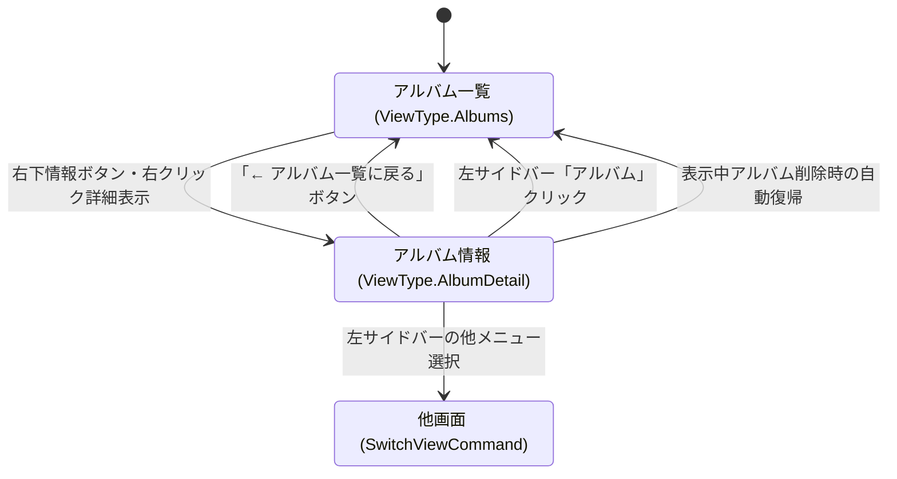

# アルバム情報 UI仕様書

## 1. 概要 (Overview)

選択したアルバムの詳細情報および全収録曲一覧を中央ワークスペースにフルビュー表示するシングル詳細画面（`AlbumDetailView`）の UI 仕様を定義する。
高精細カバーアート、アルバムメタデータ（アルバムタイトル、アーティスト名、リリース年、ジャンル、曲数、総再生時間、音質／フォーマットバッジ）、クイックアクションボタン群、および UI 仮想化対応の収録曲リストを備え、アルバム全体の一括操作と個別トラックの再生・管理をシームレスに提供する。

- **主要操作対象オブジェクト**:
  - [アルバム (`Album`)](../../主要オブジェクト/02_アルバム_Album.md)
  - [楽曲 (`Track`)](../../主要オブジェクト/01_楽曲_Track.md)

---

## 2. 実装イメージ（モックアップ）

### 2.1 ASCIIモックアップ

```text
+--------------------------------------------------------------------------------------------------------------------+
| [← アルバム一覧に戻る]                                                                                             |
+--------------------------------------------------------------------------------------------------------------------+
|  +----------------------+   Random Access Memories                                                                 |
|  |                      |   Daft Punk                                                                              |
|  |                      |   2013 • Electronic • 13 曲 • 1:14:24                                                    |
|  |     [Album Art]      |   [FLAC] [Hi-Res]                                                                        |
|  |      200 x 200       |                                                                                          |
|  |                      |   [▶ 全曲再生]  [🔀 シャッフル]  [⏭ 次に再生]  [＋ 最後に再生]                          |
|  |                      |   [＋ プレイリストに追加]  [🗑 削除]                                                     |
|  +----------------------+                                                                                          |
+--------------------------------------------------------------------------------------------------------------------+
|    | (☐) |  #  | ★ | タイトル                       | アーティスト        | 形式            |  時間 | 操作       |
|----+-----+-----+---+--------------------------------+---------------------+-----------------+-------+------------|
|    | (☐) |  1  | ☆ | Give Life Back to Music        | Daft Punk           | [FLAC][Hi-Res]  | 04:34 |    [+]     |
|    | (☐) |  2  | ☆ | The Game of Love               | Daft Punk           | [FLAC][Hi-Res]  | 05:22 |    [+]     |
| || | (☐) |  ▶  | ★ | Giorgio by Moroder             | Daft Punk           | [FLAC][Hi-Res]  | 09:04 |    [+]     |
|    | (☐) |  4  | ☆ | Within                         | Daft Punk           | [FLAC][Hi-Res]  | 03:48 |    [+]     |
|    | (☐) |  5  | ★ | Instant Crush                  | Daft Punk feat. ... | [FLAC][Hi-Res]  | 05:37 |    [+]     |
|    | (☐) |  -  | ☆ | Bonus Track                    | Daft Punk           | [MP3]           | 03:12 |    [+]     |
+--------------------------------------------------------------------------------------------------------------------+
  ^ 再生中行: 左端 3px ネオンシアン縦バー          ^ (☐) は機器転送選択モード (IsSelectionMode) 時のみ表示
```

### 2.2 Figmaモックアップ
- [Figmaデザイン（準備中 / 別タスクにて作成予定）](#)

---

## 3. 画面配置とペインレイアウト

### 3.1 全体レイアウト上の位置付け
- **配置領域**: [全体レイアウト・ペイン構成UI仕様書](../全体レイアウト・ペイン構成/全体レイアウト・ペイン構成UI仕様書.md) における中央ワークスペース（`MainWindow.xaml` の `Grid.Column="0"`）にフルビューとして表示する。
- **ビュー切替と DataContext**: `MainViewModel.CurrentViewType == ViewType.AlbumDetail` のとき、`ContentControl` の `DataTrigger` により `AlbumDetailView` を表示し、`DataContext` に `MainViewModel.AlbumDetail`（`AlbumDetailViewModel`）を割り当てる。
- **左サイドバーのアクティブ状態**: `ViewType.AlbumDetail` 表示中も、左サイドバーの「アルバム」メニューをアクティブ（選択状態＋左端アクセントライン表示）に維持し、ユーザーがアルバム階層の配下にいることを視覚的に明示する。

### 3.2 グリッド構造とリサイズ挙動

```text
AlbumDetailView (Root Grid)
├── Row 0 (Height="Auto") : 上部ナビゲーションバー（「← アルバム一覧に戻る」ボタン）
├── Row 1 (Height="Auto") : Hero セクション（2列 Grid）
│   ├── Col 0 (Width="Auto") : 高精細アルバムアート枠（200×200px）
│   └── Col 1 (Width="*")    : メタデータ（タイトル・アーティスト・年/ジャンル/曲数/総時間・バッジ）＋クイックアクションボタン群（WrapPanel）
└── Row 2 (Height="*")    : 収録曲リスト領域（2行 Grid）
    ├── Row 0 (Height="Auto") : 固定列ヘッダー行（#, ★, タイトル, アーティスト, 形式, 時間, 操作）
    └── Row 1 (Height="*")    : 仮想化収録曲 ListBox（自前スクロール）
```

| 領域 | サイズ・余白 | リサイズ挙動 |
| :--- | :--- | :--- |
| 上部ナビゲーションバー | パディング `16px, 12px, 16px, 8px` | 横幅に追従（左寄せ配置） |
| Hero セクション | パディング `16px, 8px, 16px, 16px`、アートと右列の間隔 `Spacing.XL (24px)`、下部境界線 `1px` (`BorderBrush`) | 右列が横幅に追従。タイトル・アーティスト名は `TextTrimming="CharacterEllipsis"`＋`ToolTip` で省略表示し、クイックアクションボタン群は `WrapPanel` で自動折り返し |
| 収録曲リスト領域 | 列ヘッダー高さ `32px`、各楽曲行高さ `40px`（推奨） | ウィンドウ縦リサイズ時は収録曲 `ListBox` のみ伸縮し、上部ナビゲーションバーと Hero セクションは固定表示する。列ヘッダーとデータ行は同一の `ColumnDefinitions` および左右パディングを共有し、`ListBoxItem` は `Padding="0"`・`HorizontalContentAlignment="Stretch"` とする。縦スクロールバー表示時の水平ズレを防ぐため、`AllSongsView` と同様に `ComputedVerticalScrollBarVisibility` に連動した列ヘッダー右余白補正（スクロールバー幅相当）を設ける |

---

## 4. デザイントークンの適用

### 4.1 カラートークン（Dark / Light 両テーマ対応）

| トークン名 | カラー見本 (Preview) | カラーコード (Dark / Light) | 用途 |
| :--- | :---: | :--- | :--- |
| `WindowBackgroundBrush` | <span style="background-color:#161920; color:#F0F4F8; padding:2px 8px; border-radius:3px; border:1px solid #343E4E; font-family:monospace;">■ #161920</span> / <span style="background-color:#F5F5F5; color:#1E1E1E; padding:2px 8px; border-radius:3px; border:1px solid #CCCCCC; font-family:monospace;">■ #F5F5F5</span> | `#161920` / `#F5F5F5` | 画面ルート背景 |
| `PanelBackgroundBrush` | <span style="background-color:#1B2028; color:#F0F4F8; padding:2px 8px; border-radius:3px; border:1px solid #343E4E; font-family:monospace;">■ #1B2028</span> / <span style="background-color:#EAEAEA; color:#1E1E1E; padding:2px 8px; border-radius:3px; border:1px solid #CCCCCC; font-family:monospace;">■ #EAEAEA</span> | `#1B2028` / `#EAEAEA` | Hero セクション背景、列ヘッダー背景 |
| `ControlBackgroundBrush` | <span style="background-color:#232934; color:#F0F4F8; padding:2px 8px; border-radius:3px; border:1px solid #343E4E; font-family:monospace;">■ #232934</span> / <span style="background-color:#FFFFFF; color:#1E1E1E; padding:2px 8px; border-radius:3px; border:1px solid #CCCCCC; font-family:monospace;">■ #FFFFFF</span> | `#232934` / `#FFFFFF` | SecondaryButton 背景、カバーアート枠背景、形式バッジ背景 |
| `ControlBackgroundHighlightBrush` | <span style="background-color:#2F3746; color:#00FFFF; padding:2px 8px; border-radius:3px; border:1px solid #00FFFF; font-family:monospace;">■ #2F3746</span> / <span style="background-color:#F0F0F0; color:#0078D7; padding:2px 8px; border-radius:3px; border:1px solid #0078D7; font-family:monospace;">■ #F0F0F0</span> | `#2F3746` / `#F0F0F0` | ボタンホバー背景、楽曲行ホバー／選択背景 |
| `BorderBrush` | <span style="background-color:#1B2028; color:#343E4E; padding:2px 8px; border-radius:3px; border:2px solid #343E4E; font-family:monospace;">■ #343E4E</span> / <span style="background-color:#FFFFFF; color:#CCCCCC; padding:2px 8px; border-radius:3px; border:2px solid #CCCCCC; font-family:monospace;">■ #CCCCCC</span> | `#343E4E` / `#CCCCCC` | Hero 下部区切り線、カバーアート外枠、SecondaryButton 枠線、バッジ枠線 |
| `ZebraOddBackgroundBrush` | <span style="background-color:#232934; color:#F0F4F8; padding:2px 8px; border-radius:3px; font-family:monospace;">■ #12FFFFFF</span> / <span style="background-color:#EAEAEA; color:#1E1E1E; padding:2px 8px; border-radius:3px; font-family:monospace;">■ #0C000000</span> | `#12FFFFFF` / `#0C000000` | 収録曲リスト奇数行のゼブラストライプ背景 |
| `TextForegroundBrush` | <span style="background-color:#1B2028; color:#F0F4F8; padding:2px 8px; border-radius:3px; font-family:monospace;">■ #F0F4F8</span> / <span style="background-color:#FFFFFF; color:#1E1E1E; padding:2px 8px; border-radius:3px; border:1px solid #CCCCCC; font-family:monospace;">■ #1E1E1E</span> | `#F0F4F8` / `#1E1E1E` | アルバムタイトル、楽曲タイトル、ボタンラベル |
| `SecondaryTextForegroundBrush` | <span style="background-color:#1B2028; color:#A0AEC0; padding:2px 8px; border-radius:3px; font-family:monospace;">■ #A0AEC0</span> / <span style="background-color:#FFFFFF; color:#404040; padding:2px 8px; border-radius:3px; border:1px solid #CCCCCC; font-family:monospace;">■ #404040</span> | `#A0AEC0` / `#404040` | アーティスト名、メタデータ行（年・ジャンル・曲数・総再生時間） |
| `MutedTextForegroundBrush` | <span style="background-color:#1B2028; color:#718096; padding:2px 8px; border-radius:3px; font-family:monospace;">■ #718096</span> / <span style="background-color:#FFFFFF; color:#606060; padding:2px 8px; border-radius:3px; border:1px solid #CCCCCC; font-family:monospace;">■ #606060</span> | `#718096` / `#606060` | 列ヘッダー、トラック番号、再生時間、未登録お気に入りアイコン（`☆`） |
| `InverseTextForegroundBrush` | <span style="background-color:#00FFFF; color:#161920; padding:2px 8px; border-radius:3px; font-weight:bold; font-family:monospace;">■ #161920</span> / <span style="background-color:#0078D7; color:#FFFFFF; padding:2px 8px; border-radius:3px; font-weight:bold; font-family:monospace;">■ #FFFFFF</span> | `#161920` / `#FFFFFF` | PrimaryButton（「全曲再生」）上の文字・アイコン色 |
| `NeonCyanBrush` | <span style="background-color:#00FFFF; color:#161920; padding:2px 8px; border-radius:3px; font-weight:bold; font-family:monospace;">■ #00FFFF</span> / <span style="background-color:#0078D7; color:#FFFFFF; padding:2px 8px; border-radius:3px; font-weight:bold; font-family:monospace;">■ #0078D7</span> | `#00FFFF` / `#0078D7` | 「全曲再生」ボタン背景、再生中行の左端 3px アクセントバー、再生中曲名・`▶`、お気に入り `★`、`Hi-Res` バッジ強調 |
| `DarkNeonCyanBrush` | <span style="background-color:#00E5FF; color:#161920; padding:2px 8px; border-radius:3px; font-weight:bold; font-family:monospace;">■ #00E5FF</span> / <span style="background-color:#005A9E; color:#FFFFFF; padding:2px 8px; border-radius:3px; font-weight:bold; font-family:monospace;">■ #005A9E</span> | `#00E5FF` / `#005A9E` | PrimaryButton ホバー時のアクセント強調 |

### 4.2 タイポグラフィ・角丸・スペーシング

| 要素 | タイポグラフィ | 角丸 | スペーシング |
| :--- | :--- | :--- | :--- |
| アルバムタイトル | `Typography.Header1` (`20pt`, Bold) | - | 下余白 `Spacing.XS (4px)` |
| アーティスト名 | `Typography.Subheader` (`14pt`, SemiBold) | - | 下余白 `Spacing.S (8px)` |
| メタデータ行（年・ジャンル・曲数・総時間） | `Typography.Body` (`13pt`, Regular) | - | 下余白 `Spacing.S (8px)` |
| 音質・フォーマットバッジ | `Typography.Micro` (`9pt`, Bold) | `Radius.Small (4px)` | 内側余白 `Spacing.S (8px), Spacing.XXS (2px)`、バッジ間隔 `Spacing.XS (4px)` |
| クイックアクションボタン | `Typography.Body` (`13pt`, SemiBold / Regular) | `Radius.Small (4px)` | 内側余白 `Spacing.M (12px), Spacing.S (8px)`、ボタン間隔 `Spacing.S (8px)` |
| カバーアート枠（200×200px） | - | `Radius.Medium (8px)` | 右余白 `Spacing.XL (24px)` |
| 列ヘッダー | `Typography.Caption` (`11pt`, Regular) | - | 左右パディング `Spacing.L (16px)` |
| 収録曲リスト行テキスト | `Typography.Body` (`13pt`, Regular) / 再生時間・トラック番号は等幅フォント（`Consolas`） | `Radius.Small (4px)`（行内バッジ） | 行内横パディング `Spacing.L (16px)`、列間余白 `Spacing.S (8px)` |

---

## 5. 構成要素と共通コントロール

### 5.1 上部ナビゲーションバー
- **戻るボタン（`← アルバム一覧に戻る`）**:
  - 共通コントロール: `SubtleButton` バリアント（通常時は背景透明・`SecondaryTextForegroundBrush`、ホバー時は背景 `ControlBackgroundHighlightBrush`・文字 `TextForegroundBrush`）。
  - バインディング: `BackToAlbumsCommand`。

### 5.2 Hero セクション
1. **大判高精細アルバムアート（`200×200px`）**:
   - `Border`（`CornerRadius="8"`, `BorderThickness="1"`, `BorderBrush`, `ClipToBounds="True"`）内に `Image`（`Stretch="UniformToFill"`, `RenderOptions.BitmapScalingMode="HighQuality"`）を配置する。
   - アート未設定・読込中・画像未埋め込み時はフォールバック画像（`Assets/Images/default_now_playing_bg.png`）を表示する。
2. **アルバムメタデータ**:
   - **アルバムタイトル**: `AlbumTitle`（`Album.Title`）。
   - **アーティスト名**: `Artist`（`Album.Artist`）。
   - **メタデータ行**: 有効値のみを中黒（`•`）区切りで連結表示する（例: `2013 • Electronic • 13 曲 • 1:14:24`）。各集計ルールは以下の通りとする。
     - **リリース年**: `Album.Year > 0` の場合はその値を採用する。`0` の場合は収録曲の先頭の非 0 年をフォールバック採用し、全曲 `0` の場合は項目を省略する。
     - **ジャンル**: 収録曲のうち空文字でない `Track.Genre` の最頻値（同数の場合はトラック順で先頭のもの）を採用する。全曲空の場合は項目を省略する。
     - 余分な区切り文字（`•`）が生じないよう、非空項目のみを結合して表示する。
   - **音質／フォーマットバッジ**:
     - 代表フォーマットバッジ（例: `FLAC`, `WAV`, `MP3` 等）: 収録曲のうち空文字でない `Track.Format` の最頻値（同数の場合はトラック順で先頭のもの）を採用する。該当値がない場合は `Visibility="Collapsed"` とする。
     - 音質バッジ：`ContainsHiRes == True` のとき `Hi-Res` バッジ（`NeonCyanBrush` 強調）、`ContainsHiRes == False` かつ `ContainsLossless == True` のとき `Lossless` バッジを表示。非該当バッジは `Visibility="Collapsed"` とする。
3. **クイックアクションボタン群（`WrapPanel`）**:
   - **全曲再生 (`▶ 全曲再生`)**: `PrimaryButton` バリアント（`PlayAllCommand`）。
   - **シャッフル再生 (`🔀 シャッフル`)**: `SecondaryButton` バリアント（`ShufflePlayCommand`）。
   - **次に再生 (`⏭ 次に再生`)**: `SecondaryButton` バリアント（`PlayNextAlbumCommand`）。
   - **最後に再生 (`＋ 最後に再生`)**: `SecondaryButton` バリアント（`EnqueueAlbumCommand`）。
   - **プレイリストに追加 (`＋ プレイリストに追加`)**: `SecondaryButton` バリアント（`Playlist.ShowAddAlbumToPlaylistDialogCommand`、`CommandParameter` に `CurrentAlbum` を渡す）。
   - **削除 (`🗑 削除`)**: `SecondaryButton` バリアント（`DeleteAlbumCommand`）。
   - 収録曲が 0 件（`Tracks.Count == 0`）の場合、再生・キュー・プレイリスト追加ボタンは無効状態（Disabled: `Opacity="0.4"`）とする。

### 5.3 収録曲リスト（`VirtualizedListBox`）
`LibraryView` リスト展開および `AllSongsView` と統一された列構成を採用する。

| 列 | 幅 | 内容・表示ルール |
| :--- | :--- | :--- |
| 再生中アクセントバー | `3px`（行左端） | 選択状態または現在再生中（`Track.IsPlaying == True`）のみ `NeonCyanBrush` で表示（通常時は透明） |
| 選択 `CheckBox` | `Auto`（表示時 `28px`） | 機器転送選択モード（`IsSelectionMode == True`）時のみ `Visibility="Visible"`、通常時は `Visibility="Collapsed"`。転送中（`DeviceBrowser.IsTransferring == True`）は非活性（`IsEnabled="False"`） |
| `#` | `36px`（中央／右揃え） | `Track.TrackNumber`（`0` は `-`）。再生中（`IsPlaying == True`）は `▶`（`NeonCyanBrush`）を表示 |
| `★` | `32px`（中央揃え） | お気に入りトグルボタン（`ToggleFavoriteTrackCommand`）。登録済みは `★`（`NeonCyanBrush`）、未登録は `☆`（`MutedTextForegroundBrush`） |
| `タイトル` | `2*` | `Track.Title`（`TextTrimming="CharacterEllipsis"`＋`ToolTip`）。再生中は `NeonCyanBrush`＋SemiBold で強調 |
| `アーティスト` | `1.2*` | `Track.Artist`（`TextTrimming="CharacterEllipsis"`＋`ToolTip`、`SecondaryTextForegroundBrush`） |
| `形式` | `130px` | `Track.Format` バッジ＋`Track.QualityLabel` バッジ（`Hi-Res` / `Lossless`）。`ToolTip` に `Track.QualityInfo`（サンプルレート・ビット深度・ビットレート）を表示 |
| `時間` | `64px`（右揃え） | `Track.DurationString`（等幅フォント、`MutedTextForegroundBrush`） |
| `+` | `36px`（中央揃え） | プレイリスト追加 `SubtleButton`（`Playlist.ShowAddToPlaylistDialogCommand`） |

### 5.4 オブジェクト状態スタイル

| 状態 | 視覚表現 |
| :--- | :--- |
| **Normal** | 偶数行: 透明、奇数行: `ZebraOddBackgroundBrush`。文字色 `TextForegroundBrush` / `SecondaryTextForegroundBrush` / `MutedTextForegroundBrush` |
| **Hover** | 行背景を `ControlBackgroundHighlightBrush` へ変化（`Motion.Fast: 100ms`） |
| **Pressed** | 押下中コントロールの視覚フィードバック（背景ハイライト強調または不透明度低下） |
| **Selected** | 行背景 `ControlBackgroundHighlightBrush`＋行左端 `3px` ネオンシアンアクセント縦バー（`NeonCyanBrush`） |
| **Active (IsPlaying)** | 行左端 `3px` ネオンシアンアクセント縦バー（`NeonCyanBrush`）、`#` 列に `▶`（`NeonCyanBrush`）、曲名を `NeonCyanBrush`＋SemiBold で強調 |
| **Disabled** | `Opacity="0.4"`、クリック操作無効（転送中 `CheckBox`、空アルバム時の再生系ボタン） |

---

## 6. アニメーションとインタラクション

### 6.1 画面遷移と戻り操作



- **遷移トリガー**:
  1. `LibraryView` グリッド表示カードの右下アルバム情報ボタン（`ShowAlbumInfoCommand`）のクリック。
  2. `LibraryView` グリッド表示／リスト表示のアルバム右クリックコンテキストメニュー「アルバム詳細情報を表示」の選択。
- **戻り操作**:
  1. 画面上部の「← アルバム一覧に戻る」ボタン（`BackToAlbumsCommand`）クリックにより `ViewType.Albums` へ復帰する。
  2. 左サイドバー「アルバム」メニューのクリックにより `ViewType.Albums` へ復帰する。
  3. 表示中アルバム自体を削除した場合、または最後の収録曲を削除してアルバムがライブラリから消滅した場合は、自動的に `ViewType.Albums` へ復帰する。

### 6.2 Hero クイックアクション操作
- **全曲再生 (`PlayAllCommand`)**: アルバム全曲をトラック順で再生キューに展開し、1 曲目から再生を開始する。
- **シャッフル再生 (`ShufflePlayCommand`)**: アルバム全曲をシャッフル順で再生キューに展開し、先頭曲から再生を開始する。
- **次に再生 (`PlayNextAlbumCommand`)**: アルバム全曲を予約キューの先頭に一括挿入する。
- **最後に再生 (`EnqueueAlbumCommand`)**: アルバム全曲を再生キューの末尾に追加する。
- **プレイリストに追加 (`Playlist.ShowAddAlbumToPlaylistDialogCommand`)**: `PlaylistSelectionDialog` を開き、選択したプレイリストへ `CurrentAlbum` の全収録曲を一括追加する。
- **削除 (`DeleteAlbumCommand`)**: 確認 `MessageBox` を表示し、承認された場合はアルバムと全収録曲をライブラリおよびお気に入り（`favorites.json`）から除外した上で `ViewType.Albums` へ自動復帰する（ディスク上の実ファイルは削除しない）。

### 6.3 収録曲リストのインタラクション
- **行クリック再生**: 収録曲行の左クリックで `PlayTrackCommand` を実行し、当該アルバムの収録曲リストをコンテキストとして選択曲から再生を開始する。
- **子コントロールのイベントバブリング抑止**: 行内の「お気に入り (`★`/`☆`)」ボタン、「プレイリスト追加 (`+`)」ボタン、および「転送選択 `CheckBox`」のクリック時は行クリック再生を発火させない。
- **コンテキストメニュー（右クリック）**: `PlacementTarget.Tag` 経由で親 ViewModel コマンドを解決し、共通コントロール仕様書の論理グループ順で以下の項目を提供する。
  1. 再生 / 停止
  2. 次に再生
  3. 最後に再生
  4. *(区切り線)*
  5. お気に入りに追加 / お気に入りから解除
  6. プレイリストに追加...
  7. *(区切り線)*
  8. プロパティ（`MessageBox` でメタデータ詳細を表示）
  9. ファイルの場所を開く（Windows エクスプローラーで選択表示）
  10. *(区切り線)*
  11. 削除（確認 `MessageBox` 後、ライブラリおよびお気に入りから除外。実ファイルは削除しない）

---

## 7. パフォーマンス最適化要件

[パフォーマンス最適化 詳細設計書](../../詳細設計/パフォーマンス最適化.md) に基づき、以下の要件を必須とする。

### 7.1 収録曲リストの UI 仮想化（親 `ScrollViewer` 禁止）
収録曲リストは親 `ScrollViewer` の内側に配置してはならず、自前スクロールポートを持つ `ListBox` に以下の 4 属性を必須指定する。

```xml
VirtualizingPanel.IsVirtualizing="True"
VirtualizingPanel.VirtualizationMode="Recycling"
VirtualizingPanel.ScrollUnit="Pixel"
ScrollViewer.CanContentScroll="True"
```

### 7.2 Hero 大判アートワークの高解像度非同期読み込み方針
- **既存サムネイルローダーとの棲み分け**:
  - 一覧カード・行サムネイル用の既存 `Presentation.AttachedProperties.AlbumArtLoader`（150px 相当デコード）とは責務を分離し、Hero セクションでは `200×200px` 表示（高 DPI 環境含む）で鮮鋭さを維持する高解像度デコード（`DecodePixelWidth = 400` 相当）を行う。
- **非同期デコードと `Freeze()`**:
  - `Album.RepresentativeTrackFilePath` からバックグラウンドスレッドで画像バイト列を抽出し、`BitmapCacheOption.OnLoad` でデコードした `BitmapImage` に必ず `Freeze()` を呼び出してから UI スレッドへ反映する。
- **レースコンディション防止（世代番号＋キャンセル制御）**:
  - アルバム切替や画面離脱が高頻度に発生した場合でも古い読み込み結果で上書きされないよう、`CancellationTokenSource` のキャンセルとインクリメンタルな世代番号（バージョンカウンタ）を併用して一致確認を行う。
- **メモリ解放**:
  - 別アルバムへの遷移時および一覧画面への復帰時は、不要になった高解像度 `BitmapImage` 参照を速やかに解放する。

### 7.3 非表示要素の完全描画抑止と高負荷エフェクト排除
- **完全描画抑止 (`Visibility="Collapsed"`)**:
  - `MainWindow` の `ContentControl` 切替により、`CurrentViewType != ViewType.AlbumDetail` の間は本ビューのビジュアルツリーを生成・維持しない。
  - 画面内の条件付き要素（非選択モード時の `CheckBox`、非該当音質バッジ等）はすべて `Visibility="Collapsed"` を使用する。
- **高負荷エフェクトの禁止**:
  - 収録曲リスト行および動的更新要素に対する `DropShadowEffect` / `BlurEffect` の適用を禁止する。境界分離は `BorderThickness="1"` + `BorderBrush` で表現する。

---

## 8. 関連Issue・仕様書

- **関連 Issue**:
  - 親 Issue: [#188](https://github.com/taketonnbo/Audio_Effector/issues/188)（アルバム情報画面の実装）
  - 上位 Epic: [#51](https://github.com/taketonnbo/Audio_Effector/issues/51)（アプリ画面表示の調整対応）
  - 仕様策定 Issue: [#289](https://github.com/taketonnbo/Audio_Effector/issues/289)
  - 後続実装 Issue: [#290](https://github.com/taketonnbo/Audio_Effector/issues/290)（ViewModel・画面遷移・高解像度アートワーク読込基盤）、[#291](https://github.com/taketonnbo/Audio_Effector/issues/291)（`AlbumDetailView` UI 実装・遷移導線接続）
  - 関連 Issue: [#168](https://github.com/taketonnbo/Audio_Effector/issues/168)（アルバム情報ボタン追加）、[#264](https://github.com/taketonnbo/Audio_Effector/issues/264)（アルバム一覧リスト展開楽曲情報拡充）
- **関連仕様書**:
  - [画面遷移・ナビゲーション設計書](../画面遷移・ナビゲーション設計書.md)
  - [アルバム一覧 UI仕様書](../アルバム一覧/アルバム一覧UI仕様書.md)
  - [全体レイアウト・ペイン構成 UI仕様書](../全体レイアウト・ペイン構成/全体レイアウト・ペイン構成UI仕様書.md)
  - [主要オブジェクト: 02. アルバム (`Album`)](../../主要オブジェクト/02_アルバム_Album.md)
  - [主要オブジェクト: 01. 楽曲 (`Track`)](../../主要オブジェクト/01_楽曲_Track.md)
  - [ユースケース: 02. 楽曲ライブラリ管理](../../ユースケース/02_楽曲ライブラリ管理.md)
  - [デザイントークン仕様書](../../デザインシステム/01_デザイントークン仕様書.md)
  - [共通コントロールスタイル仕様書](../../デザインシステム/02_共通コントロールスタイル仕様書.md)
  - [パフォーマンス最適化 詳細設計書](../../詳細設計/パフォーマンス最適化.md)
