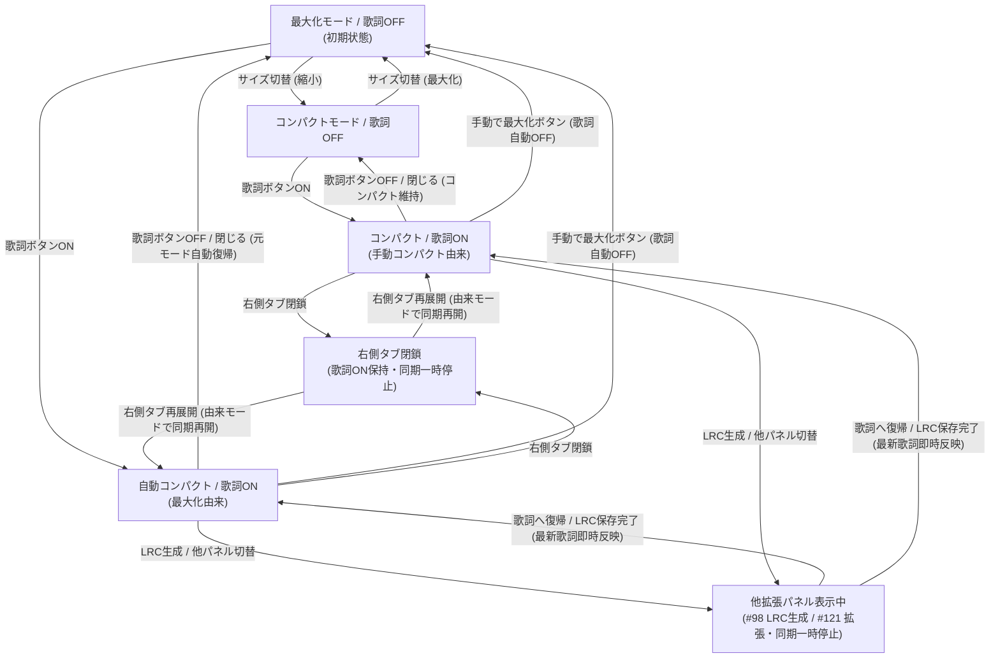

# 歌詞表示 UI仕様書

## 1. 概要 (Overview)

メイン画面の右側タブ下部拡張領域へ現在再生中楽曲の同期歌詞（`.lrc` ファイルおよびタイムタグ付き埋め込み歌詞）および非同期（プレーン）歌詞を表示し、アクティブ行のハイライト追従・自動中央寄せスクロール・任意行クリックによるシーク操作を提供する UI コンポーネントの画面仕様を定義する。

- **主要対象オブジェクト**: [楽曲 (`Track`)](../../主要オブジェクト/01_楽曲_Track.md)、歌詞データ（`LyricsDocument` / `LyricLine`）
- **コンポーネント構成**: メイン画面の右側タブ状態から独立した再利用可能 `UserControl`（`LyricsView`）として設計し、メイン画面右側タブ下部向けの**通常モード**と、ミニプレイヤー（`MiniPlayerWindow`）組み込み向けの**コンパクトモード**の 2 モードを提供する。
- **外部機能との連携**: 右側タブ下部拡張領域（`MainWindow.xaml` の `Grid.Row="1"`）は、本機能のほか LRC 自動生成パネル（#98）および右側タブ拡張ウィジェット（#121）と共有し、排他切り替えによって一貫した操作導線を保つ。

---

## 2. 実装イメージ（モックアップ）

### 2.1 ASCIIモックアップ

#### A. 右側タブ展開時（コンパクト表示＋歌詞パネル通常モード：同期歌詞表示状態）

```text
+-----------------------------------------------------------------------------------------+
| [Art 50] Midnight City / M83                                           [♪] [🗖]        |
|          [Hi-Res] FLAC 96kHz/24bit                                     (ON)(最大化)     |
|   [🔀] [|<] [ ▶ ] [>|] [🔁] [≡]   01:23 =======O========== 04:03        [+] [★]        |
+-----------------------------------------------------------------------------------------+
| ♪ 歌詞  [LRC 同期]                                                    [↻] [✨] [✕]      |
+-----------------------------------------------------------------------------------------+
|                                                                                         |
|                         Waiting in a car                                                | <- 既歌唱行 (Muted)
|                         Waiting for a ride in the dark                                  | <- 前近接行 (Secondary)
|  ┃  The night city grows                                                                | <- アクティブ行 (左3px NeonCyan + 強調)
|  ┃  夜の街が広がっていく                                                                 | <- 同一時刻の訳詞行 (同時ハイライト)
|                         Look and see her eyes, they glow                                | <- 次近接行 (Secondary)
|                         Waiting in a car                                                | <- 未歌唱行 (Muted)
|                                                                                         |
|                         • • •                                                           | <- 間奏空行 (ハイライト解除・シーク対象外)
|                                                                                         |
|                         Waiting for the right time                                      | <- 未歌唱行 (Muted)
|                                                                                         |
+-----------------------------------------------------------------------------------------+
```

#### B. 右側タブ最大化時からの起動導線（右上操作ボタン群）

```text
+-----------------------------------------------------------------------------------------+
|                                                                        [♪] [🗗]        | <- 常時配置 (28x28 × 2)
| +-----------------------------------+ +-----------------------------------------------+ |
| |       [ アルバムアート ]           | | Playlist: Hurry Up, We're Dreaming  22 Tracks | |
| |       Hurry Up, We're Dreaming    | |-----------------------------------------------| |
| |       M83                         | | 01. Intro (feat. Zola Jesus)            05:22 | |
| |       [ Player Pod カード ]       | | ▶   Midnight City                       04:03 | |
| +-----------------------------------+ +-----------------------------------------------+ |
+-----------------------------------------------------------------------------------------+
  ※ 最大化時に [♪] を ON にすると自動でコンパクト表示へ切り替わり、下部拡張領域に歌詞を展開する。
```

#### C. 状態別 UI バリエーション（手動スクロール一時停止／非同期歌詞／エンプティ／ローディング・エラー）

```text
【手動スクロール一時停止状態】                   【非同期（プレーン）歌詞表示状態】
+---------------------------------------------+ +---------------------------------------------+
| ♪ 歌詞  [LRC 同期]              [↻] [✨] [✕] | | ♪ 歌詞  [同期なし]              [↻] [✨] [✕] |
+---------------------------------------------+ +---------------------------------------------+
|   The night city grows                      | |   Waiting in a car                          |
|   Look and see her eyes, they glow          | |   Waiting for a ride in the dark            |
|   Waiting in a car                          | |   The night city grows                      |
|   Waiting for the right time                | |   Look and see her eyes, they glow          |
|                                             | |   (全行均一コントラスト・通常スクロール閲覧) |
|         ( ↓ 現在の再生行へ戻る )             | |                                             |
+---------------------------------------------+ +---------------------------------------------+
  ^ フローティングピルボタン (Radius.Pill)

【エンプティステート：歌詞未検出】               【エンプティステート：楽曲未再生】
+---------------------------------------------+ +---------------------------------------------+
| ♪ 歌詞                          [↻] [✨] [✕] | | ♪ 歌詞                          [↻] [✨] [✕] |
+---------------------------------------------+ +---------------------------------------------+
|                                             | |                                             |
|                     ♪                       | |                     ♪                       |
|           歌詞が見つかりません               | |          再生中の楽曲がありません            |
|  同フォルダの .lrc または埋め込み歌詞が      | |    楽曲を再生すると、対応する歌詞が         |
|  見つかりませんでした                        | |    自動的に表示されます                     |
|                                             | |                                             |
|   [ ✨ LRC を自動生成する ]  [ ↻ 再読み込み ] | |                                             |
+---------------------------------------------+ +---------------------------------------------+

【ローディング状態】                             【エラー状態（読込失敗フォールバック）】
+---------------------------------------------+ +---------------------------------------------+
| ♪ 歌詞                          [↻] [✨] [✕] | | ♪ 歌詞                          [↻] [✨] [✕] |
+---------------------------------------------+ +---------------------------------------------+
|                                             | |                     !                       |
|                    •••                      | |          歌詞を読み込めませんでした          |
|           歌詞を読み込んでいます...          | |  ファイルの読み取り権限や形式を確認して      |
|                                             | |  再読み込みしてください                     |
|                                             | |     [ ↻ 再読み込み ]   [ ✨ LRC を生成 ]    |
+---------------------------------------------+ +---------------------------------------------+
  ※ 楽曲未再生時・ローディング中はヘッダーの [↻] [✨] を非活性 (Disabled / Opacity="0.4") 表示とする。
```

#### D. `LyricsView` コンパクトモード（ミニプレイヤー組み込み用）

```text
【横長ミニプレイヤー下部ドック組み込み時 (幅 350px × 歌詞高 136px 想定)】
+-------------------------------------------------------------------+
| +-------+  Midnight City            [⏮] [ ⏯ ] [⏭] [♪] [☰] [⤢]    |
| | [Art] |  M83                                                    |
| +-------+                                                         |
+-------------------------------------------------------------------+
|                     Waiting for a ride in the dark                | <- 前行 (Caption 11pt / Secondary)
| ┃ The night city grows                                            | <- 現在行 (Body 13pt / SemiBold / NeonCyan)
|                     Look and see her eyes, they glow              | <- 次行 (Caption 11pt / Secondary)
+-------------------------------------------------------------------+

【正方形ミニプレイヤー下部ドック組み込み時 (幅 220px × 歌詞高 120px 想定)】
+---------------------------------------+
|  [ アルバムアート & 下部情報ドック ]  |
+---------------------------------------+
|      Waiting for a ride in the dark   | <- 前行 (Caption 11pt / Secondary)
| ┃ The night city grows                | <- 現在行 (Body 13pt / SemiBold / NeonCyan)
|      Look and see her eyes, they glow | <- 次行 (Caption 11pt / Secondary)
+---------------------------------------+
```

### 2.2 Figmaモックアップ

- [Figmaデザイン（準備中 / 別タスクにて作成予定）](#)
- ※ `tools/MockupRenderer` による XAML オフスクリーンレンダリング画像は、仕様書本文には直接配置せず、Figma で策定した完成イメージと本番実装との差分比較・視覚検証用として利用する。

---

## 3. 画面配置とペインレイアウト

### 3.1 全体レイアウト上の位置付け（`MainWindow.xaml` 右カラム）

メイン画面 3 ペイン構成のうち、右側パネル（`Grid.Column="2"`、`Background="{DynamicResource PanelBackgroundBrush}"`、`ClipToBounds="True"`）内に配置する。右側パネルの縦 2 行構造は以下の通りである。

| 行定義 | 最大化モード (`IsAlbumViewMaximized = True`) | コンパクトモード (`IsAlbumViewMaximized = False`) | 配置内容 |
| :--- | :---: | :---: | :--- |
| `Grid.Row="0"` | `1*` | `Auto` | プレイヤーセクション（最大化アルバムビュー／コンパクトプレイヤービューを `Visibility` で排他切替） |
| `Grid.Row="1"` | `0*` | `1*` | **下部拡張領域ホスト**（歌詞パネル `LyricsView`、LRC 自動生成パネル `LrcGeneratorView` [#98]、拡張ウィジェット [#121] を排他配置） |

### 3.2 右側タブ右上アクションボタン群（常時アクセス導線）

最大化モード・コンパクトモードの双方から迷わず歌詞表示を切り替えられるよう、右側パネル右上（`Panel.ZIndex="100"`、`HorizontalAlignment="Right"`、`VerticalAlignment="Top"`、`Margin="0,12,15,0"`）に水平 `StackPanel` で 2 つの操作ボタンを並列配置する。

1. **歌詞表示トグルボタン**（左、`Width="28"`, `Height="28"`, `Margin="0,0,4,0"`）：クリックで歌詞パネルの ON / OFF を切り替える。
2. **表示サイズ切り替えボタン**（右、`Width="28"`, `Height="28"`）：既存の `ToggleAlbumViewSizeModeCommand` を実行する最大化／縮小トグルボタン。

- **重なり防止マージン**:
  - 最大化モードの上部コンテンツは `Margin="20,42,20,15"` により `Y=42px` 以下から開始するため、右上ボタン群（`Y=12〜40px`）と干渉しない。
  - コンパクトモードの上部情報行（`RightPanelCompactInfoGrid`）は右マージンを `Margin="0,0,68,8"` とし、2 ボタン合計幅（`28 + 4 + 28 = 60px`）＋余白 `8px` を確保して曲名マーキーと干渉しない配置とする。

### 3.3 下部拡張領域（`Grid.Row="1"`）の内部レイアウトと排他パネル共存

下部拡張領域には `PanelBackgroundBrush` 上に上部 `1px` 境界線（`BorderBrush`）を設け、アクティブな拡張パネル種別（`None` / `Lyrics` / `LrcGenerator` [#98] / `ExtensionWidget` [#121]）に応じて 1 つのパネルのみを `Visibility="Visible"`、非選択パネルを `Visibility="Collapsed"` として排他表示する。

- **他パネル切替時の振る舞い**:
  - 歌詞パネル表示中に LRC 自動生成パネル（#98）または拡張ウィジェット（#121）へ切り替えた場合、歌詞パネルは `Visibility="Collapsed"` となり同期更新を一時停止する。
  - LRC 自動生成パネル（#98）で `.lrc` ファイルを保存完了した際、または戻る操作を行った際は、歌詞パネルへ遷移するとともに最新歌詞データを即時反映する。

### 3.4 `LyricsView` コンポーネント内部構造と 2 モード設計

`LyricsView`（`UserControl`）は依存関係プロパティ `IsCompactMode`（`False`: 通常モード / `True`: コンパクトモード）によりレイアウト密度を切り替え、同一の `LyricsViewModel`（歌詞データ・同期状態・シークコマンド）を共有する。

| 項目 | 通常モード (`IsCompactMode="False"`) | コンパクトモード (`IsCompactMode="True"`) |
| :--- | :--- | :--- |
| **主な配置先** | `MainWindow.xaml` 右カラム `Grid.Row="1"` | `MiniPlayerWindow.xaml` 下部拡張ドック |
| **推奨サイズ** | 幅 `1*`（`MinWidth="260"`）、高さ `1*`（`MinHeight="180"`） | 横長: 幅 `350px` × 高 `136px` / 正方形: 幅 `220px` × 高 `120px` |
| **内部 Grid 構成** | `Row 0 (Auto, 36px)`: パネルヘッダー<br>`Row 1 (*)`: 歌詞コンテンツ領域＋フローティング復帰ボタン層 | `Row 0 (0px / Collapsed)`: ヘッダー非表示<br>`Row 1 (*)`: 歌詞コンテンツ領域（前後行＋現在行の 3〜5 行表示） |
| **行パディング・余白** | 内側余白 `Padding="16,8"`、行間隔 `Spacing.S (8px)` | 内側余白 `Padding="12,4"`、行間隔 `Spacing.XS (4px)` |
| **上下スクロール余白** | 先頭行・末尾行も中央寄せできるよう上下にビューポート半高相当のスペーサーまたはパディングを確保 | 同左（先頭行・末尾行を中央配置可能） |
| **アクションボタン** | ヘッダーに `[再読込]` `[LRC生成/再生成]` `[閉じる]` を配置 | 原則非表示（クリックシーク・自動追従に集中） |
| **エンプティ／エラー表示** | アイコン（`32×32px`）・見出し・補足文・アクションボタン（§5.4 準拠）を内余白 `24px` で中央配置 | アイコン・アクションボタンを省略し、1〜2 行の簡略メッセージ（「歌詞が見つかりません」「再生中の楽曲がありません」「歌詞を読み込めませんでした」等、`Typography.Caption`）のみを中央表示 |

---

## 4. デザイントークンの適用

カラートークンは [`DarkTheme.xaml`](../../../AudioEffector/Presentation/Themes/DarkTheme.xaml) および [`LightTheme.xaml`](../../../AudioEffector/Presentation/Themes/LightTheme.xaml) で定義されたセマンティックブラシのみを使用する。独自カラーコードの直書きは行わない。

### 4.1 カラートークン適用一覧

| トークン名 | カラー見本 (Preview) | カラーコード (Dark / Light) | 用途 |
| :--- | :---: | :--- | :--- |
| `PanelBackgroundBrush` | <span style="background-color:#1B2028; color:#F0F4F8; padding:2px 8px; border-radius:3px; border:1px solid #343E4E; font-family:monospace;">■ #1B2028</span> / <span style="background-color:#EAEAEA; color:#1E1E1E; padding:2px 8px; border-radius:3px; border:1px solid #CCCCCC; font-family:monospace;">■ #EAEAEA</span> | `#1B2028` / `#EAEAEA` | 歌詞パネルヘッダーおよび外側コンテナ背景 |
| `WindowBackgroundBrush` | <span style="background-color:#161920; color:#F0F4F8; padding:2px 8px; border-radius:3px; border:1px solid #343E4E; font-family:monospace;">■ #161920</span> / <span style="background-color:#F5F5F5; color:#1E1E1E; padding:2px 8px; border-radius:3px; border:1px solid #CCCCCC; font-family:monospace;">■ #F5F5F5</span> | `#161920` / `#F5F5F5` | 歌詞リスト内面サーフェス背景・ミニプレイヤー組み込み時背景 |
| `ControlBackgroundBrush` | <span style="background-color:#232934; color:#F0F4F8; padding:2px 8px; border-radius:3px; border:1px solid #343E4E; font-family:monospace;">■ #232934</span> / <span style="background-color:#FFFFFF; color:#1E1E1E; padding:2px 8px; border-radius:3px; border:1px solid #CCCCCC; font-family:monospace;">■ #FFFFFF</span> | `#232934` / `#FFFFFF` | 同期種別バッジ、SecondaryButton、フローティング復帰ボタン背景 |
| `ControlBackgroundHighlightBrush` | <span style="background-color:#2F3746; color:#00FFFF; padding:2px 8px; border-radius:3px; border:1px solid #00FFFF; font-family:monospace;">■ #2F3746</span> / <span style="background-color:#F0F0F0; color:#0078D7; padding:2px 8px; border-radius:3px; border:1px solid #0078D7; font-family:monospace;">■ #F0F0F0</span> | `#2F3746` / `#F0F0F0` | アクティブ歌詞行背景、歌詞行ホバー背景、SubtleButton ホバー・トグル ON 背景 |
| `BorderBrush` | <span style="background-color:#1B2028; color:#343E4E; padding:2px 8px; border-radius:3px; border:2px solid #343E4E; font-family:monospace;">■ #343E4E</span> / <span style="background-color:#FFFFFF; color:#CCCCCC; padding:2px 8px; border-radius:3px; border:2px solid #CCCCCC; font-family:monospace;">■ #CCCCCC</span> | `#343E4E` / `#CCCCCC` | 拡張領域上部境界線（1px）、ヘッダー下部区切り線、SecondaryButton 枠線 |
| `TextForegroundBrush` | <span style="background-color:#1B2028; color:#F0F4F8; padding:2px 8px; border-radius:3px; font-family:monospace;">■ #F0F4F8</span> / <span style="background-color:#FFFFFF; color:#1E1E1E; padding:2px 8px; border-radius:3px; border:1px solid #CCCCCC; font-family:monospace;">■ #1E1E1E</span> | `#F0F4F8` / `#1E1E1E` | パネル見出し、非同期（プレーン）歌詞本文、ホバー中歌詞行文字、エンプティ見出し |
| `SecondaryTextForegroundBrush` | <span style="background-color:#1B2028; color:#A0AEC0; padding:2px 8px; border-radius:3px; font-family:monospace;">■ #A0AEC0</span> / <span style="background-color:#FFFFFF; color:#404040; padding:2px 8px; border-radius:3px; border:1px solid #CCCCCC; font-family:monospace;">■ #404040</span> | `#A0AEC0` / `#404040` | アクティブ行に近接する前後歌詞行（±1〜2 行）、エンプティ・エラー補足テキスト |
| `MutedTextForegroundBrush` | <span style="background-color:#1B2028; color:#718096; padding:2px 8px; border-radius:3px; font-family:monospace;">■ #718096</span> / <span style="background-color:#FFFFFF; color:#606060; padding:2px 8px; border-radius:3px; border:1px solid #CCCCCC; font-family:monospace;">■ #606060</span> | `#718096` / `#606060` | 既歌唱行・遠方歌詞行、非アクティブ時トグルアイコン、同期なしバッジ文字、間奏ドット |
| `InverseTextForegroundBrush` | <span style="background-color:#00FFFF; color:#161920; padding:2px 8px; border-radius:3px; font-weight:bold; font-family:monospace;">■ #161920</span> / <span style="background-color:#0078D7; color:#FFFFFF; padding:2px 8px; border-radius:3px; font-weight:bold; font-family:monospace;">■ #FFFFFF</span> | `#161920` / `#FFFFFF` | PrimaryButton（「LRC を自動生成する」）およびフローティングボタンホバー時の反転文字 |
| `NeonCyanBrush` | <span style="background-color:#00FFFF; color:#161920; padding:2px 8px; border-radius:3px; font-weight:bold; font-family:monospace;">■ #00FFFF</span> / <span style="background-color:#0078D7; color:#FFFFFF; padding:2px 8px; border-radius:3px; font-weight:bold; font-family:monospace;">■ #0078D7</span> | `#00FFFF` / `#0078D7` | 歌詞表示ボタン ON アイコン、アクティブ歌詞行文字・左端 3px 縦バー、PrimaryButton 背景、フローティング復帰ボタン枠線・文字 |
| `DarkNeonCyanBrush` | <span style="background-color:#00E5FF; color:#161920; padding:2px 8px; border-radius:3px; font-weight:bold; font-family:monospace;">■ #00E5FF</span> / <span style="background-color:#005A9E; color:#FFFFFF; padding:2px 8px; border-radius:3px; font-weight:bold; font-family:monospace;">■ #005A9E</span> | `#00E5FF` / `#005A9E` | PrimaryButton ホバー時・押下時の濃色アクセント |

- スクロールバーにはグローバル暗黙スタイル（`ScrollBarResources.xaml`）の `ScrollBarTrackBrush` / `ScrollBarThumbBrush` / `ScrollBarThumbHoverBrush` / `ScrollBarThumbDraggingBrush` を自動適用する。

### 4.2 タイポグラフィ・スペーシング・角丸・エレベーション

| カテゴリ | トークン名 | 設定値 | 適用要素 |
| :--- | :--- | :--- | :--- |
| **タイポグラフィ** | `Typography.Subheader` | `14pt / SemiBold / LineHeight 1.40` | パネルヘッダータイトル、通常モードのアクティブ歌詞行 |
| **タイポグラフィ** | `Typography.Body` | `13pt / Regular / LineHeight 1.45` | 通常モードの非アクティブ歌詞行、非同期歌詞本文、コンパクトモードのアクティブ歌詞行（`SemiBold`）、ボタンラベル |
| **タイポグラフィ** | `Typography.Caption` | `11pt / Regular / LineHeight 1.40` | コンパクトモードの非アクティブ歌詞行、エンプティ／エラー補足説明、フローティング復帰ボタン（`SemiBold`）、ホバー時タイムスタンプツールチップ（`Consolas`） |
| **タイポグラフィ** | `Typography.Micro` | `9pt / Bold / LineHeight 1.20` | ヘッダーのソース／同期種別バッジ（`LRC 同期` / `埋込 同期` / `同期なし`） |
| **スペーシング** | `Spacing.XS`〜`Spacing.L` | `4px / 8px / 12px / 16px` | ボタン間隔 `4px`、行内パディング `12px, 8px`（コンパクト `8px, 4px`）、ヘッダーパディング `16px, 8px`、エンプティ内余白 `24px` (`Spacing.XL`) |
| **角丸** | `Radius.Small` | `4px` | 歌詞表示トグルボタン、ヘッダー操作ボタン、歌詞行コンテナ、バッジ、Primary/SecondaryButton |
| **角丸** | `Radius.Medium` | `8px` | エンプティ／エラー状態カードコンテナ |
| **角丸** | `Radius.Pill` | `9999px` | フローティング「現在の再生行へ戻る」ボタン |
| **エレベーション** | `Level 0 (Flat)` / `Level 1 (Surface)` | 境界線なし / `BorderThickness="1"` (`BorderBrush`) | パネル境界およびフローティングボタンは `Border` による輪郭分離のみとし、`DropShadowEffect` / `BlurEffect` は使用しない |

---

## 5. 構成要素と共通コントロール

### 5.1 右側タブ 歌詞表示ボタン（`ToggleButton` / `SubtleButton` バリアント）

右側タブ右上に配置する `ToggleButton`（`28×28px`、角丸 `Radius.Small 4px`）。アイコンは `14×14px` の歌詞・音符ドキュメントを示す軽量ベクター `Path` とする。

| 状態 | 背景 | アイコン前景色 | 枠線 / 補足 | ツールチップ |
| :--- | :--- | :--- | :--- | :--- |
| **Normal (OFF)** | `Transparent` | `MutedTextForegroundBrush` | なし | 「歌詞を表示」 |
| **Hover (OFF)** | `ControlBackgroundHighlightBrush` | `TextForegroundBrush` | なし | 「歌詞を表示」 |
| **Pressed** | `ControlBackgroundHighlightBrush` (`Opacity="0.8"`) | `NeonCyanBrush` | なし | 状態連動 |
| **Active (ON / Checked)** | `ControlBackgroundHighlightBrush` | `NeonCyanBrush` | 下端 `2px` または枠線 `1px` `NeonCyanBrush` | 「歌詞を閉じる」 |
| **Hover (ON)** | `ControlBackgroundHighlightBrush` | `DarkNeonCyanBrush` | アクティブ強調維持 | 「歌詞を閉じる」 |
| **Disabled** | `Transparent` | `MutedTextForegroundBrush` | `Opacity="0.4"` | 「歌詞表示は利用できません」 |

### 5.2 歌詞パネルヘッダー（通常モードのみ）

高さ `36px`、`Background="{DynamicResource PanelBackgroundBrush}"`、`BorderBrush="{DynamicResource BorderBrush}"`、`BorderThickness="0,0,0,1"`、`Padding="16,0,12,0"`。

- **左側グループ**:
  - 歌詞アイコン（`14×14px`, `NeonCyanBrush`）＋見出し「歌詞」（`Typography.Subheader`, `TextForegroundBrush`）
  - **状態バッジ**（`Border`, `Radius.Small 4px`, `Padding="8,2"`, `Typography.Micro`）：
    - 外部 `.lrc` 同期歌詞表示時：`LRC 同期`（背景 `ControlBackgroundBrush`、文字 `NeonCyanBrush`、枠線 `1px` `BorderBrush`）
    - 埋め込み同期歌詞表示時：`埋込 同期`（背景 `ControlBackgroundBrush`、文字 `NeonCyanBrush`、枠線 `1px` `BorderBrush`）
    - 非同期（プレーン）歌詞表示時：`同期なし`（背景 `ControlBackgroundBrush`、文字 `MutedTextForegroundBrush`、枠線 `1px` `BorderBrush`）
    - 未再生・未検出・ローディング・エラー時：`Visibility="Collapsed"`
- **右側アクションボタン群**（各 `28×28px`、`SubtleButton`、`Spacing.XS 4px` 間隔）：
  1. **再読み込みボタン**（`↻` アイコン、ToolTip「歌詞を再読み込み」）：現在再生中楽曲の外部 `.lrc` および埋め込み歌詞を再読込する。楽曲未再生時・読み込み中は `Disabled`（`Opacity="0.4"`）。
  2. **LRC 自動生成／再生成ボタン**（`✨` 相当アイコン、ToolTip「LRC を自動生成・再生成」）：現在再生中楽曲を対象に LRC 自動生成パネル（#98）を起動する。既存歌詞がある場合でも作り直し導線として機能する。楽曲未再生時・読み込み中・または LRC 自動生成機能が利用不可の状態では `IsEnabled="False"`（`Opacity="0.4"`）とし、機能利用不可時はツールチップでその旨を案内する。
  3. **閉じるボタン**（`✕` アイコン、ToolTip「歌詞を閉じる」）：歌詞表示を OFF にする（右側タブ右上トグルボタンの OFF 操作と同一挙動）。

### 5.3 歌詞リスト（`VirtualizedListBox`）と歌詞行状態スタイル

歌詞本文の表示には親 `ScrollViewer` を内包しない仮想化 `ListBox`（`ScrollViewer.HorizontalScrollBarVisibility="Disabled"`、`ScrollViewer.VerticalScrollBarVisibility="Auto"`）を使用する。各歌詞行は左端に幅 `3px` のアクセント縦バー領域を常設し、アクティブ行切替時にテキスト位置が横ずれしない構造とする。

| 歌詞行の状態 | 左端 3px 縦バー | 行背景 | テキスト色 | フォントスタイル | カーソル・操作 |
| :--- | :--- | :--- | :--- | :--- | :--- |
| **Active（現在歌唱行）** | `NeonCyanBrush`（幅 `3px`・角丸 `2px`） | `ControlBackgroundHighlightBrush`（角丸 `4px`） | `NeonCyanBrush` | 通常: `14pt / SemiBold`<br>コンパクト: `13pt / SemiBold` | `Hand`（再クリックで該当時刻へ再シーク可） |
| **Active（同一時刻複数行）** | 該当全行へ `NeonCyanBrush`（幅 `3px`） | 該当全行へ `ControlBackgroundHighlightBrush` | `NeonCyanBrush` | 同上（原文・訳詞等を同時ハイライト） | `Hand` |
| **Selected（キーボード選択等）** | `NeonCyanBrush`（幅 `3px`） | `ControlBackgroundHighlightBrush` | `TextForegroundBrush` | `13pt / Regular` | `Hand` |
| **Near Inactive（前後近接行）** | `Transparent` | `Transparent` | `SecondaryTextForegroundBrush` | 通常: `13pt / Regular`<br>コンパクト: `11pt / Regular` | `Hand`（クリックでシーク） |
| **Passed / Distant（既歌唱・遠方行）** | `Transparent` | `Transparent` | `MutedTextForegroundBrush` | 同上 | `Hand`（クリックでシーク） |
| **Hover（シーク可能同期行）** | 状態維持 | `ControlBackgroundHighlightBrush` | `TextForegroundBrush`（Active 時は `NeonCyanBrush`） | 状態維持 | `Hand`・ツールチップに `[mm:ss]` 表示 |
| **Pressed（クリック押下中）** | 状態維持 | `ControlBackgroundHighlightBrush`（`Opacity="0.85"`） | `NeonCyanBrush` | 状態維持 | `Hand` |
| **Interlude Blank（間奏・休止空行）** | `Transparent` | `Transparent` | `MutedTextForegroundBrush`（控えめな `• • •` または高さ `16px` 空白） | `11pt / Regular` | `Arrow`（クリックシーク対象外・ホバー反応なし） |
| **Unsynced（非同期プレーン歌詞行）** | `Transparent` | `Transparent` | `TextForegroundBrush` | `13pt / Regular` | `Arrow`（クリックシーク対象外・ホバー反応なし） |
| **Disabled（操作抑止状態）** | `Transparent` | `Transparent` | `MutedTextForegroundBrush`（`Opacity="0.4"`） | 状態維持 | `Arrow` |

- 長い歌詞行は `TextWrapping="Wrap"` を適用し、横スクロールバーを発生させず折り返して全文を視認可能とする。
- 行クリックによるシーク実行後は `ListBox.SelectedItem` を解除する（または `Selected` スタイルをキーボードフォーカス保持時のみ適用する）ことで、再生進行後にクリック済み過去行へ 3px 縦バーおよび背景ハイライトが残留して現在歌唱行と重複する視認性低下を防止する。

### 5.4 状態別 UI コンポーネント仕様

| パネル状態 | 表示条件 | 構成要素と共通コントロール |
| :--- | :--- | :--- |
| **同期歌詞表示** | タイムタグを含む外部 `.lrc` または埋め込み歌詞を読み込み済み | 仮想化 `ListBox`（各行中央寄せまたは読みやすい左基準インデント配置＋左端 3px バー）、アクティブ行ハイライト、自動中央寄せスクロール。最初のタイムタグ以前のイントロ区間は全行非アクティブで待機。 |
| **非同期（プレーン）歌詞表示** | タイムタグを含まない歌詞を読み込み済み | ヘッダーに `同期なし` バッジを表示し、仮想化 `ListBox` で全行を均一コントラスト（`TextForegroundBrush`）表示。アクティブハイライト・自動スクロール・行クリックシークは無効。 |
| **手動スクロール一時停止** | 同期歌詞表示中にユーザーが手動スクロール操作を実施 | 歌詞リスト下部中央（`VerticalAlignment="Bottom"`, `HorizontalAlignment="Center"`, `Margin="0,0,0,16"`, `Panel.ZIndex="10"`）にフローティングピルボタン「`↓ 現在の再生行へ戻る`」（`Radius.Pill`、背景 `ControlBackgroundBrush`、枠線 `1px` `NeonCyanBrush`、文字 `NeonCyanBrush`、`Typography.Caption / SemiBold`、ホバー時は背景 `NeonCyanBrush`・文字 `InverseTextForegroundBrush`）を表示。 |
| **エンプティ：歌詞未検出** | 再生中楽曲が存在し、外部 `.lrc`・埋め込み歌詞のいずれも有効行なし | 中央配置コンテナ内にアイコン（`32×32px`, `MutedTextForegroundBrush`）、見出し「歌詞が見つかりません」（`Typography.Subheader`, `TextForegroundBrush`）、補足文（`Typography.Caption`, `SecondaryTextForegroundBrush`）、および横並びアクション：`PrimaryButton`「LRC を自動生成する」（#98 起動、利用不可時は `Disabled`＋案内ツールチップ）＋ `SecondaryButton`「再読み込み」。 |
| **エンプティ：楽曲未再生** | `CurrentTrack == null` | 中央配置コンテナ内にアイコン（`32×32px`, `MutedTextForegroundBrush`）、見出し「再生中の楽曲がありません」（`Typography.Subheader`, `TextForegroundBrush`）、補足文「楽曲を再生すると、対応する歌詞が自動的に表示されます」（`Typography.Caption`, `SecondaryTextForegroundBrush`）。 |
| **ローディング** | 歌詞ファイルの探索・解析を実行中 | 中央配置の軽量インジケーター（静的円環・ドットアニメーション等、`DropShadowEffect` 不使用）＋テキスト「歌詞を読み込んでいます...」（`Typography.Caption`, `MutedTextForegroundBrush`）。高速な読み込み完了時のちらつきを避けるため、表示切替に短い遅延（例: `150ms`）を許容する。 |
| **エラー（読込失敗）** | ファイルアクセス権限エラー・破損等で読み込み例外が発生し、フォールバック候補も取得不可 | 中央配置コンテナ内に警告アイコン（`32×32px`, `MutedTextForegroundBrush`）、見出し「歌詞を読み込めませんでした」、補足文、および `SecondaryButton`「再読み込み」＋ `SubtleButton`「LRC を自動生成する」。エラーダイアログは表示せず、音楽再生を中断しない。 |

---

## 6. アニメーションとインタラクション

### 6.1 右側タブサイズ連動・開閉状態遷移



- **表示・非表示トランジション**:
  - 歌詞パネル表示時は即座に `Visibility="Visible"` とし、不透明度を `0 → 1`（`Motion.Normal 200ms`、`Easing.Enter` `CubicEase EaseOut`）でフェードインする。
  - 歌詞パネル非表示時は `Visibility="Collapsed"` に切り替えてレイアウト・同期負荷を即座に遮断する。

### 6.2 同期ハイライトと自動中央寄せスクロール

- **アクティブ行のハイライト更新**:
  - 楽曲の再生位置進行に伴い、現在時刻に対応する歌詞行へハイライトを遷移させる。
  - 最初の歌詞行のタイムスタンプより前の区間（イントロ等）ではどの行もハイライトせず待機する。
  - 同一タイムスタンプを持つ複数行（訳詞併記等）に到達した場合は、該当グループの**全行を同時にハイライト**し、自動スクロールの基準位置は**グループの先頭行**とする。
  - 間奏用の空行（タイムタグのみでテキストが空の行）に到達した場合は、直前の歌詞行のハイライトを解除して歌唱休止中であることを示す。
- **自動中央寄せスクロール**:
  - アクティブ行（または同一時刻グループの先頭行）が切り替わるたび、対象行が `ListBox` ビューポートの垂直中央付近に収まるオフセットへ滑らかにスクロールする（目安 `Motion.Normal 200ms`、`Easing.Standard` `CubicEase EaseInOut`）。

### 6.3 手動スクロール一時停止と自動追従復帰（4 条件）

- ユーザーがマウスホイール・タッチパッド・スクロールバー操作により歌詞リストを手動スクロールした場合、自動スクロール追従を一時停止し、フローティング「現在の再生行へ戻る」ボタンをフェードイン（`Motion.Fast 100ms`, `Easing.Enter`）で表示する。
- 以下の **4 つのいずれか** を満たした時点で自動スクロール追従へ復帰し、フローティングボタンをフェードアウト後 `Visibility="Collapsed"` にする：
  1. **「現在の再生行へ戻る」ボタンのクリック**: 即座に現在アクティブ行へ中央スクロールし追従復帰する。
  2. **タイムタグ付き歌詞行のクリックによるシーク**: シーク実行と同時に自動スクロール追従へ即時復帰する。
  3. **再生楽曲の切り替え**: 新楽曲の歌詞読み込み完了後、先頭から自動スクロール追従を再開する。
  4. **最後の手動スクロール操作から既定 5 秒の経過**: 追加の手動スクロール操作が発生するたびに 5 秒タイマーをリセットし、無操作で 5 秒経過した時点で現在行へ中央スクロールして追従復帰する。

### 6.4 歌詞行クリックシーク・再読み込み・連続曲送り

- **行クリックシーク**:
  - テキストを含む同期歌詞行を左クリックすると、該当行のタイムスタンプ位置（`[offset:]` 補正がある場合は表示同期と一致する補正後位置）へ再生位置をシークする。
  - 再生中にクリックした場合は再生を継続したままシークし、一時停止中にクリックした場合は該当位置へシークしたうえで一時停止状態を維持する。
  - 間奏用の空行および非同期（プレーン）歌詞の各行はクリックシーク対象外とする。
- **手動再読み込み**:
  - ヘッダーまたはエンプティ／エラー状態の「再読み込み」ボタンクリックで現在楽曲の歌詞ソース（外部 `.lrc` → 埋め込み歌詞）を再探索・再読込する。
- **連続曲送り時の表示整合**:
  - 連続して高速に楽曲を切り替えた場合は非同期読み込みのキャンセルおよび世代検証を行い、古い楽曲の歌詞結果が現在再生中の楽曲表示を上書きしないように保護する。

### 6.5 キーボード操作・アクセシビリティ

- 歌詞表示トグルボタン、ヘッダー各アクションボタン、フローティング復帰ボタンには `ToolTip` および `AutomationProperties.Name` を設定し、明確な操作意味を提供する。
- 歌詞リスト（`ListBox`）上で方向キー・`PageUp` / `PageDown` によるスクロールを行った場合も手動スクロール操作として扱い、一時停止および復帰タイマーを連動させる。

---

## 7. パフォーマンス最適化要件

[パフォーマンス最適化詳細設計書](../../詳細設計/パフォーマンス最適化.md) に基づき、以下の最適化要件を必須とする。

1. **コレクション表示の UI 仮想化（親 `ScrollViewer` の禁止）**:
   - 長大な歌詞（数千文字・数百行のコーラスや訳詞付き歌詞等）でも軽快にスクロール・自動追従できるよう、歌詞リストには親 `ScrollViewer` の内包を禁止し、`ListBox` へ以下の 4 属性を必ず指定する：
     ```xml
     VirtualizingPanel.IsVirtualizing="True"
     VirtualizingPanel.VirtualizationMode="Recycling"
     VirtualizingPanel.ScrollUnit="Pixel"
     ScrollViewer.CanContentScroll="True"
     ```
2. **非表示時の完全描画抑止（`Visibility="Collapsed"` 連動）**:
   - 歌詞パネルが非表示の状態（歌詞表示 OFF、最大化モード、右側タブ閉鎖中、LRC 自動生成 [#98]・他拡張パネル [#121] 表示中）では `LyricsView` を `Visibility="Collapsed"` とし、WPF の Measure / Arrange レイアウトパスおよび再生位置同期のバックグラウンド更新を完全停止する。
   - 歌詞リスト・エンプティステート（未検出／未再生）・ローディング・エラー・フローティング復帰ボタンの各コンテナも、非アクティブ時はすべて `Visibility="Collapsed"` とする。
3. **高負荷エフェクトの排除**:
   - 高頻度にハイライト変化およびスクロールが発生する歌詞行テンプレート、パネルコンテナ、フローティングボタンには、`DropShadowEffect`、`BlurEffect`、`VisualBrush` を一切適用しない。
   - 強調表現は `NeonCyanBrush` の左端 3px 縦バー、ソリッド背景（`ControlBackgroundHighlightBrush`）、および 1px 枠線（`BorderBrush`）など GPU アクセラレーションが効く軽量描画のみで構成する。
4. **UI スレッド負荷抑止（差分通知の最小化）**:
   - 再生位置の進行監視から UI へ通知する際は、アクティブ行（またはアクティブ行グループ）が実際に変化したタイミングのみプロパティ変更通知（`INotifyPropertyChanged`）を発行し、同一行再生中の不要な再バインド・再描画を行わない。

---

## 8. 関連Issue・仕様書

- [歌詞表示機能 仕様書](../../機能仕様/歌詞表示機能.md)
- [全体レイアウト・ペイン構成UI仕様書](../全体レイアウト・ペイン構成/全体レイアウト・ペイン構成UI仕様書.md)
- [右側アルバム情報表示サイズ切り替え機能UI仕様書](../右側アルバム情報表示サイズ切り替え機能/右側アルバム情報表示サイズ切り替え機能UI仕様書.md)
- [右側タブ開閉機能UI仕様書](../右側タブ開閉機能/右側タブ開閉機能UI仕様書.md)
- [ミニプレイヤーUI仕様書](../ミニプレイヤー/ミニプレイヤーUI仕様書.md)
- [デザイントークン仕様書](../../デザインシステム/01_デザイントークン仕様書.md)・[共通コントロールスタイル仕様書](../../デザインシステム/02_共通コントロールスタイル仕様書.md)
- [パフォーマンス最適化詳細設計書](../../詳細設計/パフォーマンス最適化.md)
- [ユースケース: 01_楽曲再生・再生制御](../../ユースケース/01_楽曲再生・再生制御.md)
- [主要オブジェクト一覧](../../主要オブジェクト/index.md)・[01_楽曲_Track](../../主要オブジェクト/01_楽曲_Track.md)
- [LyricsView.xaml](../../../AudioEffector/Presentation/Views/LyricsView.xaml)・[LyricsViewModel.cs](../../../AudioEffector/Presentation/ViewModels/LyricsViewModel.cs)・[MainWindow.xaml](../../../AudioEffector/Presentation/Views/MainWindow.xaml)・[MiniPlayerWindow.xaml](../../../AudioEffector/Presentation/Views/MiniPlayerWindow.xaml)
- 関連Issue: 親Epic [#401](https://github.com/taketonnbo/Audio_Effector/issues/401)、先行 [#402](https://github.com/taketonnbo/Audio_Effector/issues/402)、本Issue [#403](https://github.com/taketonnbo/Audio_Effector/issues/403)、後続 [#406](https://github.com/taketonnbo/Audio_Effector/issues/406)、関連 [#98](https://github.com/taketonnbo/Audio_Effector/issues/98)、[#100](https://github.com/taketonnbo/Audio_Effector/issues/100)、[#121](https://github.com/taketonnbo/Audio_Effector/issues/121)
