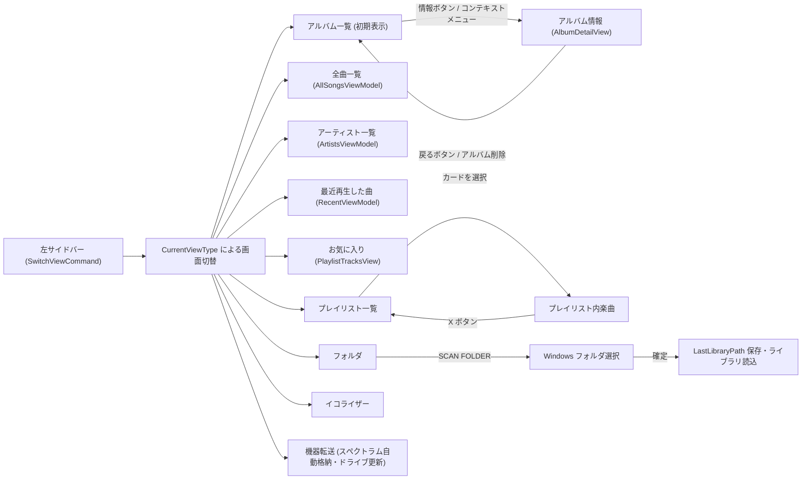

# 画面遷移・ナビゲーション設計書

## 1. 概要

`MainWindow` の `CurrentViewType`（初期値: `ViewType.Albums`）と `DataTrigger` によって中央ワークスペースの表示ビューを切り替える。左サイドバー、右側パネル（アルバム情報・Player Pod）、上部コンパクトプレイヤー、下部スペクトラムアナライザ、および右端オーバーレイの再生キュースライドパネルは同一のメインウィンドウ内に配置する。各画面の詳細仕様は [画面仕様一覧](index.md) を参照する。

## 2. ワークスペースの遷移

| サイドバー・トリガー | ViewType | 表示XAML / DataContext (`MainViewModel` プロパティ) |
| :--- | :--- | :--- |
| すべての曲 | `AllSongs` | `AllSongsView` / `AllSongs` (`AllSongsViewModel`) |
| アルバム（初期表示） | `Albums` | `LibraryView` / `Library` (`LibraryViewModel`) |
| アルバム詳細表示（情報ボタン／コンテキストメニュー） | `AlbumDetail` | `AlbumDetailView` / `AlbumDetail` (`AlbumDetailViewModel`) |
| アーティスト | `Artists` | `ArtistsView` / `Artists` (`ArtistsViewModel`) |
| フォルダ | `Folders` | `FolderView` / `Folder` (`FolderViewModel`) |
| お気に入り | `Favorites` | `PlaylistTracksView` / `Playlist` (`PlaylistViewModel` - お気に入りモード) |
| プレイリスト | `Playlists` | `PlaylistSelectorView` / `Playlist` (`PlaylistViewModel`) |
| プレイリストカード選択 | `PlaylistTracks` | `PlaylistTracksView` / `Playlist` (`PlaylistViewModel`) |
| 最近再生した曲 | `Recent` | `RecentView` / `Recent` (`RecentViewModel`) |
| イコライザー | `Equalizer` | `EqualizerView` / `Equalizer` (`EqualizerViewModel`) |
| 機器転送 | `DeviceSync` | `DeviceSyncView` / `DeviceBrowser` (`DeviceBrowserViewModel`) |

- 左サイドバーの各メニューボタンは `SwitchViewCommand` に `ViewType` を渡して画面を切り替える。
- アルバム一覧（`ViewType.Albums`）のグリッド右下アルバム情報ボタンまたはコンテキストメニュー「アルバム詳細情報を表示」（`ShowAlbumInfoCommand`）により `ViewType.AlbumDetail`（`AlbumDetailView`）へ遷移する。`AlbumDetailView` 上部の「← アルバム一覧に戻る」ボタン（`BackToAlbumsCommand`）、左サイドバー「アルバム」クリック、または表示中アルバムのライブラリからの削除時に `ViewType.Albums` へ戻る。
- `ViewType.AlbumDetail` 表示中も左サイドバーの「アルバム」メニューはアクティブ状態を維持する。
- `ViewType.Favorites` 遷移時は `SwitchViewCommand` 内で `ShowFavorites()` が呼ばれ、`PlaylistTracksView` がお気に入り一覧モード（`IsFavoritesView = true`）で表示される。
- `ViewType.DeviceSync` 遷移時は作業領域確保のため `PlayerControl.IsSpectrumVisible = false` でスペクトラムアナライザを自動格納し、`DeviceBrowser.RefreshDrives()` で接続デバイス一覧・容量情報・機器別既定転送先フォルダへの自動遷移を更新する（画面上の「`↻ 機器を再検出`」ボタンからも画面切替なしで再検出可能）。
- プレイリストカードの選択は `SelectPlaylistCommand` で `ViewType.PlaylistTracks` へ遷移し、`PlaylistTracksView` 右上の `X` ボタン（`ShowPlaylistSelectorCommand`）で `ViewType.Playlists`（プレイリスト一覧）へ戻る。
- 戻る／進むの履歴スタックやタイトルバーのBack／Forwardボタンは設けない。

## 3. パネルと再生状態の独立保持

- 右側パネルの開閉は `IsRightPanelOpen`（初期値: `false`）、右側パネル内の最大化/コンパクト切替は `IsAlbumViewMaximized`（初期値: `true`）、右側パネル下部拡張領域の排他パネル表示は `ActiveRightExtensionPanel`（`RightExtensionPanelType`: `None` / `Lyrics`、`ToggleLyricsPanelCommand` / `CloseLyricsPanelCommand`）、スペクトラムアナライザの開閉は `PlayerControl.IsSpectrumVisible`（初期値: `true`）で管理し、中央ワークスペースの `CurrentViewType` と独立して状態を保持する。
- 最大化モード時に歌詞表示を ON にすると自動的にコンパクトモードへ切り替わり下部拡張領域へ `LyricsView` を展開する。OFF に戻した際は自動切替由来であれば元の最大化モードへ自動復帰し、もともとコンパクトモードであればコンパクトを維持する。また、歌詞表示中に手動で最大化モードへ切り替えた場合は歌詞表示を自動 OFF とし、右側タブ閉鎖中は `IsLyricsPanelVisible` を保持したまま `Lyrics.IsActiveView = false` で同期を一時停止する（再展開時に自動再開）。
- 再生キュースライドパネルの開閉は `IsPlayQueuePanelOpen`（初期値: `false`）、「再生リスト / 履歴」タブ切替は `PlayerControl.SelectedQueueTabIndex`（`0` / `1`）で管理する。
- 右側パネルを開くと中央ワークスペース上端のコンパクトプレイヤーを非表示（`Collapsed`）にし、右側パネルを閉じると上部に高さ60pxのコンパクトプレイヤーを表示する。
- サイドメニューの「最近再生した曲」（`RecentView`、`RecentTracks.json` 永続化・再生開始時記録）と、再生キュースライドパネル内の「履歴」タブ（`PlayHistory`、インメモリ保持・再生終了/スキップ時記録）は独立した別機能として動作する。

## 4. ダイアログと別ウィンドウ

| 起点 | 表示先 | 閉じ方・反映 |
| :--- | :--- | :--- |
| サイドバー下部「設定」 | `SettingsDialog` | 閉じるボタン。各設定変更（テーマ・ショートカット・転送時形式変換設定等）は逐次 `settings.json` へ保存され、閉じた後に `SettingsUpdated` イベントでメインウィンドウおよびミニプレイヤーのショートカット設定（`WindowShortcutHandler`）へ最新値を反映 |
| 機器転送の「`⚙ Manage`」 | `DeviceManagerDialog` | `"Close"` ボタン。閉じた後に転送画面の現在フォルダ再読込・重複インデックス再構築および空き容量情報更新を実行 |
| プレイリスト作成／名称変更・EQ保存 | `InputBox` | `"OK"` / `Enter` で文字列確定、`"Cancel"` / `Esc` で取消 |
| 曲・アルバムのプレイリスト追加 | `PlaylistSelectionDialog` | `"ADD"` で選択確定（結果 `MessageBox` 表示）、`"CANCEL"` / `Esc` で取消 |
| メインウィンドウ最小化 | `MiniPlayerWindow`（`DisableMiniPlayerOnMinimize == false` 時） | 復帰ボタン（`⤢`）または最大化ショートカット（`Win + ↑` 等）でメインウィンドウへ復帰（閉じた際に座標を保存・キュー展開状態をリセット）。`DisableMiniPlayerOnMinimize == true` 時は `MiniPlayerWindow` を表示せず OS 標準のタスクバー最小化を維持。再生キューは下部に一体型として連結展開（旧 `PlayQueueDialog` は Issue #217 にて撤廃） |
| フォルダ画面の「`SCAN FOLDER`」 | Windows `OpenFolderDialog` | 確定で `LastLibraryPath` 保存とライブラリスキャン実行、キャンセル時は変更なし |

- 削除確認、プレイリスト追加結果、曲のプロパティ情報、ショートカット重複警告、データ転送中のアプリ終了確認は WPF `MessageBox` で表示する。

## 5. 実装参照

- [MainWindow.xaml](../../AudioEffector/Presentation/Views/MainWindow.xaml)
- [MainViewModel.cs](../../AudioEffector/Presentation/ViewModels/MainViewModel.cs)
- [ViewType.cs](../../AudioEffector/Presentation/ViewModels/ViewType.cs)
- [RightExtensionPanelType.cs](../../AudioEffector/Presentation/ViewModels/RightExtensionPanelType.cs)
- [LyricsView.xaml](../../AudioEffector/Presentation/Views/LyricsView.xaml)
- [LyricsViewModel.cs](../../AudioEffector/Presentation/ViewModels/LyricsViewModel.cs)
- [AlbumDetailView.xaml](../../AudioEffector/Presentation/Views/AlbumDetailView.xaml)
- [AlbumDetailViewModel.cs](../../AudioEffector/Presentation/ViewModels/AlbumDetailViewModel.cs)
- [SidebarControl.xaml](../../AudioEffector/Presentation/Views/SidebarControl.xaml)
- [PlaylistViewModel.cs](../../AudioEffector/Presentation/ViewModels/PlaylistViewModel.cs)
