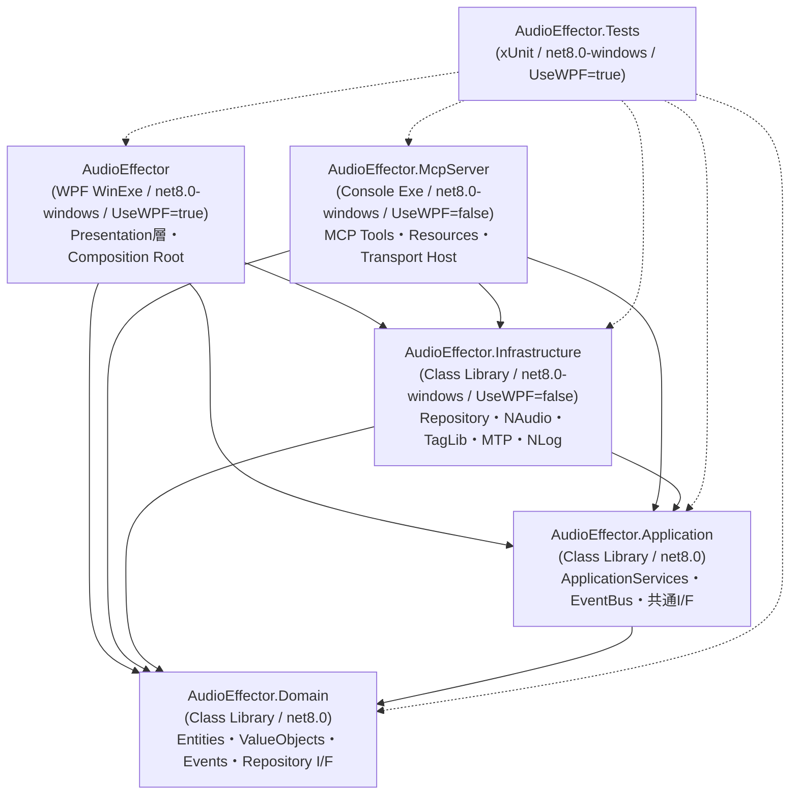
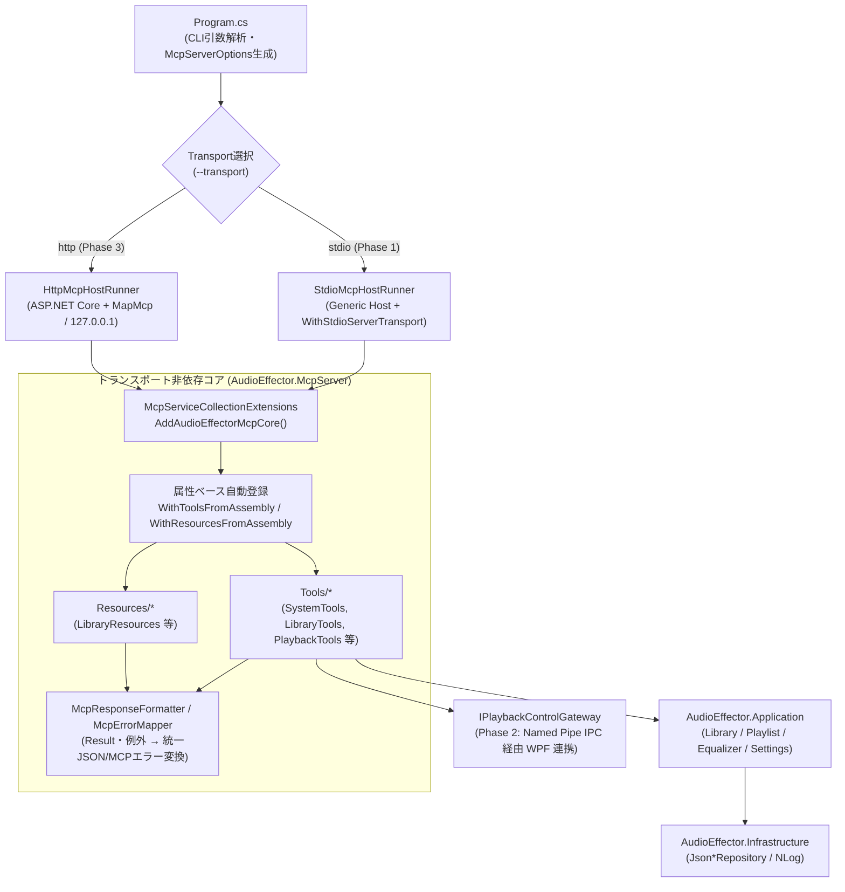
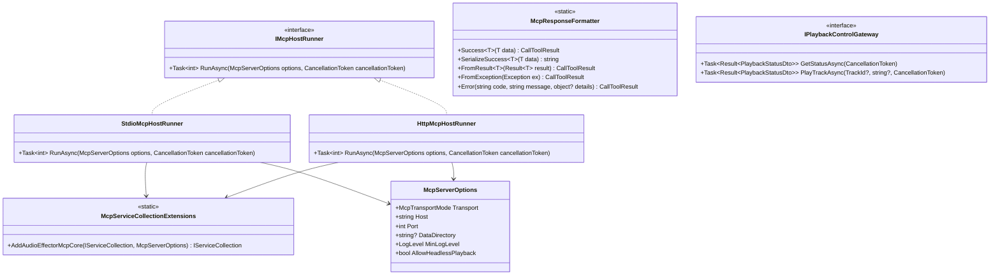
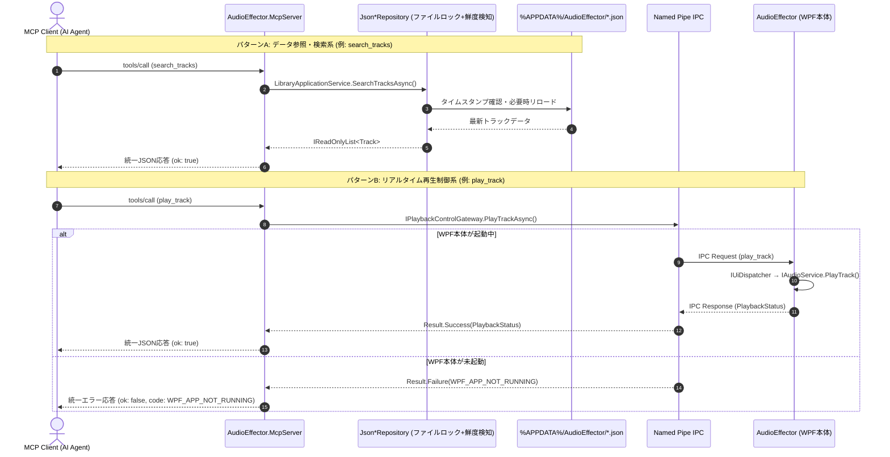

# MCPサーバ詳細設計書

## 1. 概要

本ドキュメントは、Audio Effector に C# / .NET 8 実装の **MCP (Model Context Protocol) サーバ機能**を追加するための技術アーキテクチャ、プロジェクト構成、トランスポート抽象化設計（`stdio` 先行 → 将来 `HTTP` 拡張）、既存 WPF アプリとのデータ整合性・リアルタイム連携方針、および MCP Tools / Resources / Prompts の拡張基盤・共通規約を定義する詳細設計書です。

本設計書は Phase 1（#296: 基盤構築・`stdio` 実装）、Phase 2（#301: 機能別 Tools / Resources の段階的追加）、および Phase 3（HTTP トランスポート対応）のすべてにおける実装基準（Single Source of Truth）となります。

上位・関連ドキュメントとして以下を参照します：
- 機能仕様書: [MCPサーバ機能仕様書.md](../機能仕様/MCPサーバ機能仕様書.md)
- アーキテクチャ全体設計書: [アーキテクチャ全体設計書.md](アーキテクチャ/アーキテクチャ全体設計書.md)
- 各層詳細設計書: [ドメイン層](アーキテクチャ/ドメイン層詳細設計書.md) / [アプリケーション層](アーキテクチャ/アプリケーション層詳細設計書.md) / [インフラストラクチャ層](アーキテクチャ/インフラストラクチャ層詳細設計書.md) / [プレゼンテーション層](アーキテクチャ/プレゼンテーション層詳細設計書.md)

---

## 2. プロジェクト構成および技術選定

### 2.1 5 プロジェクト構成（4 層分割 ＋ 独立 MCP サーバ）

既存の 4 層アーキテクチャおよび名前空間構造（`AudioEffector.Domain` / `AudioEffector.Application` / `AudioEffector.Infrastructure` / `AudioEffector.Presentation`）を維持したままプロジェクト単位へ分割し、独立コンソールホスト **`AudioEffector.McpServer`** を新設する **5 プロジェクト構成（＋テストプロジェクト）** を採用します。



| プロジェクト名 | OutputType | TargetFramework | UseWPF | 参照プロジェクト | 主な責務・外部依存 |
| :--- | :--- | :--- | :---: | :--- | :--- |
| `AudioEffector.Domain` | Library | `net8.0` | `false` | なし | 純粋なドメインモデル・値オブジェクト・リポジトリ I/F。**外部 NuGet 依存ゼロ**。 |
| `AudioEffector.Application` | Library | `net8.0` | `false` | `Domain` | 各 `ApplicationService`, `IEventBus`, `IUiDispatcher`, `IMetadataExtractor`, `Result`。`Microsoft.Extensions.DependencyInjection.Abstractions` のみ参照。 |
| `AudioEffector.Infrastructure` | Library | `net8.0-windows` | `false` | `Domain`, `Application` | `Json*Repository`, `NAudioPlaybackEngine`, `AudioService`, `TagLibMetadataExtractor`, `MtpDataTransferAdapter`, `StartupManager`, `NLogService`。 |
| `AudioEffector` | WinExe | `net8.0-windows` | `true` | `Domain`, `Application`, `Infrastructure` | WPF UI（Views, ViewModels, Themes, `WpfUiDispatcher`, `ShortcutKeyHelper`）および WPF Composition Root。 |
| `AudioEffector.McpServer` | Exe | `net8.0-windows` | `false` | `Domain`, `Application`, `Infrastructure` | MCP ホスト、トランスポート抽象化（`stdio` / 将来 `HTTP`）、Tools / Resources / Prompts、エラーマッパー、IPC クライアント。 |
| `AudioEffector.Tests` | Library | `net8.0-windows` | `true` | 上記 5 プロジェクト | 4 層＋MCP サーバの単体テスト・統合テスト（xUnit + Moq）。 |

> **前提条件（サブ Issue #298 / #303 との整合）**:
> 非 Presentation 層に残存していた WPF 直接依存 5 ファイル（`Track.cs`, `Album.cs`, `DeviceAlbum.cs`, `AppSettings.cs`, `AudioService.cs`）および Application → Infrastructure 直接参照 4 箇所は、すべてサブ Issue #298 の設計および Issue #303 のリファクタリングにて解消済みです（詳細は [アーキテクチャ全体設計書 第6章](アーキテクチャ/アーキテクチャ全体設計書.md) を参照）。Phase 1（#296）では既存の単一プロジェクトから上記 5 プロジェクトへの分割・移設をそのまま実施できます。

### 2.2 共通ビルド設定と `Directory.Build.props` 活用方針

5 プロジェクト全体でコード品質・静的解析・XML ドキュメント規約を統一し、設定の重複とドリフトを防ぐため、ソリューションルートに **`Directory.Build.props`** を配置して共通設定を集約します。

| 設定項目 | 方針・値 | 適用範囲 |
| :--- | :--- | :--- |
| `Nullable` / `ImplicitUsings` | `enable` / `enable` | 全プロジェクト |
| `EnableNETAnalyzers` / `AnalysisLevel` | `true` / `latest-recommended` | 全プロジェクト（テストプロジェクトは必要に応じて警告抑制） |
| `EnforceCodeStyleInBuild` | `true` | プロダクション 5 プロジェクト |
| `GenerateDocumentationFile` | `true` | プロダクション 5 プロジェクト（テストプロジェクトは `false`） |
| `StyleCop.Analyzers` | `1.2.0-beta.556`（`PrivateAssets="all"`） | プロダクション 5 プロジェクト（`Directory.Build.props` で一括参照） |
| `InternalsVisibleTo` | `AudioEffector.Tests` | `$(IsTestProject) != 'true'` の全プロジェクトへ自動付与 |
| `Version` | 共通バージョン管理（`AudioEffector` / `AudioEffector.McpServer` 同期） | `Directory.Build.props` で一元管理 |

### 2.3 採用 MCP SDK および NuGet パッケージ選定

MCP プロトコル（JSON-RPC 2.0、Capability Negotiation、Tool / Resource / Prompt スキーマ生成、`stdio` および Streamable HTTP トランスポート）の仕様追従コストと保守性を最小化するため、**Microsoft と共同メンテナンスされている C# 公式 MCP SDK（`ModelContextProtocol` ファミリー）**を採用します。

| パッケージ名 | 導入フェーズ | 採用バージョン | .NET 8 互換 | 用途・選定理由 |
| :--- | :---: | :---: | :---: | :--- |
| **`ModelContextProtocol`** | Phase 1 (#310) | `2.4.0` | 互換あり | 公式 C# MCP SDK 本体。`Microsoft.Extensions.DependencyInjection` / `Hosting` とネイティブ統合され、`AddMcpServer()`, `WithStdioServerTransport()`, `WithToolsFromAssembly()`, `[McpServerToolType]` / `[McpServerTool]` 属性による宣言的ツール定義と JSON Schema 自動生成を提供。 |
| **`Microsoft.Extensions.Hosting`** | Phase 1 (#310) | `8.0.1` | 互換あり（`8.x`） | 汎用ホスト（`Host.CreateApplicationBuilder`）、DI、構成（CLI 引数・環境変数）、ロギング、および `CancellationToken` / `SIGINT` によるグレースフルシャットダウン基盤を提供。 |
| **`ModelContextProtocol.AspNetCore`** | Phase 3 | 未定 | 互換あり | 公式 SDK の ASP.NET Core 統合パッケージ。`app.MapMcp()` により Streamable HTTP エンドポイントを提供し、Phase 1・Phase 2 で実装した `[McpServerToolType]` 群を無修正で HTTP 公開できる。 |

- **バージョン管理方針**: `.NET 8` 互換の安定版（`ModelContextProtocol 2.4.0`、`Microsoft.Extensions.Hosting 8.0.1`）を明示バージョン指定で導入し、ビルド再現性を担保しています。

---

## 3. アーキテクチャとトランスポート抽象化設計（`stdio` → 将来 `HTTP` 拡張）

### 3.1 トランスポート非依存アーキテクチャ構成図

Tool / Resource / Prompt の定義・ハンドラと、トランスポート起動処理（`stdio` / 将来の Streamable HTTP）を明確に分離し、**トランスポートを変更・追加しても業務ハンドラおよびスキーマ定義を一切変更せずに再利用できる構造**とします。



### 3.2 主要クラス・インターフェースと責務



| コンポーネント | 配置パス（`AudioEffector.McpServer/`） | 責務 |
| :--- | :--- | :--- |
| `Program.cs` | `Program.cs` | エントリポイント。CLI 引数・環境変数から `McpServerOptions` を構築し、対応する `IMcpHostRunner` を選択・実行して終了コードを返す。 |
| `McpServerOptions` / `McpTransportMode` | `Configuration/McpServerOptions.cs` | `stdio` / `http` 双方の起動設定を保持する将来互換設定モデル。 |
| `IMcpHostRunner` / `StdioMcpHostRunner` | `Hosting/StdioMcpHostRunner.cs` | Generic Host を構築し、`stderr` 専用ロギング、`AddAudioEffectorMcpCore()`、および `WithStdioServerTransport()` を構成して実行する。 |
| `HttpMcpHostRunner`（Phase 3 拡張点） | `Hosting/HttpMcpHostRunner.cs` | Phase 1 では未実装スタブ（明確なエラーメッセージ＋終了コード `2`）とし、Phase 3 で ASP.NET Core + `ModelContextProtocol.AspNetCore`（`MapMcp()`）へ差し替える。 |
| `McpServiceCollectionExtensions` | `DependencyInjection/McpServiceCollectionExtensions.cs` | `AddInfrastructureServices()` + `AddApplicationServices()` + `AddMcpServer().WithToolsFromAssembly().WithResourcesFromAssembly()` を一括登録。`IUiDispatcher` は既定の `ImmediateUiDispatcher` を利用。 |
| `McpJsonOptions` / `McpErrorCodes` | `Protocol/McpJsonOptions.cs`, `Protocol/McpErrorCodes.cs` | 共通 `JsonSerializerOptions`（`camelCase` / `null` 省略 / `JsonStringEnumConverter` / 日本語非エスケープ）および標準エラーコード定数を定義。 |
| `McpResponseFormatter` / `McpErrorMapper` | `Protocol/McpResponseFormatter.cs`, `Protocol/McpErrorMapper.cs` | 正常応答 JSON のシリアライズ、`Result` / `Result<T>` 失敗および例外の統一エラーコード変換・機密詳細の非露出とログ記録を担当。 |
| `SystemTools` / `SystemDtos` | `Tools/SystemTools.cs`, `Dtos/SystemDtos.cs` | Phase 1 の疎通確認用リファレンス実装（`ping`, `get_server_info`）および応答 DTO。 |
| `LibraryTools` / `LibraryDtos` | `Tools/LibraryTools.cs`, `Dtos/LibraryDtos.cs` | Phase 2 の楽曲・アルバム検索ツール（`search_tracks`, `search_albums`）および応答 DTO（`SearchTracksResponse`, `TrackSummaryDto`, `SearchAlbumsResponse`, `AlbumSummaryDto`）。 |
| `PlaylistTools` / `PlaylistDtos` | `Tools/PlaylistTools.cs`, `Dtos/PlaylistDtos.cs` | Phase 2 のプレイリスト検索ツール（`search_playlists`）および応答 DTO（`SearchPlaylistsResponse`, `PlaylistSummaryDto`）。 |
| `AppTools` / `AppDtos` | `Tools/AppTools.cs`, `Dtos/AppDtos.cs` | Phase 2 のアプリ起動ツール（`launch_app`）および応答 DTO（`LaunchAppResponse`）。 |
| `IAppLauncher` / `WpfAppLauncher` | `Gateways/IAppLauncher.cs`, `Gateways/WpfAppLauncher.cs` | WPF 本体の実行ファイルパス解決・多重起動防止確認・起動中プロセス追跡・IPC 待受準備完了待機を担う起動ゲートウェイ。 |
| `IAppLaunchCoordinator` / `SessionFileAppLaunchCoordinator` | `Gateways/IAppLaunchCoordinator.cs`, `Gateways/SessionFileAppLaunchCoordinator.cs` | Windows セッション単位の OS ファイルロックと共有状態ファイルにより、複数の独立 MCP プロセス間の WPF 起動を調停するコーディネータ。 |
| `IIpcReadinessProbe` / `NamedPipeIpcReadinessProbe` | `Gateways/IIpcReadinessProbe.cs`, `Gateways/NamedPipeIpcReadinessProbe.cs` | Named Pipe IPC（`AudioEffector.Ipc.v1.<CurrentUserSidHash>.s<SessionId>`）へ `ping` を送信し、WPF 本体の待受準備完了を確認するプローブ。 |
| `PlaybackTools` / `PlaybackDtos` | `Tools/PlaybackTools.cs`, `Dtos/PlaybackDtos.cs` | Phase 2 の楽曲再生ツール（`play_track`）および応答 DTO（`PlayTrackResponse`, `PlayedTrackDto`）。 |
| `IPlaybackControlGateway` / `IpcPlaybackControlGateway` | `Gateways/IPlaybackControlGateway.cs`, `Gateways/IpcPlaybackControlGateway.cs` | Named Pipe IPC 経由で起動中 WPF 本体へ再生制御コマンドを送信する抽象化ゲートウェイおよび実装。 |

### 3.3 CLI オプション・設定モデル（将来互換インターフェース）

Phase 1 時点から Phase 3（HTTP）互換の CLI オプションおよび環境変数バインドを定義します。

| CLI オプション | 環境変数 | 型・既定値 | 説明 |
| :--- | :--- | :--- | :--- |
| `--transport` | `AUDIOEFFECTOR_MCP__TRANSPORT` | `string` (`stdio`) | 通信トランスポート（`stdio` \| `http`）。Phase 1 で `http` 指定時は `stderr` へ未実装案内を出力し終了コード `2` で終了。 |
| `--host` | `AUDIOEFFECTOR_MCP__HOST` | `string` (`127.0.0.1`) | HTTP モード時のバインドアドレス（Phase 3 用）。 |
| `--port` | `AUDIOEFFECTOR_MCP__PORT` | `int` (`51890`) | HTTP モード時の待受ポート番号（Phase 3 用）。 |
| `--data-dir` | `AUDIOEFFECTOR_MCP__DATADIRECTORY` | `string?` (`null`) | JSON データディレクトリの明示指定（未指定時は `%APPDATA%\AudioEffector`）。テストや隔離検証で利用。 |
| `--log-level` | `AUDIOEFFECTOR_MCP__MINLOGLEVEL` | `LogLevel` (`Information`) | `stderr` へ出力する最小ログレベル。 |
| `--wpf-app-path` | `AUDIOEFFECTOR_MCP__WPFAPPPATH` | `string?` (`null`) | `AudioEffector.exe` の明示パス（未指定時は `AudioEffector.McpServer.exe` と同一ディレクトリ配下の `AudioEffector.exe` を既定解決）。 |

- **データディレクトリ指定の DI 連携方針（Phase 1 実装事項）**:
  - 環境変数名は `Microsoft.Extensions.Configuration` の自動バインド規約に合わせ、`McpServerOptions` のプロパティ名（`DataDirectory`, `MinLogLevel` 等）と完全一致させます。
  - `AddInfrastructureServices(string? dataDirectory = null)` により `IDataDirectoryProvider`（`DataDirectoryProvider`）および `IJsonFileLockHelper`（`JsonFileLockHelper.Default`）を登録し、未指定時は既定パス、指定時は全 `Json*Repository` へ同一ディレクトリ配下の JSON パスを注入する構成とします。
  - `SettingsApplicationService` は `IDataDirectoryProvider` および `IJsonFileLockHelper` を受け取り、`IsCustomDirectory == true`（`--data-dir` 指定時等）の場合は指定ディレクトリ配下の `settings.json` を一貫して参照・保存します（未指定時は既存互換の `#if DEBUG` 分岐を維持）。

### 3.4 `stdout` 汚染防止とロギング分離方針

`stdio` トランスポートでは、**標準出力（`stdout`）は MCP の JSON-RPC 2.0 メッセージ専用チャネル**です。ログやデバッグ文字列が 1 バイトでも `stdout` へ混入するとクライアント側で JSON パースエラーが発生し接続が切断されるため、以下を厳格に義務付けます。

1. **`Microsoft.Extensions.Logging` の `stderr` 強制**:
   - `StdioMcpHostRunner` 構築時に `builder.Logging.ClearProviders()` を実行したうえで、コンソールロガーへ **`LogToStandardErrorThreshold = LogLevel.Trace`** を必ず設定します。これにより `Trace`〜`Critical` の全ログが `stderr` へ出力されます。
2. **既存 `NLog`（`nlog.config` / `NLogService`）との棲み分けと明示ロード**:
   - 既存 `AudioEffector/nlog.config` は `File`（`logs/app.log`）と `Debugger` ターゲットのみであり `Console` ターゲットを持たないため原則 `stdout` を汚染しません。
   - ただし WPF 本体と MCP サーバが同時起動した際のログファイルロック競合を防ぐため、`AudioEffector.McpServer` には専用設定 **`nlog.mcp.config`**（`.csproj` で `CopyToOutputDirectory=PreserveNewest`）を配置し、出力先を **`logs/mcp-server.log`**（ローリング管理）へ分離します。
   - NLog は既定で `nlog.config` / `<App>.dll.nlog` のみを自動検索し `nlog.mcp.config` を自動検出しないため、**`Program.cs` 起動時の最初期（DI 構築および `NLogService` 解決前）に `LogManager.Setup().LoadConfigurationFromFile("nlog.mcp.config")` を明示的に呼び出す**ことを必須とします。
   - `nlog.mcp.config` に `Console` / `ColoredConsole`（`stderr="false"`）ターゲットを追加することを禁止します。
3. **`Console.Write` / `Console.WriteLine` の禁止**:
   - `AudioEffector.McpServer` および共有ライブラリ（`Domain` / `Application` / `Infrastructure`）内で `Console.Write*` を直接呼び出すことを禁止します（必要な場合は必ず `ILogger` または `Console.Error` を使用）。

### 3.5 グレースフルシャットダウンとライフサイクル管理

- クライアントからの `stdin` EOF、`SIGINT`（Ctrl+C）、`SIGTERM`、またはホスト停止要求を受信した際、`IHost.RunAsync()` の終了シーケンスを通じて DI コンテナ配下の全 `IDisposable` / `IAsyncDisposable`（各 `Json*Repository` の `SemaphoreSlim`、`NAudioPlaybackEngine`、IPC クライアント等）を安全に解放します。
- `Program.cs` の `finally` ブロックで `NLog.LogManager.Shutdown()` を呼び出し、バッファリングされたログを確実にフラッシュします。

### 3.6 将来 HTTP 対応（Phase 3）のセキュリティ要件

Phase 3 で `ModelContextProtocol.AspNetCore` を用いた Streamable HTTP トランスポート（単一 `/mcp` エンドポイント）を追加する際は、MCP セキュリティガイドラインに基づき以下を必須要件とします。

- **ループバック限定バインド**: 既定のバインドアドレスは `127.0.0.1`（ローカルホスト）に限定し、`0.0.0.0` や外部インターフェースへの公開は明示的な許可フラグなしでは拒否します。
- **`Origin` / `Host` ヘッダ検証**: ブラウザ経由の DNS Rebinding 攻撃および CSRF を防止するため、許可されたローカルオリジン以外からのリクエストをミドルウェアで `403 Forbidden` 拒否します。
- **認証方針**: ローカルループバック専用運用時は `Origin` 検証＋任意トークン設定とし、将来的にローカル外アクセスを許可する場合は Bearer トークン（または API キー）認証を必須とします。

---

## 4. 既存 WPF アプリとのデータ整合性・リアルタイム連携方針

### 4.1 JSON 永続化データの競合・キャッシュ鮮度対策

#### 現状構造と課題
既存の 5 リポジトリ（`JsonTrackRepository`, `JsonPlaylistRepository`, `JsonFavoriteRepository`, `JsonRecentTrackRepository`, `JsonSettingsRepository`）はいずれも `%APPDATA%\AudioEffector\*.json` を対象とし、以下の構造を持っています。
- プロセス内オンメモリキャッシュ（`_isLoaded` フラグ＋メモリコレクション）と、プロセス内スレッド排他（`SemaphoreSlim(1, 1)`）。
- 書き込み時は `{_filePath}.tmp` へ書き出して `File.Move(tempPath, _filePath, overwrite: true)` で置換。

WPF 本体と `AudioEffector.McpServer` の 2 プロセスが同時起動すると、以下の 2 つの課題が発生します：
1. **キャッシュ鮮度（Stale Cache）**: 一方のプロセスが JSON を更新しても、他方のプロセスは `_isLoaded == true` のため古いメモリキャッシュを返し続ける。
2. **プロセス間同時書き込み競合**: 同一パス `{_filePath}.tmp` への同時書き込みや Read-Modify-Write による `IOException`・ロストアップデート。

#### 確定対策（2 層整合性モデル）

`AudioEffector.Infrastructure` の各 `Json*Repository` に対して、共通のファイル同期ヘルパー（`JsonFileLockHelper` / `IJsonFileLockHelper`、`FileMetadataSnapshot`、`FileLockTimeoutException`）を導入し、以下を標準適用します（Phase 1-2 #309 で実装）。

1. **ファイル更新メタデータ監視による自動リロード（キャッシュ鮮度維持）**:
   - 各リポジトリは最終読み込み時の `LastWriteTimeUtc` とファイルサイズ（`FileInfo.Length`）を保持する。
   - 読み込みメソッド実行時（`EnsureLoadedAsync` 内）に、対象ファイルの現在の `LastWriteTimeUtc` / `Length` を確認し、変化（またはファイル新規作成／削除）を検知した場合のみ JSON を再読み込みしてメモリキャッシュを最新化する。
   - 変化がない場合は既存の高速オンメモリキャッシュをそのまま利用するため、WPF 側の通常パフォーマンスへの影響は極小（`FileInfo` 参照のみ）に抑えられる。
2. **OS ファイルロック（`.lock`） ＋ 一意一時ファイルによるプロセス間排他（`async`/`await` 安全設計）**:
   - 既存の `Json*Repository` は `await File.ReadAllTextAsync` / `await File.WriteAllTextAsync` による非同期実装であるため、スレッドアフィニティを持つ `System.Threading.Mutex`（`await` 跨ぎの `ReleaseMutex()` で `ApplicationException` が発生するリスク）は**採用せず**、**`{_filePath}.lock` を `FileShare.None` で排他オープンする OS ファイルロック（`FileStream` ＋ 短いジッター付き非同期リトライ `Task.Delay`）** を採用します。
   - この方式はスレッドアフィニティがなく `async`/`await` および `CancellationToken` と安全に併用でき、さらにプロセスが異常終了した場合も OS によってファイルハンドル（ロック）が自動的に解放されます（待機タイムアウト既定 `5000ms`、タイムアウト時は `CONFLICT_LOCK_TIMEOUT` へ変換）。
   - 一時ファイル名を固定 `*.tmp` から **`{_filePath}.{Environment.ProcessId}.{Guid.NewGuid():N}.tmp`** へ変更し、複数プロセス間の一時ファイル名衝突を根絶します。
   - 書き込み系操作は「`.lock` ファイル排他取得 → 最新ファイル再読込 → 変更適用 → 一意一時ファイル書出 → `File.Move(overwrite: true)` → メタデータ更新 → `FileStream.Dispose()` によるロック解放」の Read-Modify-Write 手順を徹底します。
   - ※ `SettingsApplicationService` が直接 `settings.json` を読み書きしている箇所についても、同様に本ファイルロック・原子的書き込みヘルパーを適用し、WPF・MCP 間の設定競合を防止します。

### 4.2 再生制御・再生キューのリアルタイム連携方針

`IAudioService` / `AudioService` / `NAudioPlaybackEngine` はプロセス内のメモリ状態（再生キュー・現在再生中トラック・オーディオデバイスハンドル・イコライザー DSP・UI 連動）を管理しています。MCP サーバが独自に `NAudioPlaybackEngine` を起動すると、WPF 本体との二重再生や UI 状態の不整合が生じます。

そのため、機能特性に応じて以下の 2 系統の連携方式を採用します。

| 機能分類 | 連携方式 | WPF 起動必須 | 対象機能例 |
| :--- | :--- | :---: | :--- |
| **データ参照・永続化系** | `AudioEffector.McpServer` から直接 `ApplicationService` / `Json*Repository` を呼び出し（4.1 のプロセス間整合性モデルで同期） | 不要 | 楽曲検索（#305）、アルバム・アーティスト参照、お気に入り・履歴参照、プレイリスト管理、設定参照 |
| **リアルタイム再生制御系** | **Windows 名前付きパイプ（Named Pipe）IPC ブリッジ**経由で、起動中の WPF 本体の `IAudioService` / `AudioApplicationService` へ委譲 | 原則必須 | 曲の再生（#306）、一時停止・再開・スキップ、再生中状態取得、再生キュー操作、リアルタイム EQ 変更 |

#### Named Pipe IPC ブリッジ設計方針（Phase 2 再生系ツール導入時に実装）

- **パイプ名規約**: `AudioEffector.Ipc.v1.<CurrentUserSidHash>.s<SessionId>`（同一ログオンユーザーかつ同一 Windows セッション内に限定し、他ユーザーおよび同一アカウントの別セッションからの干渉を OS レベル＋セッション ID で遮断）。
- **プロトコル**: 改行区切り JSON（NDJSON）または長さプレフィックス付き UTF-8 JSON の軽量リクエスト／レスポンス（タイムアウト既定 `3000ms`）。
- **WPF 側ホスト**: `AudioEffector`（WPF 起動時）がバックグラウンドで `PlaybackIpcServer` を起動し、受信コマンドを `IUiDispatcher` 経由で `IAudioService` / `AudioApplicationService` へディスパッチする。これにより、ミニプレイヤー・再生バー・再生キュースライドパネル・スペクトラムアナライザが完全リアルタイムに連動する。
- **WPF 未起動時の挙動**: `IpcPlaybackControlGateway` が名前付きパイプ接続タイムアウト（`TimeoutException` / `FileNotFoundException`）を検知した場合、既定では **`WPF_APP_NOT_RUNNING`** エラーを返却し、意図しないバックグラウンド再生を防止する。将来的に CLI オプション `--allow-headless-playback` によるヘッドレス再生へ拡張できるよう、MCP ツール側は必ず `IPlaybackControlGateway` インターフェースのみに依存する。



---

## 5. MCP Tools / Resources / Prompts 拡張基盤および共通規約

Phase 2（#301）以降で機能カテゴリごとに子 Issue（#305, #306 等）を順次追加していく際、既存コードへの変更を最小化し、AI エージェントにとって一貫性の高いインターフェースを維持するため、以下の共通規約を定めます。

### 5.1 拡張基盤・自動登録方式

- **ディレクトリ規約**:
  - `AudioEffector.McpServer/Tools/<Category>Tools.cs`（例: `SystemTools.cs`, `LibraryTools.cs`, `PlaybackTools.cs`, `PlaylistTools.cs`, `EqualizerTools.cs`, `SettingsTools.cs`）
  - `AudioEffector.McpServer/Resources/<Category>Resources.cs`
  - `AudioEffector.McpServer/Prompts/<Category>Prompts.cs`
  - `AudioEffector.McpServer/Dtos/<Category>Dtos.cs`
- **属性ベース自動検出＋DI 注入**:
  - クラスへ `[McpServerToolType]`（リソースは `[McpServerResourceType]`）、公開メソッドへ `[McpServerTool(Name = "...")]` と `[Description("...")]` を付与する。
  - `McpServiceCollectionExtensions` の `WithToolsFromAssembly()` / `WithResourcesFromAssembly()` により自動検出されるため、**新規ツール追加時に `Program.cs` やトランスポート層の修正は一切不要**とする。
  - ツールクラスはインスタンスクラスとして定義し、コンストラクタインジェクション（または SDK のメソッド引数 DI）で `LibraryApplicationService` 等のアプリケーションサービスや `IPlaybackControlGateway`、`ILogger<T>` を受け取る。
  - 業務ロジックはツールクラス内に重複実装せず、必ず `AudioEffector.Application` のサービス層またはゲートウェイへ委譲する。

### 5.2 命名規約およびパラメータ・スキーマ記述ルール

| 項目 | 規約 | 例 |
| :--- | :--- | :--- |
| **Tool 名** | `snake_case`（小文字英数字＋`_`）。原則 `<verb>_<noun>` 形式（例外: `ping`）。 | `ping`, `get_server_info`, `search_tracks`, `play_track`, `list_playlists`, `create_playlist` |
| **Resource URI** | `audioeffector://<category>/<resource>` | `audioeffector://library/summary`, `audioeffector://playback/status`, `audioeffector://settings/current` |
| **入力パラメータ名** | `camelCase`（C# 引数名と JSON スキーマを一致） | `keyword`, `artist`, `isFavoriteOnly`, `trackId`, `filePath`, `limit`, `offset` |
| **説明文属性** | 全 Tool メソッドおよび全引数へ `[Description("...")]` を必須付与。既定値・許容範囲・単位を明記。 | `[Description("返却する最大件数（1〜200、既定値: 50）")]` |
| **非同期・キャンセル** | I/O やサービス呼び出しを行う全 Tool は `async Task<...>` とし、末尾に `CancellationToken cancellationToken = default` を受け取る。 | `SearchTracksAsync(..., CancellationToken cancellationToken = default)` |
| **ページネーション規約** | 一覧・検索系 Tool は共通で `limit`（既定 `50`、上限 `200`）および `offset`（既定 `0`、0 以上）を採用する。 | `totalCount`, `count`, `offset`, `limit` |

### 5.3 戻り値 JSON 共通構造とエラー応答変換ルール

#### シリアライズ共通設定
全 Tool / Resource の JSON シリアライズは `McpJsonOptions.Default`（`PropertyNamingPolicy = JsonNamingPolicy.CamelCase`, `DefaultIgnoreCondition = JsonIgnoreCondition.WhenWritingNull`, `JsonStringEnumConverter` 登録、日本語エスケープ緩和 `JavaScriptEncoder.UnsafeRelaxedJsonEscaping`）で統一します。

#### 正常応答フォーマット
正常終了時は `CallToolResult`（`IsError = false`）のテキストコンテンツとして以下の統一 JSON エンベロープを返却します。

```json
{
  "ok": true,
  "data": {
    "status": "ok"
  }
}
```

#### エラー応答フォーマットおよび変換ルール
`Result` / `Result<T>` の失敗（`IsFailure == true`）、パラメータ検証エラー、および実行時例外は、すべて `McpResponseFormatter` / `McpErrorMapper` を通じて `CallToolResult`（`IsError = true`）＋以下の構造化 JSON へ変換します。**スタックトレースや機密パス等の内部詳細をクライアント応答へ露出せず、詳細情報は `stderr` / NLog へ記録します。**

```json
{
  "ok": false,
  "error": {
    "code": "INVALID_PARAMETER",
    "message": "limit は 1〜200 の範囲で指定してください。",
    "details": {
      "parameter": "limit",
      "min": 1,
      "max": 200
    }
  }
}
```

| 標準エラーコード | 発生元（例外 / 状態） | 想定ユースケース・対処指針 |
| :--- | :--- | :--- |
| `INVALID_PARAMETER` | `ArgumentException` / バリデーション失敗 | 必須項目未指定、GUID 形式不正、`limit` / `offset` 範囲外 |
| `NOT_FOUND` | `Result.Failure`（対象未存在） / `KeyNotFoundException` | 指定 `trackId` やプレイリストが存在しない |
| `FILE_NOT_FOUND` | `FileNotFoundException` / `DirectoryNotFoundException` | 対象音声ファイルがディスク上に存在しない |
| `WPF_APP_NOT_RUNNING` | IPC 接続先パイプ未存在 | WPF 本体未起動状態で再生制御ツールを実行した |
| `IPC_CONNECTION_FAILED` | `IOException` / `TimeoutException`（IPC 通信時） | WPF 本体との IPC 通信タイムアウト・切断 |
| `CONFLICT_LOCK_TIMEOUT` | OS ファイルロック（`.lock`）待機タイムアウト | 同時ファイル操作の競合によりロック取得に失敗 |
| `OPERATION_CANCELLED` | `OperationCanceledException` | クライアント側からのキャンセル要求 |
| `INTERNAL_ERROR` | その他の未捕捉例外・未分類の `Result.Failure` | 予期しない内部エラー（詳細はログ参照） |

### 5.4 疎通確認用ミニマルツール仕様（Phase 1 リファレンス実装）

Phase 1（#296）では、MCP 基盤・DI・リポジトリ疎通・エラーハンドリングのリファレンス実装として `SystemTools` に以下の 2 ツールを実装します。

1. **`ping`**:
   - **説明**: MCP サーバの稼働状態と接続疎通を確認します。
   - **入力**: `message`（任意 / `string?` — エコー確認用メッセージ）
   - **出力（`data`）**:
     ```json
     {
       "status": "ok",
       "serverName": "AudioEffector.McpServer",
       "version": "19.0.0",
       "transport": "stdio",
       "echo": "hello",
       "timestampUtc": "2026-11-24T12:00:00Z"
     }
     ```
2. **`get_server_info`**:
   - **説明**: MCP サーバの構成情報・ライブラリ登録件数・WPF 本体との連携状態を取得します。
   - **入力**: なし
   - **出力（`data`）**:
     ```json
     {
       "serverName": "AudioEffector.McpServer",
       "version": "19.0.0",
       "transport": "stdio",
       "dataDirectory": "%APPDATA%\\AudioEffector",
       "libraryTrackCount": 1240,
       "wpfIpcStatus": "not_configured"
     }
     ```
   - ※ `libraryTrackCount` は `ITrackRepository`（または `LibraryApplicationService`）経由で取得し、DI および JSON リポジトリ接続の健全性確認を兼ねます。`wpfIpcStatus` は Phase 1 では `"not_configured"`、Phase 2 の IPC 導入後は `"connected"` / `"disconnected"` を返却します。

### 5.5 楽曲ライブラリ検索ツール仕様（Phase 2 #305 実装）

`LibraryTools`（`AudioEffector.McpServer/Tools/LibraryTools.cs`）に、楽曲ライブラリを複合条件およびページネーションで検索する **`search_tracks`** ツールを実装します。業務ロジックは `LibraryApplicationService.SearchTracksAsync(TrackSearchQuery, CancellationToken)` へ集約し、ツール層は入力バリデーション・DTO 変換・共通エラー変換のみを担当します。

#### 入力パラメータ

| パラメータ名 | 型 | 必須 | 既定値 | 制約・説明 |
| :--- | :--- | :---: | :---: | :--- |
| `keyword` | `string?` | 任意 | `null` | タイトル・アーティスト・アルバムを対象とした部分一致キーワード（大文字・小文字区別なし、前後空白トリム）。未指定・空白時は全件を対象とする。 |
| `artist` | `string?` | 任意 | `null` | アーティスト名での部分一致絞り込み（大文字・小文字区別なし）。 |
| `album` | `string?` | 任意 | `null` | アルバム名での部分一致絞り込み（大文字・小文字区別なし）。 |
| `genre` | `string?` | 任意 | `null` | ジャンル名での部分一致絞り込み（大文字・小文字区別なし）。 |
| `isFavoriteOnly` | `bool` | 任意 | `false` | `true` の場合、お気に入り登録済みの楽曲のみに絞り込む。 |
| `limit` | `int` | 任意 | `50` | 返却する最大件数（`1〜200`）。範囲外は `INVALID_PARAMETER` エラー。 |
| `offset` | `int` | 任意 | `0` | ページネーション用の取得開始位置（`0` 以上）。負数は `INVALID_PARAMETER` エラー。 |

#### 出力（`data`）JSON スキーマ

```json
{
  "totalCount": 12,
  "count": 1,
  "offset": 0,
  "limit": 50,
  "tracks": [
    {
      "id": "11111111-2222-3333-4444-555555555555",
      "title": "Blue Note Morning",
      "artist": "Miles Trio",
      "album": "Midnight Sessions",
      "durationSeconds": 225.5,
      "durationString": "03:45",
      "trackNumber": 3,
      "year": 2024,
      "genre": "Jazz",
      "format": "FLAC",
      "bitrate": 1411,
      "sampleRate": 96000,
      "bitsPerSample": 24,
      "isFavorite": true,
      "filePath": "C:\\Music\\Jazz\\BlueNote.flac"
    }
  ]
}
```

#### 実装詳細・整合性・エラーケース

- **リポジトリ鮮度・お気に入り照合**:
  - WPF 側の通常読み込み・再スキャン（`LibraryViewModel.LoadLibraryAsync`）および削除操作で確定した楽曲一覧は、`LibraryApplicationService.SyncLibraryTracksAsync`（内部で既存 `TrackId` を維持しつつ `ITrackRepository.ReplaceAllAsync` により原子的置換）を通じて `tracks.json` へ同期されます。スキャン対象拡張子は `LibraryApplicationService.SupportedAudioExtensions`（`.mp3`, `.wav`, `.aiff`, `.wma`, `.m4a`, `.mp4`, `.flac`, `.aac`, `.ogg`, `.opus`, `.alac`）として WPF・Application 間で共通化しています。
  - `ITrackRepository.GetAllAsync` により `JsonTrackRepository` のメタデータ鮮度監視を通じて最新の全トラックを取得します。
  - 検索条件で候補集合を狭める前に、全トラックと `IFavoriteRepository.GetAllAsync`（`favorites.json`）を `FavoriteTrackMatcher.Reconcile` で読み取り専用照合し、お気に入り対応先のトラック ID 集合および各トラックの `IsFavorite` を一貫して確定させます（検索時の不要なファイル書き込みを回避しつつ、メタデータ優先・パスフォールバックによる誤割り当てを防止）。
  - お気に入り確定後に `keyword` / `artist` / `album` / `genre` / `isFavoriteOnly` の各フィルタ条件を適用します。
- **決定的なソート順**: ページネーション（`offset` / `limit`）時の重複・欠落を防ぐため、フィルタ適用後に `Artist` → `Album` → `TrackNumber` → `Title` → `Id` 順で安定ソートします。
- **エラーケース**:
  - `limit < 1` または `limit > 200` → `INVALID_PARAMETER`（`details: { parameter: "limit", min: 1, max: 200 }`）
  - `offset < 0` → `INVALID_PARAMETER`（`details: { parameter: "offset", min: 0 }`）
  - `FileLockTimeoutException` → `CONFLICT_LOCK_TIMEOUT`
  - `OperationCanceledException` → `OPERATION_CANCELLED`
  - その他の未捕捉例外 → `INTERNAL_ERROR`（内部詳細・ファイルパスを非露出とし `ILogger` へ記録）

### 5.6 アプリ起動ツール仕様（Phase 2 #316 実装）

`AppTools`（`AudioEffector.McpServer/Tools/AppTools.cs`）に、Audio Effector（WPF 本体）を通常起動またはミニプレイヤー起動する **`launch_app`** ツールを実装します。プロセス起動・実行ファイルパス解決・起動排他・準備完了待機は `IAppLauncher` / `WpfAppLauncher`（`AudioEffector.McpServer/Gateways/`）へ委譲し、ツール層は入力バリデーション・DTO 変換・共通エラー変換のみを担当します。

#### 入力パラメータ

| パラメータ名 | 型 | 必須 | 既定値 | 制約・説明 |
| :--- | :--- | :---: | :---: | :--- |
| `mode` | `string` | 任意 | `"mini_player"` | 起動モード（`"mini_player"` または `"normal"`、大文字・小文字区別なし・前後空白トリム）。不正値は `INVALID_PARAMETER` エラー。 |
| `waitForReady` | `bool` | 任意 | `true` | 起動後（既起動時を含む）、WPF 本体の Named Pipe IPC 待受へ接続・疎通確認できるまで待機するかどうか。 |

#### 出力（`data`）JSON スキーマ

```json
{
  "launched": true,
  "alreadyRunning": false,
  "mode": "mini_player",
  "ipcReady": true
}
```

- `alreadyRunning == true`（起動済み）の場合：`launched: false`, `alreadyRunning: true`, `mode: "existing"` を返し、新規起動を行わず既存ウィンドウ状態をそのまま維持します（`waitForReady == true` の場合は IPC 接続可能になるまで待機して `ipcReady: true` を返却し、タイムアウト時は `IPC_CONNECTION_FAILED` エラー）。

#### 実装詳細・WPF 側連携・エラーケース

- **実行ファイルパス解決**: `McpServerOptions.WpfAppPath`（CLI `--wpf-app-path` / 環境変数 `AUDIOEFFECTOR_MCP__WPFAPPPATH`）が指定されていればそのパスを使用し、未指定時は `AppContext.BaseDirectory` 配下の `AudioEffector.exe` を既定パスとして解決します。
- **起動排他・独立 MCP プロセス間起動調停およびライフサイクル**: `WpfAppLauncher` はプロセス内の `SemaphoreSlim`・起動中プロセス追跡に加え、Windows セッション単位の `IAppLaunchCoordinator`（`SessionFileAppLaunchCoordinator` による OS ファイルロック＋共有状態ファイル）を併用します。同一 MCP プロセスからの連続呼び出しだけでなく、複数の独立した stdio MCP サーバプロセスから Mutex 確立前に同時呼び出しされた場合も先行起動へ合流させ、多重起動・二重 `launched: true`・後発終了による誤エラーを防止します。起動された `AudioEffector.exe` は独立プロセスとして動作し、MCP サーバ終了後も継続動作します。
- **IPC 待受準備完了確認**:
  - WPF 本体（`AudioEffector/App.xaml.cs`）は起動時に `AudioEffector.Infrastructure.Ipc.AppIpcServer`（パイプ名 `AudioEffector.Ipc.v1.<CurrentUserSidHash>.s<SessionId>`、`PipeOptions.CurrentUserOnly`）のバックグラウンド待受を開始し、`OnExit` で安全に解放します。
  - MCP サーバ側は DI 登録された `IIpcReadinessProbe`（`NamedPipeIpcReadinessProbe`）で Named Pipe へ `{"command":"ping"}` を送信して `{"ok":true}` 応答を確認します。`waitForReady == true` の場合は新規起動・既起動を問わず IPC 接続成功またはタイムアウト（既定 10 秒、`IPC_CONNECTION_FAILED`）まで待機します。
- **WPF 側起動オプション（`--mini-player` / `--normal`）および単一インスタンス制御**:
  - `AudioEffector/AppStartupOptions.cs` にて CLI 引数 `--mini-player` / `--normal` を解析します。
  - `AudioEffector/App.xaml.cs` の `OnStartup` 最初期で同一ユーザーセッション内スコープの名前付き Mutex（`Local\AudioEffector.SingleInstance`）を取得し、すでに起動中の場合は既存インスタンスのウィンドウ状態を変更せず安全に `Shutdown(0)` します（`OnExit` で確実に解放・破棄）。
  - `--mini-player` 指定時は `MainWindow.StartInMiniPlayerMode()` によりメインウィンドウを表示せず直ちに `MiniPlayerWindow` を表示します。`--normal` 指定時は `MainWindow.StartInNormalMode()` により `AppSettings.StartMinimized` を抑止して通常ウィンドウで初回表示します（引数なしの直接起動時は従来どおり `StartMinimized` 設定を適用）。
- **エラーケース**:
  - 不正な `mode` 指定 → `INVALID_PARAMETER`（`details: { parameter: "mode", allowedValues: ["mini_player", "normal"] }`）
  - `AudioEffector.exe` 未存在（`FileNotFoundException`）→ `FILE_NOT_FOUND`（パス非露出）
  - 起動待機タイムアウト（`TimeoutException`、既定 10 秒）→ `IPC_CONNECTION_FAILED`
  - プロセス起動失敗・待機前終了（`InvalidOperationException`）→ `INTERNAL_ERROR`
  - キャンセル要求（`OperationCanceledException`）→ `OPERATION_CANCELLED`

### 5.7 楽曲再生ツール仕様（Phase 2 #306 実装）

`PlaybackTools`（`AudioEffector.McpServer/Tools/PlaybackTools.cs`）に、起動中の Audio Effector（WPF 本体）で指定楽曲の再生を開始する **`play_track`** ツールを実装します。IPC 通信は `IPlaybackControlGateway` / `IpcPlaybackControlGateway`（`AudioEffector.McpServer/Gateways/`）へ委譲し、WPF 側の `AppIpcServer` / `PlaybackIpcCommandHandler`（`AudioEffector.Infrastructure/Ipc/`）が `IUiDispatcher` 経由で UI スレッド上の `IAudioService.PlayTrack` を呼び出します。

#### 入力パラメータ

| パラメータ名 | 型 | 必須 | 既定値 | 制約・説明 |
| :--- | :--- | :---: | :---: | :--- |
| `trackId` | `string?` | 条件付き必須 | `null` | 再生対象トラックの `TrackId`（有効な非空 GUID 文字列）。`filePath` 未指定時は必須。両方指定時は `trackId` を優先する。 |
| `filePath` | `string?` | 条件付き必須 | `null` | 再生対象音声ファイルの絶対パス（前後空白トリム）。`trackId` 未指定時に使用する。 |

#### 出力（`data`）JSON スキーマ

```json
{
  "playbackState": "playing",
  "track": {
    "id": "11111111-2222-3333-4444-555555555555",
    "title": "Blue Note Morning",
    "artist": "Miles Trio",
    "album": "Midnight Sessions",
    "durationSeconds": 225.5,
    "durationString": "03:45",
    "filePath": "C:\\Music\\Jazz\\BlueNote.flac"
  }
}
```

#### Named Pipe IPC プロトコル詳細および WPF 画面同期

- **パイプ名・トランスポート**: 既存 `AppIpcServer` と同一のユーザー／セッション限定 Named Pipe（`AudioEffector.Ipc.v1.<CurrentUserSidHash>.s<SessionId>`、`PipeOptions.CurrentUserOnly`）上で改行区切り UTF-8 JSON（NDJSON）を送受信します。
- **リクエスト JSON**:
  ```json
  {"command":"play_track","trackId":"11111111-2222-3333-4444-555555555555","deadlineUtc":"2026-11-25T12:00:03Z"}
  ```
- **レスポンス JSON（成功時）**:
  ```json
  {"ok":true,"playbackState":"playing","track":{"id":"...","title":"...","artist":"...","album":"...","durationSeconds":225.5,"durationString":"03:45","filePath":"..."}}
  ```
- **レスポンス JSON（失敗時）**:
  ```json
  {"ok":false,"errorCode":"NOT_FOUND","error":"..."}
  ```
- **タイムアウト分離・期限伝播・応答検証**:
  - `IpcPlaybackControlGateway` はパイプ接続確立（既定 `500ms`）とコマンド送受信（既定 `3000ms`）を分離して監視し、リクエストにクライアント有効期限（`deadlineUtc`）を付与して WPF 側へ伝播します。接続確立前のタイムアウト・未存在は **`WPF_APP_NOT_RUNNING`**（`launch_app` 案内付き）、接続後の応答タイムアウト・切断・必須項目（`playbackState` / `track`）欠損等の不正応答は **`IPC_CONNECTION_FAILED`** へ分類します。
  - `--data-dir` によるカスタムデータディレクトリ使用時は、MCP 側リポジトリ（`ITrackRepository`）で `trackId` から `filePath` を解決して WPF 側へ送信し、成功応答の `track.id` には MCP 側で解決した `trackId` を引き継ぐことで、検索と再生のライブラリ参照先および再利用可能な ID を一致させます。
- **WPF 側トラック解決・再生開始待機・画面同期**:
  - `AudioEffector/App.xaml.cs` は `ITrackRepository`・`LibraryApplicationService`・`IAudioService`・`IUiDispatcher` を注入した `PlaybackIpcCommandHandler` を `AppIpcServer` へ登録して待受開始します。
  - `trackId` 指定時は `ITrackRepository.GetByIdAsync` で取得し、`filePath` 指定時は絶対パス検証（`Path.IsPathFullyQualified`）およびファイル存在確認後に `LibraryApplicationService.GetTrackByPathAsync`（リポジトリ優先＋メタデータ抽出フォールバック）でトラックを解決します。
  - `AppIpcServer` および `PlaybackIpcCommandHandler` は `deadlineUtc` に連動したキャンセル制御を行い、`IUiDispatcher.Invoke` 上で再生を開始する直前にも期限超過を再確認してタイムアウト後の遅延再生を防止します。
  - 再生要求は `IAudioService.PlayTrackAsync` によりデコードおよび出力デバイス初期化・再生開始完了まで非同期で待機し、破損ファイル等で再生開始に失敗した場合は `INTERNAL_ERROR` を返却します。正常開始時は `IAudioService` の `TrackChanged` / `PlaylistChanged` / `PlaybackStateChanged` イベント経由で `MainViewModel`・`PlayerControlViewModel`・再生キュー・ミニプレイヤー・スペクトラムアナライザが完全リアルタイム同期され、ウィンドウ状態（通常メイン画面／ミニプレイヤー）は変更せずそのまま維持します。

#### エラーケース

- `trackId`・`filePath` 両方未指定、`trackId` が無効・空 GUID、または `filePath` に相対パスを指定 → `INVALID_PARAMETER`
- WPF 本体未起動（パイプ接続不可）→ `WPF_APP_NOT_RUNNING`（`launch_app` ツールでの事前起動案内メッセージ付き）
- 指定 `trackId` に一致するトラック未存在 → `NOT_FOUND`
- 対象音声ファイルがディスク上に未存在 → `FILE_NOT_FOUND`
- IPC 応答タイムアウト・切断・不正応答 → `IPC_CONNECTION_FAILED`
- キャンセル要求（`OperationCanceledException`）→ `OPERATION_CANCELLED`
- その他の未捕捉例外 → `INTERNAL_ERROR`（内部診断・ファイルパス非露出、詳細は `ILogger` へ記録）

### 5.8 アルバム・プレイリスト検索ツール仕様（Phase 2 #331 実装）

#### 5.8.1 アルバム検索ツール（`search_albums`）

`LibraryTools`（`AudioEffector.McpServer/Tools/LibraryTools.cs`）に、楽曲ライブラリからアルバム単位で検索する **`search_albums`** ツールを実装します。業務ロジック（集約・代表年算出・フィルタ・ページネーション）は `LibraryApplicationService.SearchAlbumsAsync(AlbumSearchQuery, CancellationToken)` へ集約します。

##### 入力パラメータ

| パラメータ名 | 型 | 必須 | 既定値 | 制約・説明 |
| :--- | :--- | :---: | :---: | :--- |
| `keyword` | `string?` | 任意 | `null` | アルバム名・アーティスト名を対象とした部分一致キーワード（大文字・小文字区別なし、前後空白トリム）。 |
| `artist` | `string?` | 任意 | `null` | アーティスト名での部分一致絞り込み（大文字・小文字区別なし）。 |
| `genre` | `string?` | 任意 | `null` | 収録楽曲のジャンル名での部分一致絞り込み（大文字・小文字区別なし）。 |
| `year` | `int?` | 任意 | `null` | 代表リリース年での一致絞り込み（`0` 以上）。負数は `INVALID_PARAMETER` エラー。 |
| `includeTracks` | `bool` | 任意 | `false` | `true` の場合、各アルバムの収録トラック一覧（`TrackSummaryDto` 配列）を含める。 |
| `limit` | `int` | 任意 | `50` | 返却する最大件数（`1〜200`）。範囲外は `INVALID_PARAMETER` エラー。 |
| `offset` | `int` | 任意 | `0` | ページネーション用の取得開始位置（`0` 以上）。負数は `INVALID_PARAMETER` エラー。 |

##### 出力（`data`）JSON スキーマ

```json
{
  "totalCount": 3,
  "count": 1,
  "offset": 0,
  "limit": 50,
  "albums": [
    {
      "id": "aaaaaaaa-bbbb-cccc-dddd-eeeeeeeeeeee",
      "name": "Midnight Sessions",
      "artist": "Miles Trio",
      "year": 2024,
      "trackCount": 2,
      "totalDurationSeconds": 420.0,
      "totalDurationString": "07:00",
      "containsHiRes": true,
      "containsLossless": true,
      "tracks": [
        {
          "id": "11111111-2222-3333-4444-555555555555",
          "title": "Opening",
          "artist": "Miles Trio",
          "album": "Midnight Sessions",
          "durationSeconds": 180.0,
          "durationString": "03:00",
          "trackNumber": 1,
          "year": 2024,
          "genre": "Jazz",
          "format": "FLAC",
          "bitrate": 1411,
          "sampleRate": 96000,
          "bitsPerSample": 24,
          "isFavorite": true,
          "filePath": "C:\\Music\\Midnight\\01.flac"
        }
      ]
    }
  ]
}
```

- `includeTracks: false` の場合、`tracks` プロパティは `null` となり `McpJsonOptions.Default` により JSON 出力から省略されます。
- **集約・代表年算出・ソート順**: `AlbumGroupingResolver.ResolveAndApply` で決定論的 `AlbumId` とアルバムアーティストを確定し、収録トラックの `Year > 0` の最頻値（同数時は最小の年、すべて 0 の場合は 0）を代表リリース年として `Album.Year` に反映します。フィルタ適用後は `Name` → `Artist` → `Id` 順で安定ソートします。

#### 5.8.2 プレイリスト検索ツール（`search_playlists`）

`PlaylistTools`（`AudioEffector.McpServer/Tools/PlaylistTools.cs`）を新設し、ユーザー作成プレイリストを検索する **`search_playlists`** ツールを実装します。検索および収録トラック解決ロジックは `PlaylistApplicationService.SearchPlaylistsAsync` / `ResolvePlaylistTracksMapAsync` へ集約します。

##### 入力パラメータ

| パラメータ名 | 型 | 必須 | 既定値 | 制約・説明 |
| :--- | :--- | :---: | :---: | :--- |
| `keyword` | `string?` | 任意 | `null` | プレイリスト名を対象とした部分一致キーワード（大文字・小文字区別なし、前後空白トリム）。 |
| `includeTracks` | `bool` | 任意 | `false` | `true` の場合、各プレイリストの収録トラック一覧（`TrackSummaryDto` 配列）を順序通りに含める。 |
| `limit` | `int` | 任意 | `50` | 返却する最大件数（`1〜200`）。範囲外は `INVALID_PARAMETER` エラー。 |
| `offset` | `int` | 任意 | `0` | ページネーション用の取得開始位置（`0` 以上）。負数は `INVALID_PARAMETER` エラー。 |

##### 出力（`data`）JSON スキーマ

```json
{
  "totalCount": 2,
  "count": 1,
  "offset": 0,
  "limit": 50,
  "playlists": [
    {
      "id": "99999999-8888-7777-6666-555555555555",
      "name": "Night Jazz",
      "trackCount": 1,
      "createdAt": "2026-11-01T10:00:00Z",
      "updatedAt": "2026-11-20T15:30:00Z",
      "tracks": [
        {
          "id": "11111111-2222-3333-4444-555555555555",
          "title": "Blue Note",
          "artist": "Miles Trio",
          "album": "Midnight Sessions",
          "durationSeconds": 200.0,
          "durationString": "03:20",
          "trackNumber": 1,
          "year": 2024,
          "genre": "Jazz",
          "format": "FLAC",
          "bitrate": 1411,
          "sampleRate": 44100,
          "bitsPerSample": 16,
          "isFavorite": false,
          "filePath": "C:\\Music\\blue.flac"
        }
      ]
    }
  ]
}
```

- `includeTracks: false` の場合は `ITrackRepository` へアクセスせず、`tracks` プロパティを省略します。
- `includeTracks: true` の場合は `UserPlaylist.TrackIds`（未設定時は旧互換 `UserPlaylist.TrackPaths`）を `ITrackRepository.GetAllAsync` から一括解決し、プレイリスト内の順序を維持して返却します。
- **ソート順・エラーケース**: フィルタ適用後は `Name` → `Id` 順で安定ソートします。`limit` / `offset` / `year` 範囲外は `INVALID_PARAMETER`、ファイルロックタイムアウトは `CONFLICT_LOCK_TIMEOUT`、キャンセルは `OPERATION_CANCELLED`、その他例外は `INTERNAL_ERROR` へ変換します。

### 5.9 将来拡張候補カテゴリ一覧（Phase 2 以降の指針）

個別ツールの詳細スキーマ・バリデーション・実装仕様は Phase 2 親 Issue（#301）配下の各子 Issue にて順次策定し、実装に合わせて本設計書および機能仕様書へ追記します。

| カテゴリ | 想定ツール / リソース例 | 主な接続先 | 関連子 Issue |
| :--- | :--- | :--- | :--- |
| **アプリ起動・ライフサイクル** | `launch_app` | `IAppLauncher` → WPF `AudioEffector.exe` | #316（アプリの起動） |
| **楽曲ライブラリ参照・検索** | `search_tracks`, `search_albums`, `get_track`, `list_artists`, `list_favorites`, `list_recent_tracks` | `LibraryApplicationService` | #305（曲の検索）, #331（アルバム・プレイリスト検索）ほか |
| **プレイリスト管理** | `search_playlists`, `get_playlist`, `create_playlist`, `add_tracks_to_playlist`, `remove_track_from_playlist` | `PlaylistApplicationService` | #331（アルバム・プレイリスト検索）ほか |
| **イコライザー・プリセット** | `list_equalizer_presets`, `get_equalizer_settings`, `apply_equalizer_preset` | `EqualizerApplicationService` | 順次起票 |
| **アプリ設定** | `get_settings`, `update_settings` | `SettingsApplicationService` / `ISettingsService` | 順次起票 |
| **再生制御・再生キュー連携** | `play_track`, `get_playback_status`, `pause_playback`, `next_track`, `enqueue_tracks` | `IPlaybackControlGateway` → WPF `IAudioService` / `AudioApplicationService` | #306（曲の再生）ほか |

---

## 6. テスト・品質保証方針

[テスト方針書](テスト仕様/テスト方針書.md) に従い、`AudioEffector.Tests/McpServer/` 配下へテストを対称配置します。

1. **ツールハンドラ単体テスト（トランスポート非依存）**:
   - 各 `*Tools` クラスを直接インスタンス化し、依存する `ApplicationService` / `ITrackRepository` / `IPlaybackControlGateway` を Moq で差し替えてテストする。
   - 正常系（返却 JSON 構造・フィールド名 camelCase・件数）、異常系（バリデーションエラー、`Result.Failure`、例外からの標準エラーコード変換）、および `CancellationToken` 伝播を網羅する。
2. **`stdio` プロトコルおよび `stdout` 汚染防止テスト**:
   - メモリストリーム（または子プロセス起動）を用いて JSON-RPC 2.0 の `initialize` → `tools/list` → `tools/call`（`ping` / `get_server_info`）の往復を検証する。
   - 実行中の `stdout` 出力がすべて有効な JSON-RPC メッセージのみで構成され、ログ文字列が一切混入していないことをアサートする。
3. **JSON リポジトリプロセス間整合性テスト**:
   - 同一 JSON ファイルを指す 2 つの `Json*Repository` インスタンス間で、一方の更新後に他方が自動リロードで最新データを取得できること、および並行書き込み時にファイル破損が発生しないことを検証する。

---

## 7. 関連ドキュメント・Issue

- **機能仕様書**: [MCPサーバ機能仕様書](../機能仕様/MCPサーバ機能仕様書.md)
- **アーキテクチャ設計**:
  - [アーキテクチャ全体設計書](アーキテクチャ/アーキテクチャ全体設計書.md)
  - [ドメイン層詳細設計書](アーキテクチャ/ドメイン層詳細設計書.md)
  - [アプリケーション層詳細設計書](アーキテクチャ/アプリケーション層詳細設計書.md)
  - [インフラストラクチャ層詳細設計書](アーキテクチャ/インフラストラクチャ層詳細設計書.md)
  - [プレゼンテーション層詳細設計書](アーキテクチャ/プレゼンテーション層詳細設計書.md)
  - [テスト方針書](テスト仕様/テスト方針書.md)
- **関連 Issue**: [#294](https://github.com/taketonnbo/Audio_Effector/issues/294), [#295](https://github.com/taketonnbo/Audio_Effector/issues/295), [#296](https://github.com/taketonnbo/Audio_Effector/issues/296), [#298](https://github.com/taketonnbo/Audio_Effector/issues/298), [#301](https://github.com/taketonnbo/Audio_Effector/issues/301), [#303](https://github.com/taketonnbo/Audio_Effector/issues/303), [#305](https://github.com/taketonnbo/Audio_Effector/issues/305), [#306](https://github.com/taketonnbo/Audio_Effector/issues/306), [#308](https://github.com/taketonnbo/Audio_Effector/issues/308), [#309](https://github.com/taketonnbo/Audio_Effector/issues/309), [#310](https://github.com/taketonnbo/Audio_Effector/issues/310), [#311](https://github.com/taketonnbo/Audio_Effector/issues/311), [#316](https://github.com/taketonnbo/Audio_Effector/issues/316), [#331](https://github.com/taketonnbo/Audio_Effector/issues/331)
