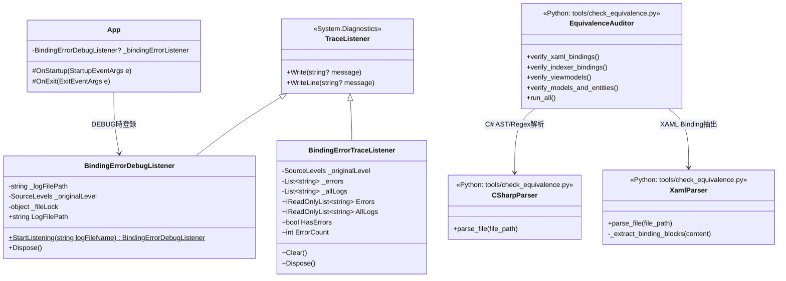
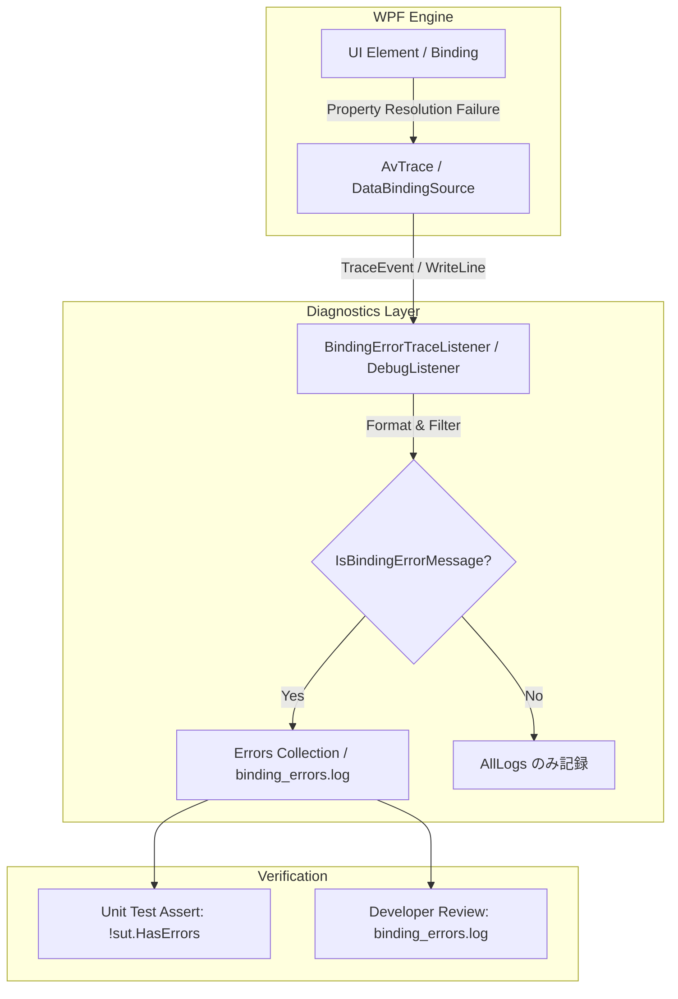
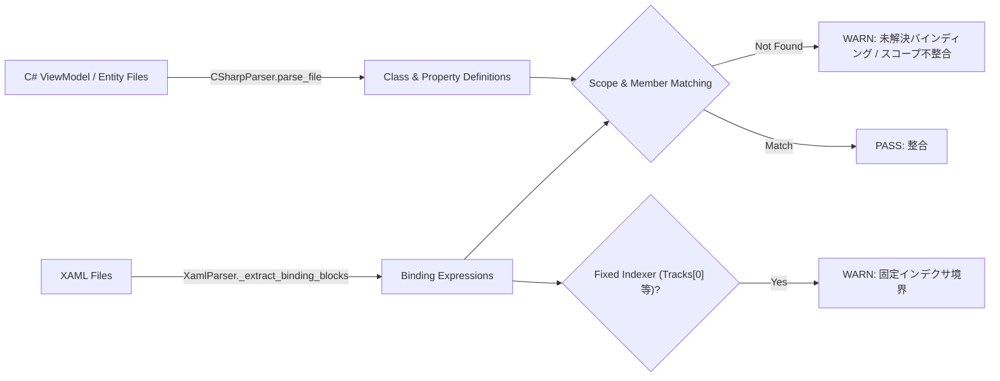

# XAMLバインディング検証基盤 詳細設計書

## 1. 概要
本設計書は、WPFアプリケーションにおけるXAMLデータバインディングエラーを自動検出し、早期発見・品質担保を実現するための検証基盤（静的検証ツール、実行時テスト監視機構、デバッグ時トレースロガー）の実装詳細を定義する。

### 1.1 背景と目的
- WPFのデータバインディングエラー（プロパティ名のタイポ、未解決パス、ViewModelスコープの不整合など）は、デフォルトでは実行時例外をスローせず、サイレントに失敗してVisual Studioのデバッグ出力に埋もれやすい。
- コレクションの固定インデクサバインディング（例: `Tracks[0].FilePath`）は、コレクション要素が0件の場合に実行時バインディングエラーや意図しない表示欠落を招く潜在的リスクがある。
- リファクタリングや画面追加・改修時において、バインディングの整合性デグレを自動かつ機械的に検証する仕組みを提供する。

---

## 2. アーキテクチャとクラス構造

### 2.1 クラス構成図 (Mermaid)


### 2.2 主要クラスと責務
| クラス / ツール | 配置場所 | 役割と責務 |
| :--- | :--- | :--- |
| `BindingErrorDebugListener` | `AudioEffector/Presentation/Diagnostics/` | デバッグ起動時に `PresentationTraceSources.DataBindingSource` を監視し、`binding_errors.log` およびデバッグ出力へ自動記録する常駐リスナー。 |
| `BindingErrorTraceListener` | `AudioEffector.Tests/Presentation/Diagnostics/` | 単体テスト実行中にデータバインディングエラーをインターセプト・蓄積（`Errors`, `AllLogs`）し、テストのアサーションで利用可能にするテスト用リスナー。 |
| `BindingErrorDebugListenerTests` | `AudioEffector.Tests/Presentation/Diagnostics/` | `BindingErrorDebugListener` のファイル出力・メッセージ記録・リソース解放を検証する単体テスト。 |
| `BindingErrorDetectionTests` | `AudioEffector.Tests/Presentation/Diagnostics/` | 不正プロパティバインディング発生時にリスナーがエラーを確実に捕捉できることを検証する単体テスト。 |
| `check_equivalence.py` | `tools/` | `EquivalenceAuditor` / `CSharpParser` / `XamlParser` によりXAMLファイル群とViewModel・Entityを静的走査し、バインディング網羅性・スコープ整合性・固定インデクサ境界（`--indexer`）を機械検証するスクリプト。 |

---

## 3. データフローと処理パイプライン

### 3.1 実行時トレース監視パイプライン (Mermaid)


### 3.2 静的解析パイプライン (Mermaid)


### 3.3 スレッド制御とリスナー登録順序
WPFの内部実装において、`PresentationTraceSources.Refresh()` をリスナー登録「後」に呼び出すと、内部の `AvTrace` キャッシュがリセットされ、登録済みリスナーが消去される仕様がある。
本基盤では以下の登録シーケンスを徹底する：

1. `PresentationTraceSources.Refresh()` を呼び出し、内部設定を最新化。
2. 現在の `Switch.Level` をバックアップ退避。
3. `Switch.Level` を `SourceLevels.Error | SourceLevels.Warning` に設定。
4. `PresentationTraceSources.DataBindingSource.Listeners.Add(listener)`（および `Trace.Listeners.Add(listener)`）でリスナーを追加。
5. （破棄時）リスナーを両コレクションから削除し、`Switch.Level` を元に戻す。

---

## 4. 検出アルゴリズム・判定詳細

### 4.1 静的解析ツールの検出仕様 (`tools/check_equivalence.py`)
1. **ViewModelプロパティの再帰解決**:
   - `ClassInfo.get_all_members()` により、基底クラス（`ViewModelBase` 等）のメンバーも再帰的に走査し、派生クラス側で未定義に見える偽陽性（False Positive）を防止。
2. **ネスト波括弧対応のバインディング抽出とスコープ追跡**:
   - `XamlParser._extract_binding_blocks()` により、`RelativeSource={RelativeSource ...}` のようなネストした波括弧を含む `{Binding ...}` ブロックを正確に抽出。
   - `ElementName=MainWindowRoot` または `AncestorType=Window` を持つバインディング式から `DataContext.` パスを追跡し、`MainViewModel` 等の対象スコープにメンバーが存在するか判定。
3. **固定インデクサ境界チェック (`--indexer`)**:
   - 正規表現 `re.compile(r'\[(\d+)\]')` により、`Tracks[0].FilePath` 等の固定インデックス指定を検出し、コレクション空時の境界リスク箇所としてレポート出力する。

### 4.2 実行時トレースの検出判定 (`IsBindingErrorMessage`)
`BindingErrorTraceListener` / `BindingErrorDebugListener` は、トレースメッセージに以下のいずれかのキーワード（大文字小文字無視）が含まれる場合にバインディングエラーとして捕捉する：
- `"Error:"` / `"Warning:"`
- `"System.Windows.Data Error"`
- `"BindingExpression path error"`
- `"Cannot find governing FrameworkElement"`
- `"Cannot find source for binding"`
- `"not found"` / `"Cannot find"`

---

## 5. 開発・レビュー時の運用方法

- **デバッグ実行時**: アプリをDEBUGビルドで起動すると、実行ファイル直下に `binding_errors.log` が自動生成され、バインディングエラー発生時にタイムスタンプ付きで記録される。
- **PR作成前セルフレビュー / CI静的チェック時**:
  ```powershell
  # XAML バインディング網羅性および固定インデクサ境界チェック
  python tools/check_equivalence.py --xaml
  python tools/check_equivalence.py --indexer
  ```
  - アクティブXAMLバインディングは全件 `PASS`（スコープ不整合 0 件）を維持する（固定インデクサは `DeviceSyncView.xaml:161` および `LibraryView.xaml:401, 556` のアルバム代表トラック参照 3 箇所のみ監視対象として把握）。
- **単体テストでの検証**:
  ```powershell
  dotnet test AudioEffector.Tests\AudioEffector.Tests.csproj --filter "FullyQualifiedName~AudioEffector.Tests.Presentation.Diagnostics"
  ```

---

## 6. 関連ドキュメント・Issue
- 関連Issue: #193, #194
- パフォーマンス最適化設計書: [パフォーマンス最適化.md](パフォーマンス最適化.md)
- テスト方針書: [テスト方針書.md](テスト仕様/テスト方針書.md)
- テストコード作成ルール: [.agents/rules/test_rules.md](../../.agents/rules/test_rules.md)
- ビルド・検証ルール: [.agents/rules/build_rules.md](../../.agents/rules/build_rules.md)
