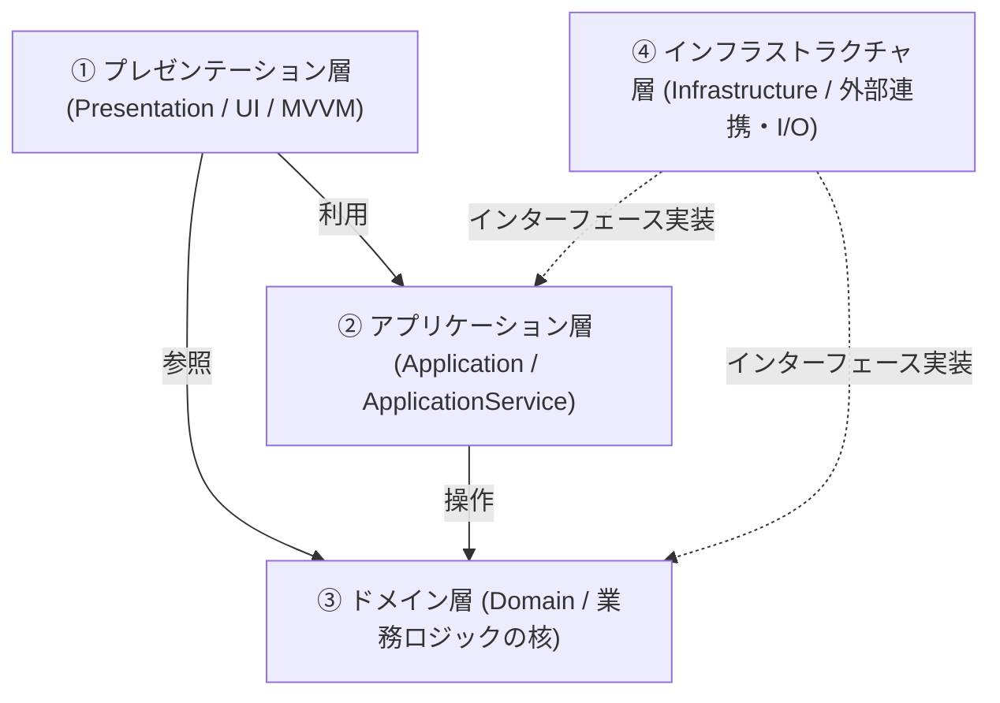
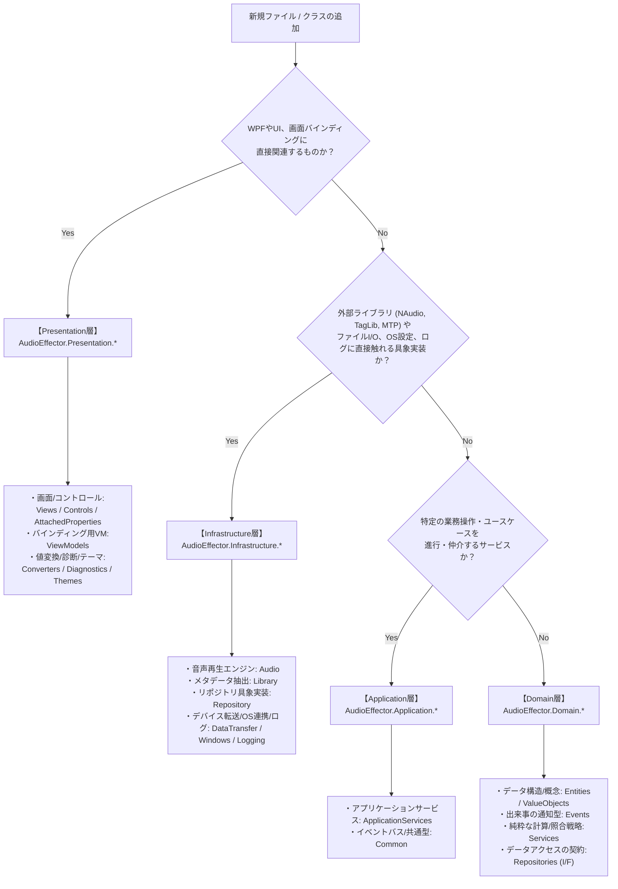
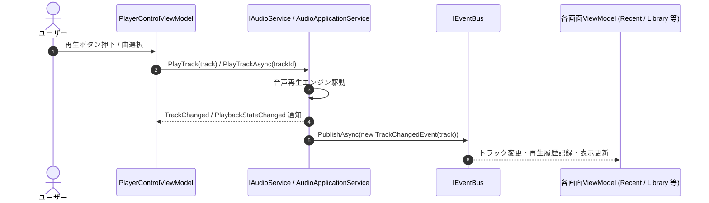
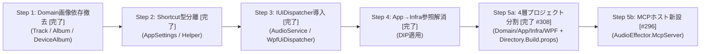

# アーキテクチャ全体設計書

## 1. 概要

### 1.1 目的
本ドキュメントは、AudioEffector におけるアーキテクチャの基本構造、各層の責務、名前空間（Namespace）の階層構造、およびソースコード配置の基準を定義する仕様書です。
開発者が新しい機能やクラスを追加する際に、**「どの層のどの名前空間に配置すべきか」「インターフェースと実装をどう分けるべきか」「DIをどのように管理するか」** に迷わないための共通ガイドラインとします。

### 1.2 設計の基本原則
1. **関心の分離 (Separation of Concerns)**: UI制御、業務ロジック、データアクセス、外部ライブラリ連携の責務をレイヤーごとに明確に分離します。
2. **依存性逆転の原則 (DIP: Dependency Inversion Principle)**: 上位レイヤー（ドメイン層・アプリケーション層）は下位レイヤー（インフラ層）の具象に依存せず、インターフェースに依存します。
3. **ドメインの独立性**: ドメイン層は外部I/OライブラリやUIフレームワーク（WPF）に依存しない純粋なC#（`net8.0`）で構成します。非Presentation層のWPF直接依存およびApplication→Infrastructure直接参照は Issue #303 にて完全排除済みです（詳細は「6. 4層プロジェクト分割に向けた非Presentation層のWPF直接依存分離方針」および [ドメイン層詳細設計書](ドメイン層詳細設計書.md) を参照）。
4. **非同期メソッド命名規則**: インフラストラクチャ層の非同期メソッドは、すべて末尾に **`Async`** を付与することを義務付けます（例: `GetByIdAsync`, `SaveAsync`, `TransferTrackAsync` 等。同期I/Oのみを提供する軽量リポジトリは除く）。

---

## 2. 4層アーキテクチャの定義と各層の役割

本システムは以下の4層構造で構成されます。依存の方向は **常に外側から内側（ドメイン層）へ向かう単方向** です。



### 2.1 各層の役割一覧

| レイヤー名 | 役割と責務 | 配置するもの | 依存してよい層 | 依存してはならないもの |
| :--- | :--- | :--- | :--- | :--- |
| **① プレゼンテーション層**<br>*(Presentation)* | ・UIの描画とユーザー入力受付<br>・画面遷移および表示状態の管理<br>・UIバインディング（MVVM） | View, ViewModel, Control, AttachedProperty, Converter, Diagnostic, Theme | Application層, Domain層 | Infrastructure層の具象クラス |
| **② アプリケーション層**<br>*(Application)* | ・ユーザー操作シナリオの進行とオーケストレーション<br>・ドメインモデルとリポジトリ/外部エンジンの連携調整<br>・トランザクションやイベント発行の管理 | ApplicationService, サービスI/F, EventBus, 共通基盤 | Domain層, インフラ層の抽象(I/F) | Presentation層(UI/WPF), Infrastructure層の具象 |
| **③ ドメイン層**<br>*(Domain)* | ・アプリケーションの核となる業務ルールとデータ構造の表現<br>・不変条件（バリデーション等）の保護<br>・外部I/Oに依存しない純粋な計算処理 | Entity, Value Object, Domain Service, Domain Event, Repository I/F | なし (C#標準ライブラリ中心) | 全ての上位層, 外部I/O実装 |
| **④ インフラストラクチャ層**<br>*(Infrastructure)* | ・外部ライブラリやOS機能との仲介（アダプター）<br>・ファイルシステム・JSONへのデータ永続化<br>・ハードウェア（オーディオデバイス、MTPデバイス）制御 | Repository実装, Audio再生エンジン, メタデータ抽出器, データ転送(DataTransfer), Windows連携, Logger | Domain層(I/F実装), Application層(I/F実装) | Presentation層 (UIコントロール) |

---

## 3. 名前空間（Namespace）とディレクトリ配置基準

### 3.1 新規コードの配置判定フロー

新しいクラスやファイルを作成する際は、以下のフローに従って配置先の層と名前空間を決定します。



---

### 3.2 名前空間・ディレクトリ階層一覧

各ディレクトリ内の個別ファイル一覧は実コードおよび各層詳細設計書を正本とし、ここではディレクトリごとの責務を定義します。

```
(ソリューションルート)/
├── Directory.Build.props                        # 全プロジェクト共通ビルド設定（Nullable, Analyzers, StyleCop, Version, InternalsVisibleTo）
│
├── AudioEffector.Domain/                        # [Class Library / net8.0 / 外部NuGet依存ゼロ] [名前空間: AudioEffector.Domain]
│   ├── Entities/                                # エンティティ（Track, Album, UserPlaylist, AppSettings, RecentTrackEntry, FavoriteTrackEntry 等）
│   │   └── DataTransfer/                        # ポータブルデバイス・転送用モデル（DeviceAlbum, DeviceTrack）
│   ├── ValueObjects/                            # 値オブジェクト（AudioPath, FrequencyBand, Gain, PlaybackState, PlaylistId, TimePosition, TrackId, Volume）
│   ├── Events/                                  # ドメインイベント（状態変化を通知するレコード型）
│   ├── Services/                                # ドメインサービス（SpectrumCalculator, FavoriteTrackMatcher, 各種 PlaybackStrategy）
│   └── Repositories/                            # リポジトリおよび外部アクセスのインターフェース (ITrackRepository, IPlaylistRepository, IFavoriteRepository, IRecentTrackRepository, ISettingsRepository, IDataTransferRepository)
│
├── AudioEffector.Application/                   # [Class Library / net8.0 / Domainのみ参照] [名前空間: AudioEffector.Application]
│   ├── DependencyInjection.cs                   # AddApplicationServices()
│   ├── Common/                                  # アプリケーション共通基盤（IEventBus, InMemoryEventBus, IHandle, IAudioEngine, IMetadataExtractor, IUiDispatcher, ImmediateUiDispatcher, LogDescriptionAttribute, FftEventArgs, Result）
│   └── ApplicationServices/                     # アプリケーションサービスおよび抽象I/F（Audio, Library, Playlist, Equalizer, DataTransfer, Settings, IAudioService, ISettingsService）
│
├── AudioEffector.Infrastructure/                # [Class Library / net8.0-windows / UseWPF=false] [名前空間: AudioEffector.Infrastructure]
│   ├── DependencyInjection.cs                   # AddInfrastructureServices()
│   ├── Audio/                                   # NAudioを利用した音声再生・DSPエンジン実装（AudioService, NAudioPlaybackEngine, EqualizerDsp, SampleAggregator）
│   ├── Library/                                 # TagLibSharpを利用したメタデータ解析・アルバムアート読込（TagLibMetadataExtractor, AlbumArtLoader）
│   ├── DataTransfer/                            # MTP/リムーバブルデバイス操作・データ転送（MtpDataTransferAdapter）
│   ├── Repository/                              # JSONファイル永続化リポジトリ具象実装（JsonTrack/Playlist/Favorite/RecentTrack/SettingsRepository）
│   ├── Windows/                                 # Windows OS連携（StartupManager）
│   └── Logging/                                 # NLogロギングおよび透過プロキシ（NLogService, LoggingProxy）
│
└── AudioEffector/                               # [WPF WinExe / net8.0-windows / UseWPF=true] [Composition Root + Presentation層]
    └── Presentation/                            # [名前空間: AudioEffector.Presentation]
        ├── Services/                            # Presentation層固有サービス（WpfUiDispatcher）
        ├── ViewModels/                          # 各画面・コントロールに対応するViewModelおよびUI補助モデル
        ├── Views/                               # XAMLウィンドウおよびユーザーコントロール
        ├── Controls/                            # アプリ共通のカスタムUIコントロール（MarqueeTextBlock, GridLengthAnimation）
        ├── AttachedProperties/                  # XAML添付プロパティ（AlbumArtLoader）
        ├── Converters/                          # XAMLデータバインディング用ValueConverter
        ├── Diagnostics/                         # デバッグ時XAMLバインディングエラー検知（BindingErrorDebugListener）
        └── Themes/                              # テーマリソースディクショナリおよび管理（DarkTheme, LightTheme, ScrollBarResources, ThemeManager）
```

---

## 4. DI（依存性注入）設計とインターフェース・実装の配置基準

### 4.1 インターフェースと実装の配置ルール（DIPの適用）

| 種別 | インターフェース (I/F) の配置層 | 実装 (Impl) の配置層 | 理由 |
| :--- | :--- | :--- | :--- |
| **データ永続化 (Repository)** | **Domain層**<br>(`Domain.Repositories.IxxxRepository`) | **Infrastructure層**<br>(`Infrastructure.Repository.JsonxxxRepository`) | Domain層がデータアクセスの契約を定義し、永続化手段（JSON/DB）から独立させるため。 |
| **外部ハード/データ転送**<br>*(Audio Engine, MTP等)* | **Domain層** または **Application層**<br>(`Domain.Repositories.IDataTransferRepository`<br>`Application.Common.IAudioEngine`<br>`Application.ApplicationServices.IAudioService`) | **Infrastructure層**<br>(`Infrastructure.Audio.NAudioPlaybackEngine`<br>`Infrastructure.Audio.AudioService`<br>`Infrastructure.DataTransfer.MtpDataTransferAdapter`) | 外部ライブラリ（NAudio等）の変更やテスト時のモック差し替えを容易にするため。 |
| **イベント仲介 (EventBus)** | **Application層**<br>(`Application.Common.IEventBus`) | **Application層**<br>(`Application.Common.InMemoryEventBus`) | アプリケーション全体のインメモリ通信ハブとして機能させるため。 |
| **アプリケーションサービス** | 具象クラス（設定等は `ISettingsService` を併用） | **Application層** (`xxxApplicationService`) | 業務シナリオ単位のオーケストレーターとしてSingleton登録。 |
| **画面モデル (ViewModel)** | インターフェース不要（具象クラス） | **Presentation層** (`xxxViewModel`) | WPFのDataContextに直接バインドするため。 |

---

### 4.2 DIコンテナの管理方法

依存性注入には `Microsoft.Extensions.DependencyInjection` を使用します。
レイヤー間の依存関係をクリーンに保つため、**各レイヤーごとに `IServiceCollection` の拡張メソッドを用意してDI登録を集約** します。具体的な登録コードの正本は以下の各ファイルを参照してください。

- **Infrastructure層**: [`AudioEffector.Infrastructure/DependencyInjection.cs`](../../../AudioEffector.Infrastructure/DependencyInjection.cs) — `AddInfrastructureServices()`
  - `IAudioEngine` / `NAudioPlaybackEngine`, `IAudioService` / `AudioService`, 各種 `Json*Repository`（`ITrackRepository`, `IPlaylistRepository`, `IFavoriteRepository`, `IRecentTrackRepository`, `ISettingsRepository`）, `IDataTransferRepository` / `MtpDataTransferAdapter`, `TagLibMetadataExtractor`, `AlbumArtLoader`, `NLogService` をすべて **Singleton** として登録します。
- **Application層**: [`AudioEffector.Application/DependencyInjection.cs`](../../../AudioEffector.Application/DependencyInjection.cs) — `AddApplicationServices()`
  - `IEventBus` / `InMemoryEventBus`、各 `ApplicationService`（`Audio`, `Library`, `Playlist`, `Equalizer`, `DataTransfer`, `Settings`）および `ISettingsService` を **Singleton** として登録します。
- **Presentation層**: [`AudioEffector/Presentation/DependencyInjection.cs`](../../../AudioEffector/Presentation/DependencyInjection.cs) — `AddPresentationServices()`
  - 主要 `ViewModel`（`MainViewModel`, `PlayerControlViewModel`, `LibraryViewModel`, `AllSongsViewModel`, `ArtistsViewModel`, `RecentViewModel`, `PlaylistViewModel`, `EqualizerViewModel`, `DeviceSyncViewModel`, `NowPlayingViewModel`, `SettingsViewModel`）および `MainWindow` を **Singleton** として登録します。
- **アプリケーション起動 (`App.xaml.cs`)**: [`AudioEffector/App.xaml.cs`](../../../AudioEffector/App.xaml.cs)
  - `OnStartup` にて3層の拡張メソッドを呼び出して `App.ServiceProvider` を構築します。
  - DEBUGビルド時は `BindingErrorDebugListener.StartListening()` を有効化し（`OnExit` で `Dispose()`）、`ISettingsService.LoadSettings()` から読み込んだテーマを `ThemeManager.ApplyTheme()` で適用した上で、DIコンテナから `MainWindow`（およびコンストラクタ注入される `MainViewModel`）を解決して表示します。

---

### 4.3 ライフサイクル（Lifetime）の選定基準

| ライフサイクル | 適用対象 | 選定の基準 |
| :--- | :--- | :--- |
| **Singleton**<br>*(単一インスタンス)* | ・`IAudioEngine` / `IAudioService` (再生デバイス・キュー管理)<br>・各種 `Repository` (ファイルキャッシュ・I/O競合防止)<br>・`IEventBus` (`InMemoryEventBus`)<br>・各種 `ApplicationService` / `ISettingsService`<br>・主要な `ViewModel` および `MainWindow` | アプリケーション起動中に単一の状態やキャッシュを共有・維持する必要があるもの、またはデバイス・リソースの再生成コストが高いもの。 |
| **Transient**<br>*(都度生成)* | ・モーダルダイアログ等で都度生成される一時ViewModel（`DeviceManagerViewModel` 等）<br>・短命なヘルパーインスタンス | 開閉のたびに初期状態から生成・破棄する使い捨ての画面・処理。 |

---

## 5. ドメインイベントの配置と連携仕様

レイヤー間・コンポーネント間の結合度を下げるため、ドメインイベント（Pub/Sub）およびサービスイベントを併用します。

### 5.1 配置と連携ルール
1. **ドメインイベントの定義**: **Domain層 (`Domain/Events/`)** に配置し、`IDomainEvent` を実装するイミュータブルな `record` 型として定義します。
2. **イベントの発行 (Publish)**: **Application層 (`ApplicationService`)** が `IEventBus.PublishAsync(e)` を呼び出して発行します（Domain層はEventBusに依存しません）。
3. **イベントの購読 (Subscribe)**: `IEventBus.Subscribe<TEvent>()` または `IAudioService` の状態変更イベントを **Presentation層 (ViewModel)** が購読し、画面状態を更新します。なお、`MiniPlayerWindow` は専用ViewModelを持たず、`MainViewModel` / `PlayerControlViewModel` の状態を共有します。



---

## 6. 4層プロジェクト分割に向けた非Presentation層のWPF直接依存分離方針（Phase 0 設計）

親 Issue #294 / #295 の方針に基づき、既存の 4 層アーキテクチャを `AudioEffector.Domain`（`net8.0`）/ `AudioEffector.Application`（`net8.0`）/ `AudioEffector.Infrastructure`（`net8.0-windows`, `UseWPF=false`）/ `AudioEffector`（WPF）へプロジェクト分割し、独立コンソールホスト `AudioEffector.McpServer` から共有できる構成へ移行します。本節では、その前提となる非 Presentation 層の WPF 直接依存の分離設計および Phase 1（#296）での移行・検証方針を定義します。

### 6.1 非Presentation層のWPF直接依存の分離結果（#303 完了）

非 Presentation 層に残存していた WPF 直接依存の **計 5 ファイル**（Domain 4 ファイル＋Infrastructure 1 ファイル）は、以下の通り Issue #303 にてすべて分離・解消済みです。

| # | 対象ファイル | 層 | 解消したWPF・外部依存 | 分離結果（正本詳細） |
| :--- | :--- | :--- | :--- | :--- |
| 1 | `Domain/Entities/Track.cs` | Domain | `BitmapImage? CoverImage`、`BitmapImage? AlbumArt`（静的 `_artCache`、`TagLib.File.Create`、`Application.Current.Dispatcher.Invoke`） | `AlbumArt`（参照ゼロの死蔵コード）および `CoverImage` を完全削除し、アートワーク読込を Presentation 層へ統一済み（[ドメイン層詳細設計書](ドメイン層詳細設計書.md)・[プレゼンテーション層詳細設計書](プレゼンテーション層詳細設計書.md)） |
| 2 | `Domain/Entities/Album.cs` | Domain | `BitmapImage? CoverImage` | プロパティおよび `LibraryViewModel` の `CoverImage = null` 代入を削除済み（[ドメイン層詳細設計書](ドメイン層詳細設計書.md)） |
| 3 | `Domain/Entities/DataTransfer/DeviceAlbum.cs` | Domain | `BitmapImage? CoverImage` | プロパティおよび `using System.Windows.Media.Imaging;` を削除済み（[ドメイン層詳細設計書](ドメイン層詳細設計書.md)） |
| 4 | `Domain/Entities/AppSettings.cs` | Domain | `ShortcutKeyConfig.Key` (`System.Windows.Input.Key`)、`Modifiers` (`System.Windows.Input.ModifierKeys`) | `int Key` および `[Flags] enum ShortcutModifiers` へ置換し、既存 `settings.json` との 100% 数値互換を維持。Presentation 層の `ShortcutKeyHelper` に相互変換マッパーを集約済み（[ドメイン層詳細設計書](ドメイン層詳細設計書.md)・[プレゼンテーション層詳細設計書](プレゼンテーション層詳細設計書.md)） |
| 5 | `Infrastructure/Audio/AudioService.cs` | Infrastructure | `EndOfStream` ハンドラ内の `Application.Current.Dispatcher.Invoke(() => OnTrackEnded())` | `Application.Common.IUiDispatcher` 抽象を導入し、WPF 実行時は `WpfUiDispatcher`、ヘッドレス／MCP／テスト実行時は `ImmediateUiDispatcher` を DI 注入済み（[インフラストラクチャ層詳細設計書](インフラストラクチャ層詳細設計書.md)・[プレゼンテーション層詳細設計書](プレゼンテーション層詳細設計書.md)） |

### 6.2 4層プロジェクト分割の前提となる副次的依存の解消結果（#303 完了）

`AudioEffector.Application`（`net8.0`）が `AudioEffector.Domain` のみを参照するクリーンなプロジェクト依存を実現するため、以下の `Application` → `Infrastructure` 直接参照 4 箇所も Issue #303 にて解消済みです。

| 対象箇所 | 解消した直接依存 | 解消結果 |
| :--- | :--- | :--- |
| `Application/ApplicationServices/IAudioService.cs` / `ISettingsService.cs` | `Infrastructure.Logging.LogDescriptionAttribute` | `LogDescriptionAttribute` を `Application.Common` へ移動済み |
| `Application/ApplicationServices/LibraryApplicationService.cs` | `Infrastructure.Library.TagLibMetadataExtractor` | `IMetadataExtractor` インターフェースを `Application.Common` に定義し、DI で `TagLibMetadataExtractor` を注入済み |
| `Application/ApplicationServices/SettingsApplicationService.cs` | 引数なしコンストラクタの `new Infrastructure.Repository.JsonSettingsRepository()` | 引数なしコンストラクタおよび `Default` 静的フォールバックを廃止し、DI コンテナまたは Composition Root からの `ISettingsRepository` 注入へ統一済み |

### 6.3 段階的移行ステップと進捗状況

既存機能・画面表示・テストへの影響を最小化するため、以下の順序で段階的にリファクタリングおよびプロジェクト分割を実施します（Step 1〜Step 4 は Issue #303、Step 5a の 4 層クラスライブラリ分割および `Directory.Build.props` 整備は Issue #308 にて完了。Step 5b の `AudioEffector.McpServer` 新設は後続 Phase 1: #296 で実施）。



1. **Step 1（画像・Dispatcher 依存撤去）— 完了 (#303)**: `Track.cs`, `Album.cs`, `DeviceAlbum.cs` から `BitmapImage` / `AlbumArt` を削除し、`MainViewModel.cs`, `PlayerControlViewModel.cs`, `LibraryViewModel.cs`, `PlayerControlViewModelTests.cs` を更新済み。
2. **Step 2（ショートカット型分離）— 完了 (#303)**: `ShortcutModifiers` を定義し、`ShortcutKeyConfig` を WPF 非依存化。`ShortcutKeyHelper.cs`, `ShortcutInputBox.xaml.cs`, `WindowShortcutHandler.cs` および関連テストをマッパー経由へ移行し、既存 `settings.json` の後方互換テスト・未定義キーフォールバックテストを追加済み。
3. **Step 3（UI ディスパッチ抽象化）— 完了 (#303)**: `IUiDispatcher` / `ImmediateUiDispatcher`（Application 層）と `WpfUiDispatcher`（Presentation 層）を新設し、`AudioService.cs`、`MainViewModel.cs` のフォールバック生成（`new AudioService(new WpfUiDispatcher())`）、および DI 登録（`AudioEffector.Infrastructure/DependencyInjection.cs`, `AudioEffector/Presentation/DependencyInjection.cs`）を更新済み。
4. **Step 4（Application → Infrastructure 直接参照の解消）— 完了 (#303)**: 表 6.2 の 4 箇所に DIP を適用し、層間依存を単方向化済み。
5. **Step 5a（4 層クラスライブラリ分割・共通ビルド設定）— 完了 (#308)**: `AudioEffector.Domain`（`net8.0` / 外部 NuGet 依存ゼロ）, `AudioEffector.Application`（`net8.0` / `Domain` のみ参照）, `AudioEffector.Infrastructure`（`net8.0-windows` / `UseWPF=false`）, `AudioEffector`（WPF `WinExe`）へ分割し、ソリューションルートの `Directory.Build.props` で静的解析・StyleCop・`Version`・`InternalsVisibleTo` を一元管理済み（あわせて `FftEventArgs` の `NAudio.Dsp.Complex` 依存を `FftComplex` 構造体へ置換して `Application` 層の純粋性を確保）。
6. **Step 5b（MCP ホスト新設）— Phase 1 (#296)**: 独立コンソールホスト `AudioEffector.McpServer` を追加し、5 プロジェクト構成を完成させる。

### 6.4 等価性検証方針（Phase 1 完了ゲート）

Phase 1 の各ステップ完了時および分割完了時に、以下の 4 項目を必須の品質ゲートとして検証します。

- **XAML バインディング網羅性検証**: `check-equivalence` スキル（`python tools/check_equivalence.py --indexer`）を実行し、新規の未解決プロパティ警告やバインディングエラーが **0 件** であること（`AlbumDetailView.xaml`, `SettingsDialog.xaml`, 一覧系 XAML の互換維持）。
- **設定 JSON 後方互換性検証**: 旧形式 `settings.json`（WPF `Key` / `ModifierKeys` の数値表現を含む JSON）を新 `AppSettings` へデシリアライズし、再シリアライズした結果が数値・意味ともに完全一致することを単体テストで検証すること。
- **WPF / ヘッドレス双方のディスパッチ検証**: `WpfUiDispatcher`（UI スレッドマーシャリング・シャットダウン時の `BeginInvoke` 破棄［no-op］・`dispatcher == null` 時の `Task.Run` フォールバック・同一スレッド直接実行）および `ImmediateUiDispatcher`（`Application.Current == null` 環境での `EndOfStream` 非ブロッキング遷移）を単体テストで検証すること。
- **ビルド・依存境界・テスト等価性検証**: 隔離ビルド（エラー 0・警告 0）および `dotnet test` 全件合格を確認し、`AudioEffector.Domain` / `AudioEffector.Application` / `AudioEffector.Infrastructure` の各プロジェクトに `UseWPF=true` や `System.Windows.*` 参照が存在しないことを確認すること。

### 6.5 MCP サーバの位置づけと 5 プロジェクト構成方針（Phase 0 確定）

4 層プロジェクト分割の完了後、`AudioEffector`（WPF デスクトップアプリ）と並ぶ **第 2 のエントリポイント（Presentation / Host 層と同位のコンポジションルート）** として、独立コンソールホスト **`AudioEffector.McpServer`**（`OutputType=Exe` / `net8.0-windows` / `UseWPF=false`）を新設します。

- **5 プロジェクト構成と依存方向**:
  - `AudioEffector.Domain`（`net8.0` / 外部依存ゼロ）
  - `AudioEffector.Application`（`net8.0` / `Domain` のみ参照）
  - `AudioEffector.Infrastructure`（`net8.0-windows`, `UseWPF=false` / `Domain`, `Application` 参照）
  - `AudioEffector`（WPF `WinExe`, `UseWPF=true` / `Domain`, `Application`, `Infrastructure` 参照）
  - `AudioEffector.McpServer`（Console `Exe`, `UseWPF=false` / `Domain`, `Application`, `Infrastructure` 参照）
- **責務分離と共有方針**:
  - `AudioEffector.McpServer` は `AudioEffector`（WPF 層）を一切参照せず、`AddInfrastructureServices()` / `AddApplicationServices()` を共有して DI コンテナを構築します（`IUiDispatcher` は既定の `ImmediateUiDispatcher` を使用）。
  - 業務ロジックは `AudioEffector.Application` の各 `ApplicationService` をそのまま再利用し、トランスポート層（Phase 1: `stdio` / Phase 3: `HTTP`）と MCP Tools / Resources 定義を明確に分離します。
  - 共通ビルド設定（`Nullable`, `EnableNETAnalyzers`, `GenerateDocumentationFile`, `StyleCop.Analyzers`, `InternalsVisibleTo` 等）はソリューションルートの `Directory.Build.props` へ集約します。
  - WPF 本体との JSON データ整合性（OS ファイルロック `.lock`＋更新検知自動リロード）およびリアルタイム再生連携（Named Pipe IPC ブリッジ）の詳細は [MCPサーバ詳細設計書](../MCPサーバ詳細設計書.md) を正本とします。

---

## 7. 関連ドキュメント・Issue

- **各層詳細設計書**:
  - [ドメイン層詳細設計書](ドメイン層詳細設計書.md)
  - [アプリケーション層詳細設計書](アプリケーション層詳細設計書.md)
  - [インフラストラクチャ層詳細設計書](インフラストラクチャ層詳細設計書.md)
  - [プレゼンテーション層詳細設計書](プレゼンテーション層詳細設計書.md)
  - [静的解析およびコーディング規約](静的解析およびコーディング規約.md)
- **MCP サーバ仕様書**:
  - [MCPサーバ機能仕様書](../../機能仕様/MCPサーバ機能仕様書.md)
  - [MCPサーバ詳細設計書](../MCPサーバ詳細設計書.md)
- **テスト仕様**:
  - [テスト方針書](../テスト仕様/テスト方針書.md)
- **関連Issue**: [#131](https://github.com/taketonnbo/Audio_Effector/issues/131), [#132](https://github.com/taketonnbo/Audio_Effector/issues/132), [#162](https://github.com/taketonnbo/Audio_Effector/issues/162), [#294](https://github.com/taketonnbo/Audio_Effector/issues/294), [#295](https://github.com/taketonnbo/Audio_Effector/issues/295), [#296](https://github.com/taketonnbo/Audio_Effector/issues/296), [#298](https://github.com/taketonnbo/Audio_Effector/issues/298), [#301](https://github.com/taketonnbo/Audio_Effector/issues/301), [#303](https://github.com/taketonnbo/Audio_Effector/issues/303), [#308](https://github.com/taketonnbo/Audio_Effector/issues/308)
