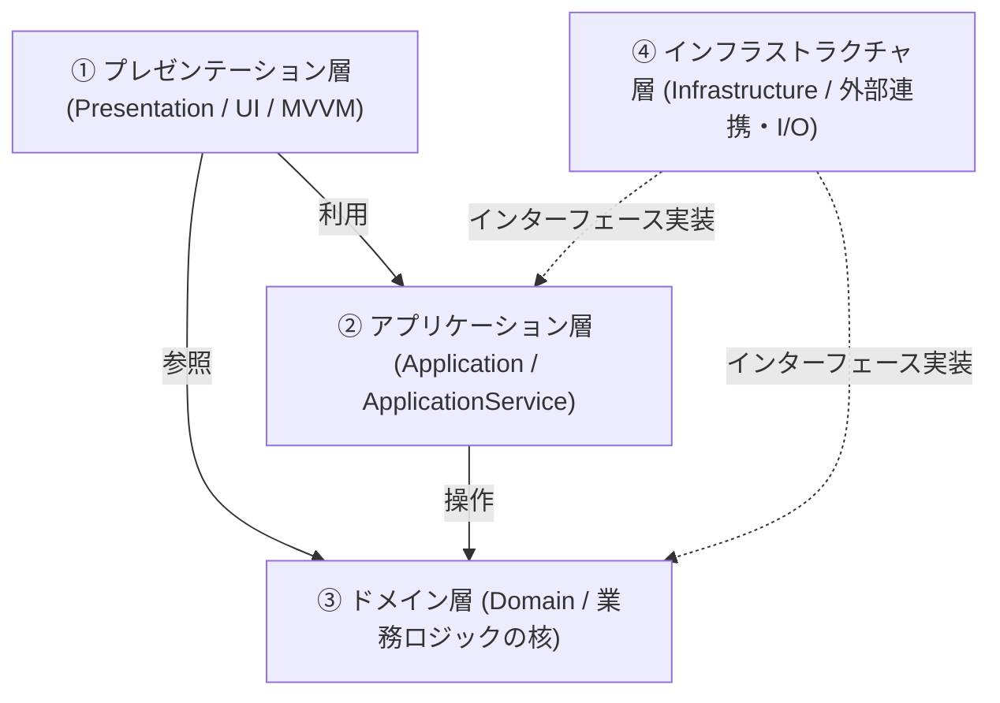
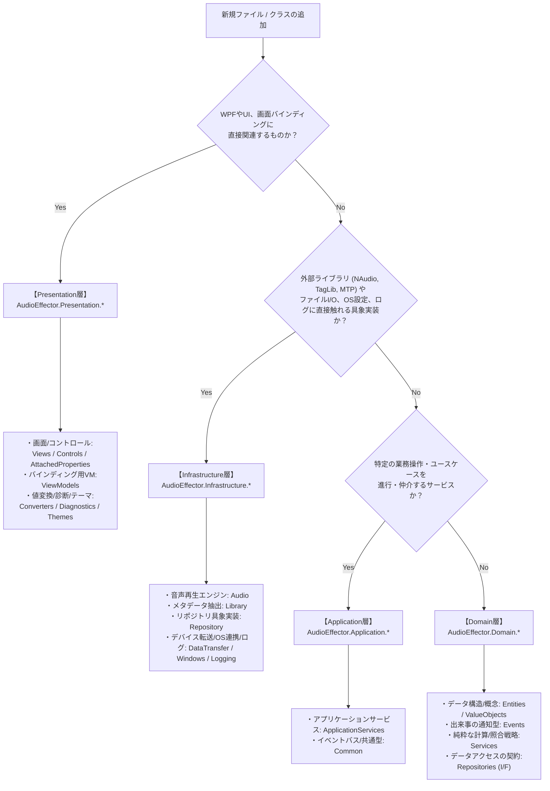
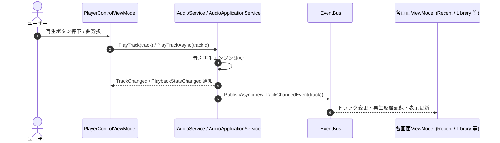

# アーキテクチャ全体設計書

## 1. 概要

### 1.1 目的
本ドキュメントは、AudioEffector におけるアーキテクチャの基本構造、各層の責務、名前空間（Namespace）の階層構造、およびソースコード配置の基準を定義する仕様書です。
開発者が新しい機能やクラスを追加する際に、**「どの層のどの名前空間に配置すべきか」「インターフェースと実装をどう分けるべきか」「DIをどのように管理するか」** に迷わないための共通ガイドラインとします。

### 1.2 設計の基本原則
1. **関心の分離 (Separation of Concerns)**: UI制御、業務ロジック、データアクセス、外部ライブラリ連携の責務をレイヤーごとに明確に分離します。
2. **依存性逆転の原則 (DIP: Dependency Inversion Principle)**: 上位レイヤー（ドメイン層・アプリケーション層）は下位レイヤー（インフラ層）の具象に依存せず、インターフェースに依存します。
3. **ドメインの独立性**: ドメイン層は原則として外部I/Oライブラリに依存しないC#で構成します（UIバインディング互換のため一部エンティティで許容している例外は [ドメイン層詳細設計書](ドメイン層詳細設計書.md) を参照）。
4. **非同期メソッド命名規則**: インフラストラクチャ層の非同期メソッドは、すべて末尾に **`Async`** を付与することを義務付けます（例: `GetByIdAsync`, `SaveAsync`, `TransferTrackAsync` 等。同期I/Oのみを提供する軽量リポジトリは除く）。

---

## 2. 4層アーキテクチャの定義と各層の役割

本システムは以下の4層構造で構成されます。依存の方向は **常に外側から内側（ドメイン層）へ向かう単方向** です。



### 2.1 各層の役割一覧

| レイヤー名 | 役割と責務 | 配置するもの | 依存してよい層 | 依存してはならないもの |
| :--- | :--- | :--- | :--- | :--- |
| **① プレゼンテーション層**<br>*(Presentation)* | ・UIの描画とユーザー入力受付<br>・画面遷移および表示状態の管理<br>・UIバインディング（MVVM） | View, ViewModel, Control, AttachedProperty, Converter, Diagnostic, Theme | Application層, Domain層 | Infrastructure層の具象クラス |
| **② アプリケーション層**<br>*(Application)* | ・ユーザー操作シナリオの進行とオーケストレーション<br>・ドメインモデルとリポジトリ/外部エンジンの連携調整<br>・トランザクションやイベント発行の管理 | ApplicationService, サービスI/F, EventBus, 共通基盤 | Domain層, インフラ層の抽象(I/F) | Presentation層(UI/WPF), Infrastructure層の具象 |
| **③ ドメイン層**<br>*(Domain)* | ・アプリケーションの核となる業務ルールとデータ構造の表現<br>・不変条件（バリデーション等）の保護<br>・外部I/Oに依存しない純粋な計算処理 | Entity, Value Object, Domain Service, Domain Event, Repository I/F | なし (C#標準ライブラリ中心) | 全ての上位層, 外部I/O実装 |
| **④ インフラストラクチャ層**<br>*(Infrastructure)* | ・外部ライブラリやOS機能との仲介（アダプター）<br>・ファイルシステム・JSONへのデータ永続化<br>・ハードウェア（オーディオデバイス、MTPデバイス）制御 | Repository実装, Audio再生エンジン, メタデータ抽出器, データ転送(DataTransfer), Windows連携, Logger | Domain層(I/F実装), Application層(I/F実装) | Presentation層 (UIコントロール) |

---

## 3. 名前空間（Namespace）とディレクトリ配置基準

### 3.1 新規コードの配置判定フロー

新しいクラスやファイルを作成する際は、以下のフローに従って配置先の層と名前空間を決定します。



---

### 3.2 名前空間・ディレクトリ階層一覧

各ディレクトリ内の個別ファイル一覧は実コードおよび各層詳細設計書を正本とし、ここではディレクトリごとの責務を定義します。

```
AudioEffector/
│
├── Domain/                                      # [名前空間: AudioEffector.Domain]
│   ├── Entities/                                # エンティティ（Track, Album, UserPlaylist, AppSettings, RecentTrackEntry, FavoriteTrackEntry 等）
│   │   └── DataTransfer/                        # ポータブルデバイス・転送用モデル（DeviceAlbum, DeviceTrack）
│   ├── ValueObjects/                            # 値オブジェクト（AudioPath, FrequencyBand, Gain, PlaybackState, PlaylistId, TimePosition, TrackId, Volume）
│   ├── Events/                                  # ドメインイベント（状態変化を通知するレコード型）
│   ├── Services/                                # ドメインサービス（SpectrumCalculator, FavoriteTrackMatcher, 各種 PlaybackStrategy）
│   └── Repositories/                            # リポジトリおよび外部アクセスのインターフェース (ITrackRepository, IPlaylistRepository, IFavoriteRepository, IRecentTrackRepository, ISettingsRepository, IDataTransferRepository)
│
├── Application/                                 # [名前空間: AudioEffector.Application]
│   ├── Common/                                  # アプリケーション共通基盤（IEventBus, InMemoryEventBus, IHandle, IAudioEngine, FftEventArgs, Result）
│   └── ApplicationServices/                     # アプリケーションサービスおよび抽象I/F（Audio, Library, Playlist, Equalizer, DataTransfer, Settings, IAudioService, ISettingsService）
│
├── Infrastructure/                              # [名前空間: AudioEffector.Infrastructure]
│   ├── Audio/                                   # NAudioを利用した音声再生・DSPエンジン実装（AudioService, NAudioPlaybackEngine, EqualizerDsp, SampleAggregator）
│   ├── Library/                                 # TagLibSharpを利用したメタデータ解析・アルバムアート読込（TagLibMetadataExtractor, AlbumArtLoader）
│   ├── DataTransfer/                            # MTP/リムーバブルデバイス操作・データ転送（MtpDataTransferAdapter）
│   ├── Repository/                              # JSONファイル永続化リポジトリ具象実装（JsonTrack/Playlist/Favorite/RecentTrack/SettingsRepository）
│   ├── Windows/                                 # Windows OS連携（StartupManager）
│   └── Logging/                                 # NLogロギングおよび透過プロキシ（NLogService, LoggingProxy, LogDescriptionAttribute）
│
└── Presentation/                                # [名前空間: AudioEffector.Presentation]
    ├── ViewModels/                              # 各画面・コントロールに対応するViewModelおよびUI補助モデル
    ├── Views/                                   # XAMLウィンドウおよびユーザーコントロール
    ├── Controls/                                # アプリ共通のカスタムUIコントロール（MarqueeTextBlock, GridLengthAnimation）
    ├── AttachedProperties/                      # XAML添付プロパティ（AlbumArtLoader）
    ├── Converters/                              # XAMLデータバインディング用ValueConverter
    ├── Diagnostics/                             # デバッグ時XAMLバインディングエラー検知（BindingErrorDebugListener）
    └── Themes/                                  # テーマリソースディクショナリおよび管理（DarkTheme, LightTheme, ScrollBarResources, ThemeManager）
```

---

## 4. DI（依存性注入）設計とインターフェース・実装の配置基準

### 4.1 インターフェースと実装の配置ルール（DIPの適用）

| 種別 | インターフェース (I/F) の配置層 | 実装 (Impl) の配置層 | 理由 |
| :--- | :--- | :--- | :--- |
| **データ永続化 (Repository)** | **Domain層**<br>(`Domain.Repositories.IxxxRepository`) | **Infrastructure層**<br>(`Infrastructure.Repository.JsonxxxRepository`) | Domain層がデータアクセスの契約を定義し、永続化手段（JSON/DB）から独立させるため。 |
| **外部ハード/データ転送**<br>*(Audio Engine, MTP等)* | **Domain層** または **Application層**<br>(`Domain.Repositories.IDataTransferRepository`<br>`Application.Common.IAudioEngine`<br>`Application.ApplicationServices.IAudioService`) | **Infrastructure層**<br>(`Infrastructure.Audio.NAudioPlaybackEngine`<br>`Infrastructure.Audio.AudioService`<br>`Infrastructure.DataTransfer.MtpDataTransferAdapter`) | 外部ライブラリ（NAudio等）の変更やテスト時のモック差し替えを容易にするため。 |
| **イベント仲介 (EventBus)** | **Application層**<br>(`Application.Common.IEventBus`) | **Application層**<br>(`Application.Common.InMemoryEventBus`) | アプリケーション全体のインメモリ通信ハブとして機能させるため。 |
| **アプリケーションサービス** | 具象クラス（設定等は `ISettingsService` を併用） | **Application層** (`xxxApplicationService`) | 業務シナリオ単位のオーケストレーターとしてSingleton登録。 |
| **画面モデル (ViewModel)** | インターフェース不要（具象クラス） | **Presentation層** (`xxxViewModel`) | WPFのDataContextに直接バインドするため。 |

---

### 4.2 DIコンテナの管理方法

依存性注入には `Microsoft.Extensions.DependencyInjection` を使用します。
レイヤー間の依存関係をクリーンに保つため、**各レイヤーごとに `IServiceCollection` の拡張メソッドを用意してDI登録を集約** します。具体的な登録コードの正本は以下の各ファイルを参照してください。

- **Infrastructure層**: [`AudioEffector/Infrastructure/DependencyInjection.cs`](../../../AudioEffector/Infrastructure/DependencyInjection.cs) — `AddInfrastructureServices()`
  - `IAudioEngine` / `NAudioPlaybackEngine`, `IAudioService` / `AudioService`, 各種 `Json*Repository`（`ITrackRepository`, `IPlaylistRepository`, `IFavoriteRepository`, `IRecentTrackRepository`, `ISettingsRepository`）, `IDataTransferRepository` / `MtpDataTransferAdapter`, `TagLibMetadataExtractor`, `AlbumArtLoader`, `NLogService` をすべて **Singleton** として登録します。
- **Application層**: [`AudioEffector/Application/DependencyInjection.cs`](../../../AudioEffector/Application/DependencyInjection.cs) — `AddApplicationServices()`
  - `IEventBus` / `InMemoryEventBus`、各 `ApplicationService`（`Audio`, `Library`, `Playlist`, `Equalizer`, `DataTransfer`, `Settings`）および `ISettingsService` を **Singleton** として登録します。
- **Presentation層**: [`AudioEffector/Presentation/DependencyInjection.cs`](../../../AudioEffector/Presentation/DependencyInjection.cs) — `AddPresentationServices()`
  - 主要 `ViewModel`（`MainViewModel`, `PlayerControlViewModel`, `LibraryViewModel`, `AllSongsViewModel`, `ArtistsViewModel`, `RecentViewModel`, `PlaylistViewModel`, `EqualizerViewModel`, `DeviceSyncViewModel`, `NowPlayingViewModel`, `SettingsViewModel`）および `MainWindow` を **Singleton** として登録します。
- **アプリケーション起動 (`App.xaml.cs`)**: [`AudioEffector/App.xaml.cs`](../../../AudioEffector/App.xaml.cs)
  - `OnStartup` にて3層の拡張メソッドを呼び出して `App.ServiceProvider` を構築します。
  - DEBUGビルド時は `BindingErrorDebugListener.Start()` を有効化し、`ISettingsRepository` から読み込んだテーマを `ThemeManager.ApplyTheme()` で適用した上で、DIコンテナから `MainWindow` と `MainViewModel` を解決して表示します。

---

### 4.3 ライフサイクル（Lifetime）の選定基準

| ライフサイクル | 適用対象 | 選定の基準 |
| :--- | :--- | :--- |
| **Singleton**<br>*(単一インスタンス)* | ・`IAudioEngine` / `IAudioService` (再生デバイス・キュー管理)<br>・各種 `Repository` (ファイルキャッシュ・I/O競合防止)<br>・`IEventBus` (`InMemoryEventBus`)<br>・各種 `ApplicationService` / `ISettingsService`<br>・主要な `ViewModel` および `MainWindow` | アプリケーション起動中に単一の状態やキャッシュを共有・維持する必要があるもの、またはデバイス・リソースの再生成コストが高いもの。 |
| **Transient**<br>*(都度生成)* | ・モーダルダイアログ等で都度生成される一時ViewModel（`DeviceManagerViewModel` 等）<br>・短命なヘルパーインスタンス | 開閉のたびに初期状態から生成・破棄する使い捨ての画面・処理。 |

---

## 5. ドメインイベントの配置と連携仕様

レイヤー間・コンポーネント間の結合度を下げるため、ドメインイベント（Pub/Sub）およびサービスイベントを併用します。

### 5.1 配置と連携ルール
1. **ドメインイベントの定義**: **Domain層 (`Domain/Events/`)** に配置し、`IDomainEvent` を実装するイミュータブルな `record` 型として定義します。
2. **イベントの発行 (Publish)**: **Application層 (`ApplicationService`)** が `IEventBus.PublishAsync(e)` を呼び出して発行します（Domain層はEventBusに依存しません）。
3. **イベントの購読 (Subscribe)**: `IEventBus.Subscribe<TEvent>()` または `IAudioService` の状態変更イベントを **Presentation層 (ViewModel)** が購読し、画面状態を更新します。なお、`MiniPlayerWindow` は専用ViewModelを持たず、`MainViewModel` / `PlayerControlViewModel` の状態を共有します。



---

## 6. 関連ドキュメント・Issue

- **各層詳細設計書**:
  - [ドメイン層詳細設計書](ドメイン層詳細設計書.md)
  - [アプリケーション層詳細設計書](アプリケーション層詳細設計書.md)
  - [インフラストラクチャ層詳細設計書](インフラストラクチャ層詳細設計書.md)
  - [プレゼンテーション層詳細設計書](プレゼンテーション層詳細設計書.md)
  - [静的解析およびコーディング規約](静的解析およびコーディング規約.md)
- **テスト仕様**:
  - [テスト方針書](../テスト仕様/テスト方針書.md)
- **関連Issue**: [#131](https://github.com/taketonnbo/Audio_Effector/issues/131), [#132](https://github.com/taketonnbo/Audio_Effector/issues/132), [#162](https://github.com/taketonnbo/Audio_Effector/issues/162)
