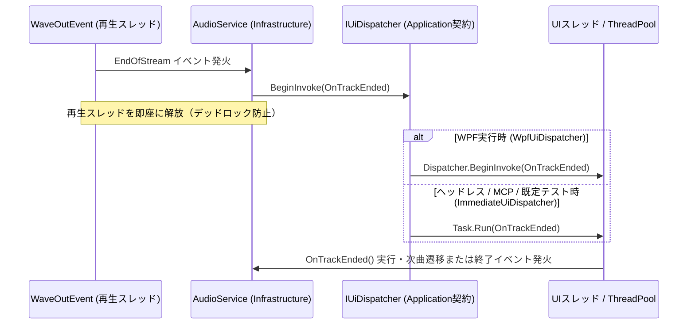

# インフラストラクチャ層 詳細設計書

## 1. 概要

### 1.1 目的
本ドキュメントは、AudioEffector における **インフラストラクチャ層（Infrastructure Layer）** の設計仕様書です。
インフラストラクチャ層は、外部ライブラリ（NAudio, TagLibSharp, MediaDevices）、ファイルシステム（JSON永続化）、Windows OS機能（レジストリ）、およびNLogロギングとの具体的な連携（アダプターおよびリポジトリ具象クラス）を担当します。

### 1.2 設計原則
1. **インターフェースへの適合**: Domain層またはApplication層で定義されたインターフェース（`ITrackRepository`, `IPlaylistRepository`, `IFavoriteRepository`, `IRecentTrackRepository`, `ISettingsRepository`, `IDataTransferRepository`, `IAudioEngine`, `IAudioService` 等）を忠実に実装する。
2. **外部仕様のカプセル化**: サードパーティ製ライブラリの内部型やI/O例外を上位レイヤーに漏洩させず、インフラ層内でドメインモデルや安全なフォールバックへ変換する。
3. **プレゼンテーション層非依存**: WPFのUIコントロールや画面遷移ロジックを含めない。
4. **非同期メソッドの命名規則**: 非同期I/Oを提供するメソッドは、**必ず末尾に `Async` を付与する**（例: `GetByIdAsync`, `SaveAllAsync`, `TransferTrackAsync`, `PlayAsync` 等）。なお、`IRecentTrackRepository` のような軽量同期契約のみ同期メソッド（`Load`, `Save`）として実装する。

---

## 2. 名前空間とディレクトリ構造

インフラストラクチャ層は `AudioEffector.Infrastructure` をルート名前空間とし、連携対象ごとにサブ名前空間を構成します。

```
AudioEffector.Infrastructure/                    # [Class Library / net8.0-windows / UseWPF=false] [名前空間: AudioEffector.Infrastructure]
├── DependencyInjection.cs                       # AddInfrastructureServices() DI登録拡張
├── Audio/                                       # NAudioを利用した音声再生エンジン・DSP処理
│   ├── AudioService.cs                          # IAudioService の具象実装（再生・キュー・EQ・FFT統括）
│   ├── NAudioPlaybackEngine.cs                  # IAudioEngine の具象実装
│   ├── SampleAggregator.cs                      # FFT解析用サンプルアグリゲーター
│   └── EqualizerDsp.cs                          # 10バンドBiQuadフィルタDSPチェーン
├── Library/                                     # ファイルメタデータ解析・画像読み込み
│   ├── TagLibMetadataExtractor.cs               # IMetadataExtractor 実装（TagLibSharpによるメタデータ・音質情報解析）
│   └── AlbumArtLoader.cs                        # アルバムアートの画像バイト配列・Bitmap読込
├── DataTransfer/                                # 外部デバイスへのデータ転送
│   └── MtpDataTransferAdapter.cs                # IDataTransferRepository の具象実装
├── Repository/                                  # JSON永続化リポジトリ具象実装・プロセス間整合性基盤
│   ├── JsonFileLockHelper.cs                    # IJsonFileLockHelper 実装（.lock排他・一意一時ファイル原子的書込・メタデータ監視）
│   ├── JsonTrackRepository.cs                   # ITrackRepository の具象実装
│   ├── JsonPlaylistRepository.cs                # IPlaylistRepository の具象実装
│   ├── JsonFavoriteRepository.cs                # IFavoriteRepository の具象実装
│   ├── JsonRecentTrackRepository.cs             # IRecentTrackRepository の具象実装
│   └── JsonSettingsRepository.cs                # ISettingsRepository の具象実装
├── Windows/                                     # Windows OS連携
│   └── StartupManager.cs                        # OS自動起動レジストリ制御
└── Logging/                                     # ロギング基盤
    ├── NLogService.cs                           # NLogロギングサービス
    └── LoggingProxy.cs                          # メソッド呼び出し透過的ロギングプロキシ
```

> **補足（EQプリセットの永続化）**: イコライザーのカスタムプリセット永続化（`presets.json`）は独立したRepositoryクラスを持たず、`EqualizerApplicationService` が直接ファイルアトミック保存および `ISettingsRepository` 連携を行います。

---

## 3. 各コンポーネントの配置基準と実装ルール

### 3.1 Audio (`AudioEffector.Infrastructure.Audio`)
- **配置基準**: NAudioに直接依存するオーディオデバイス制御、リサンプリング、ピークノーマライズ、イコライザーDSP、FFTサンプル収集。
- **実装ルール**:
  - `AudioService`（`IAudioService` 実装）および `NAudioPlaybackEngine`（`IAudioEngine` 実装）を提供する。
  - パイプラインは `AudioFileReader` →（ピークノーマライズ）→（リサンプラー）→ `EqualizerDsp` → `SampleAggregator`（FFT）→ `VolumeSampleProvider`（マスター音量）→ `EndOfStreamProvider` → `WaveOutEvent` の順に構成する。
  - **UI スレッドディスパッチの抽象化方針（#298）**:
    - `AudioEffector.Infrastructure` を `UseWPF=false` として WPF 非依存化するため、`EndOfStreamProvider.EndOfStream` ハンドラ内の `System.Windows.Application.Current.Dispatcher.Invoke(() => OnTrackEnded())` を撤去し、`Application.Common.IUiDispatcher` 経由の非ブロッキング通知（`_uiDispatcher.BeginInvoke(OnTrackEnded)`）へ置き換える。
    - `WaveOutEvent` のオーディオ再生スレッド上で直接 `StopInternal()`（`_outputDevice.Stop()` / `Dispose()`）を呼ぶとデッドロックや不安定動作の原因となるため、WPF 実行時・ヘッドレス実行時のいずれでも必ずオーディオ再生スレッドから離脱して `OnTrackEnded()` を実行する契約とする。
    - `AudioService` のコンストラクタは `public AudioService(IUiDispatcher? uiDispatcher = null)` とし、未指定時は `ImmediateUiDispatcher.Instance` をフォールバック使用する。これにより、既存の単体テスト（`AudioServiceHistoryTests`, `AudioServicePlaylistTests`, `AudioServiceSectionQueueTests` の `new AudioService()`）との互換性を維持する。なお、`MainViewModel` 内の DI 未使用フォールバック生成（`_fallbackAudioService = new AudioService();`）は、WPF 実行時にも UI スレッドへ安全にマーシャリング（かつヘッドレス時は `Task.Run` フォールバック）できるよう `new AudioService(new WpfUiDispatcher())` へ更新する。



### 3.2 Library (`AudioEffector.Infrastructure.Library`)
- **配置基準**: 音声ファイルからID3タグやFLACヘッダー等を読み出すメタデータ抽出処理、およびアルバムアート読込。
- **実装ルール**:
  - `TagLibMetadataExtractor` を用いて曲名・アーティスト・アルバム・トラック番号・ジャンル・再生時間・サンプリングレート・ビット深度・ビットレート等を抽出し、Domainの `Track` / `Album` を構築する。

### 3.3 Repository (`AudioEffector.Infrastructure.Repository`)
- **配置基準**: `%AppData%\AudioEffector\`（または DI 指定されたカスタムデータディレクトリ）配下のJSONファイル等に対するデータの保存・読み込みリポジトリ具象クラス、およびプロセス間整合性ヘルパー。
- **実装ルール**:
  - **プロセス間ファイル整合性（`JsonFileLockHelper` / `IJsonFileLockHelper`）**:
    - OS ファイルロック（`{filePath}.lock` を `FileShare.None` の `FileStream` で排他オープン、ジッター付き非同期リトライ、既定タイムアウト `5000ms`、タイムアウト時は `FileLockTimeoutException` 送出）を採用し、`async`/`await` および `CancellationToken` と安全に併用する。
    - 書き込み時は `{filePath}.{Environment.ProcessId}.{Guid.NewGuid():N}.tmp` の一意一時ファイルへ出力した後に `File.Move(..., overwrite: true)` で置換する**アトミック保存**を行い、異常時は一時ファイルを確実にクリーンアップする。
    - 読み込み時は `FileMetadataSnapshot`（存在有無・`LastWriteTimeUtc`・`Length`）を比較して変化があった場合のみ再読み込みする**キャッシュ鮮度検知**を行い、書き込み時は「`.lock` 排他取得 → 最新ファイル再読込 → 変更適用 → 一意一時ファイル書出 → `File.Move` → メタデータ更新 → ロック解放」の Read-Modify-Write 手順を徹底する。
  - **各リポジトリの永続化仕様**:
    - `JsonFavoriteRepository` (`favorites.json`): `FavoriteTrackEntry` 配列を非同期永続化する。旧形式（ファイルパス文字列配列 `List<string>`）からの自動マイグレーション、一時I/O失敗時のデータ保護、およびプロセス間排他・鮮度検知を備える。
    - `JsonRecentTrackRepository` (`RecentTracks.json`): 最近再生した曲（`RecentTrackEntry`）のメタデータと再生日時（`PlayedAt`）を同期 `Load()` / `Save()` でキャッシュ鮮度検知＋ロック付きアトミック保存する。破損JSON時は空リストへ安全にフォールバックする。
    - `JsonPlaylistRepository` (`playlists.json`): ユーザープレイリストをプロセス間排他・鮮度検知付きで永続化する。
    - `JsonSettingsRepository` (`settings.json`): 設定キー・値をプロセス間排他・鮮度検知付きで永続化する。
    - `JsonTrackRepository` (`tracks.json`): トラック情報のインメモリキャッシュおよびプロセス間排他・鮮度検知付きJSON永続化を提供する。

### 3.4 DataTransfer (`AudioEffector.Infrastructure.DataTransfer`)
- **配置基準**: 外部ストレージ／ポータブルオーディオ機器への楽曲転送・一覧取得・削除アダプター。
- **実装ルール**:
  - `MtpDataTransferAdapter` は `Domain.Repositories.IDataTransferRepository` を実装し、`GetDeviceTracksAsync`, `GetDeviceAlbumsAsync`, `TransferTrackAsync`, `DeleteDeviceTrackAsync` 等の非同期メソッドを提供する。

### 3.5 Windows (`AudioEffector.Infrastructure.Windows`)
- **`StartupManager.cs`**: Windowsレジストリ（`HKCU\SOFTWARE\Microsoft\Windows\CurrentVersion\Run`）への実行可能ファイルパス登録・削除により、OSログオン時の自動起動を制御する。

### 3.6 Logging (`AudioEffector.Infrastructure.Logging`)
- **`NLogService.cs` / `LoggingProxy.cs`**: NLogを用いたログ出力と、`DispatchProxy` によるメソッド呼び出し・例外の透過的ロギングを提供する（説明属性 `LogDescriptionAttribute` は `Application.Common` に配置）。

---

## 4. DI（依存性注入）登録仕様

インフラストラクチャ層のクラスは、[`AudioEffector.Infrastructure/DependencyInjection.cs`](../../../AudioEffector.Infrastructure/DependencyInjection.cs) の `AddInfrastructureServices(string? dataDirectory = null)` で一括して **Singleton** 登録します。

- **データディレクトリ・プロセス間ロック基盤**: `IDataDirectoryProvider`（`DataDirectoryProvider`：`dataDirectory` 未指定時は `%APPDATA%\AudioEffector`、指定時は正規化したカスタムディレクトリ）、`IJsonFileLockHelper`（`JsonFileLockHelper.Default`）
- **オーディオ**: `IAudioEngine` (`NAudioPlaybackEngine`), `IAudioService` (`AudioService`), `IUiDispatcher`（`TryAddSingleton<IUiDispatcher, ImmediateUiDispatcher>()` でヘッドレス既定実装を登録し、WPF 起動時は Presentation 層が `WpfUiDispatcher` へ上書き）
- **リポジトリ**: `ITrackRepository` (`JsonTrackRepository`), `IPlaylistRepository` (`JsonPlaylistRepository`), `IFavoriteRepository` (`JsonFavoriteRepository`), `IRecentTrackRepository` (`JsonRecentTrackRepository`), `ISettingsRepository` (`JsonSettingsRepository`) — いずれも `IDataDirectoryProvider` で解決したディレクトリ配下のパスと `IJsonFileLockHelper` を注入
- **データ転送・ライブラリ・ログ**: `IDataTransferRepository` (`MtpDataTransferAdapter`), `IMetadataExtractor` / `TagLibMetadataExtractor`, `AlbumArtLoader`, `NLogService`

---

## 5. 関連ドキュメント・Issue

- **全体設計書**: [アーキテクチャ全体設計書.md](アーキテクチャ全体設計書.md)
- **関連Issue**: [#105](https://github.com/taketonnbo/Audio_Effector/issues/105), [#132](https://github.com/taketonnbo/Audio_Effector/issues/132), [#134](https://github.com/taketonnbo/Audio_Effector/issues/134), [#148](https://github.com/taketonnbo/Audio_Effector/issues/148), [#265](https://github.com/taketonnbo/Audio_Effector/issues/265), [#298](https://github.com/taketonnbo/Audio_Effector/issues/298), [#303](https://github.com/taketonnbo/Audio_Effector/issues/303), [#308](https://github.com/taketonnbo/Audio_Effector/issues/308), [#309](https://github.com/taketonnbo/Audio_Effector/issues/309)
