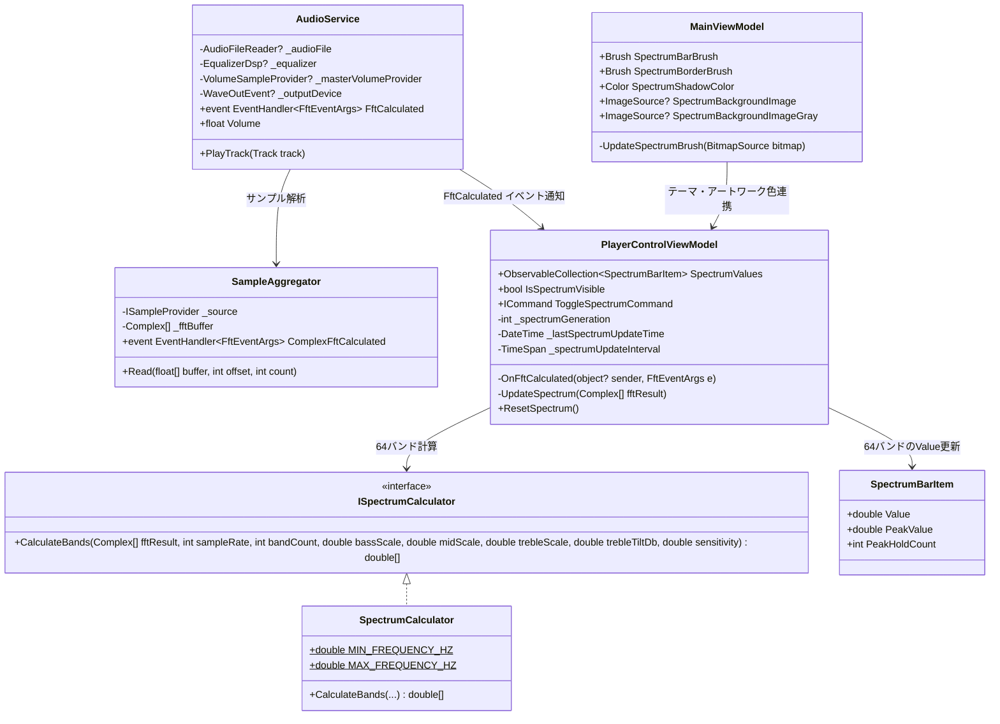
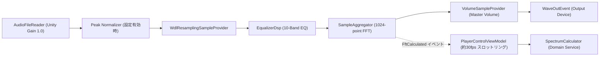

# スペクトラムアナライザ 詳細設計書

## 1. 概要
本ドキュメントは、Audio Effector アプリケーションにおける「スペクトラムアナライザ」機能の内部構造、データフロー、アルゴリズム、およびUIレンダリングの詳細仕様を定義する詳細設計書です。

---

## 2. アーキテクチャとクラス構造

### 2.1 クラス構成図


---

## 3. オーディオパイプラインとFFT解析フロー

### 3.1 パイプライン構成
音声信号は以下の順序で処理されます。`SampleAggregator` は `EqualizerDsp` の後段かつ `VolumeSampleProvider`（マスター音量）の前段に配置されるため、イコライザーによる周波数ブースト／カットはスペクトラムに反映され、かつマスター音量の増減やミュートの影響を受けずに解析されます。



---

## 4. 周波数分割およびアルゴリズム詳細

### 4.1 64バンド周波数対数マッピング (`SpectrumCalculator.cs`)
- **解析周波数範囲**: $f_{\min} = 20.0\text{ Hz} \sim f_{\max} = \min(20,000.0\text{ Hz},\ \text{sampleRate} / 2.0)$
- **FFTサイズ**: 1024点（44.1kHz時ナイキスト周波数: 22,050 Hz、1ビンあたり解像度 $\approx 43.07\text{ Hz}$）
- **対数ステップ計算**:
  $$\text{logMin} = \log_{10}(f_{\min}), \quad \text{logMax} = \log_{10}(f_{\max}), \quad \text{logStep} = \frac{\text{logMax} - \text{logMin}}{64}$$
  各バンド $i$ ($0 \le i < 64$) の周波数範囲 $[f_{\text{start}}, f_{\text{end}}]$:
  $$f_{\text{start}} = 10^{\text{logMin} + i \cdot \text{logStep}}, \quad f_{\text{end}} = 10^{\text{logMin} + (i+1) \cdot \text{logStep}}$$

### 4.2 チューニング係数と周波数補正ロジック
音響エネルギーの特性（低音域のエネルギー集中と高音域のロールオフ）を補正するため、`PlayerControlViewModel` から `SpectrumCalculator.CalculateBands` へ以下の係数を渡して計算します（`SpectrumCalculator` 単体のデフォルト引数は `midScale = 1.0`, `trebleScale = 2.4`, `sensitivity = 1.0`）。

| 係数名 (`PlayerControlViewModel`) | 型・実渡値 | 役割・説明 |
| :--- | :--- | :--- |
| `SpectrumBassScale` | `double = 0.55` | 低音域（〜250Hz）のスケール係数。低音が天井に張り付くのを防止 |
| `SpectrumMidScale` | `double = 0.90` | 中音域（250Hz〜2.5kHz）のスケール係数。ボーカルやメロディの明瞭化 |
| `SpectrumTrebleScale` | `double = 2.90` | 高音域（2.5kHz〜20kHz）のスケール係数。シンバル・ハイハットの跳躍を強化 |
| `SpectrumTrebleTiltDb` | `double = 8.5` | 高音域チルト補正係数（250Hz以上に対しオクターブあたり +8.5dB 底上げ） |
| `SpectrumSensitivity` | `double = 1.65` | 全体ゲイン係数（バーの高さスケーリング） |

#### 高音域チルト・スケーリング数式
中心周波数 $f_c = \sqrt{f_{\text{start}} \cdot f_{\text{end}}}$ に対し：
$$\text{trebleTilt} = \begin{cases} \log_2\left(\frac{f_c}{250}\right) \times 8.5 & (f_c > 250\text{ Hz}) \\ 0 & (f_c \le 250\text{ Hz}) \end{cases}$$
$$\text{adjustedDb} = \text{rawDb} + 65 + \text{trebleTilt}$$
$$\text{val} = \max(0, \text{adjustedDb}) \times 1.65$$
帯域スケーリング:
- **低音域 ($f_c < 250\text{ Hz}$)**: $\text{val} \times \left(0.45 + (0.55 - 0.45) \times \frac{f_c}{250}\right)$
- **中音域 ($250\text{ Hz} \le f_c < 2500\text{ Hz}$)**: $\text{val} \times 0.90$
- **高音域 ($f_c \ge 2500\text{ Hz}$)**: $\text{val} \times \left(0.90 + (2.90 - 0.90) \times \left(\min\left(1.0, \frac{f_c - 2500}{12000}\right)\right)^{0.85}\right)$

### 4.3 スムージング・高さクランプ・世代リセット (`PlayerControlViewModel.cs`)
- **高さ上限クランプ**: 計算された目標値は $\text{Target} = \min(78.0,\ \text{bars}[i])$ にクランプされます。
- **アタック（上昇時）**: 係数 `0.45`（高速応答）
  $$\text{Value}_{t} = \text{Value}_{t-1} + (\text{Target} - \text{Value}_{t-1}) \times 0.45$$
- **ディケイ（下降時）**: 係数 `0.075`（滑らかな減衰）
  $$\text{Value}_{t} = \text{Value}_{t-1} - (\text{Value}_{t-1} - \text{Target}) \times 0.075$$
- **ピークホールド更新**: `PeakValue` を保持（`PeakHoldCount = 14` フレーム維持後、毎フレーム `-1.3` 減衰）。
- **世代管理によるリセット (`_spectrumGeneration`)**: トラック切替・停止時に `ResetSpectrum()` が呼ばれると `_spectrumGeneration` をインクリメントし、バックグラウンドキューに残っていた旧トラックのFFT更新が遅延到着しても破棄します。

---

## 5. UIレイアウトおよびレンダリング設計

### 5.1 固定アスペクト比コンテナと軽量描画構成 (`MainWindow.xaml`)
パフォーマンス最適化方針（第6.2節：動的要素への高負荷エフェクト排除）に基づき、64本のバー自体には `DropShadowEffect` や `VisualBrush`（水面ミラー反射）を使用せず、GPUで高速描画可能な `Border` のみでレンダリングします。

```xml
<!-- 展開時高さ: 140px / アニメーション開閉対応 -->
<Grid Grid.Row="1" x:Name="SpectrumSlidePanel" Height="140" ClipToBounds="True">
    <!-- 背景: アルバムアートブラー (Radius=30) + グレースケール重ね合わせ + 暗色グラデーション (#E60A0D14) -->
    
    <!-- 中央固定幅描画領域 (768px) -->
    <Grid Width="768" HorizontalAlignment="Center">
        <Grid.RowDefinitions>
            <RowDefinition Height="22"/> <!-- Row 0: 周波数ラベル (60Hz, 250Hz, 500Hz, 1kHz, 4kHz, 16kHz) -->
            <RowDefinition Height="*"/>  <!-- Row 1: ビジュアライザー (基準線 + 64本バー) -->
        </Grid.RowDefinitions>
        
        <!-- 1. 下端ベースライン (Height: 1px, Opacity: 0.45) -->
        <!-- 2. スペクトラムバー (64本, Width: 6px, Height: {Binding Value}, CornerRadius: 3,3,1,1) -->
    </Grid>
</Grid>
```

### 5.2 カラードミナント抽出連携 (`MainViewModel.UpdateSpectrumBrush`)
- 再生中トラックのアルバムアートからドミナントカラーを抽出し、3段階の縦方向リニアグラデーション（`SpectrumBarBrush`）および境界ブラシ（`SpectrumBorderBrush`）を動的生成して `Freeze()` した上でバインドします。

---

## 6. 関連ドキュメント・Issue
- 画面設計書: [スペクトラムアナライザUI仕様書](../画面設計/スペクトラムアナライザ/スペクトラムアナライザUI仕様書.md)
- 機能仕様書: [スペクトラムアナライザ機能仕様書](../機能仕様/スペクトラムアナライザ.md)
- パフォーマンス設計書: [パフォーマンス最適化.md](パフォーマンス最適化.md)
- 関連Issue: #87, #108
