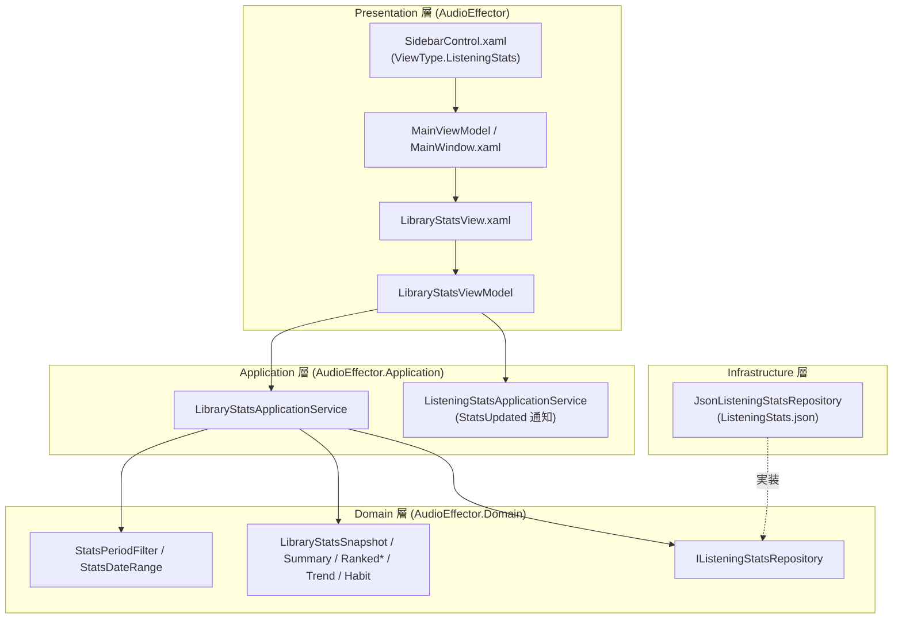

# ライブラリ全体リスニング統計 詳細設計書

## 1. 概要

本ドキュメントは、左側メイン画面「リスニング統計」ビュー（Issue #453 / Epic #452）におけるドメイン集計モデル・アプリケーション集計サービス・プレゼンテーション層 ViewModel / View および画面間遷移連携の詳細設計を定義します。

---

## 2. アーキテクチャ構成

4 層アーキテクチャに準拠し、既存の永続化基盤 `IListeningStatsRepository`（`ListeningStats.json`）を共有します。

---

## 3. ドメイン層設計 (`AudioEffector.Domain.Entities`)

| 型名 | 役割 | 主なプロパティ / メソッド |
| :--- | :--- | :--- |
| `StatsPeriodFilter` | UI 既定期間フィルタ列挙体 | `ThisWeek`, `ThisMonth`, `ThisYear`, `AllTime` |
| `StatsDateRange` | 任意集計期間（半開区間 `[StartInclusive, EndExclusive)`） | `StartInclusive`, `EndExclusive`, `IsUnbounded`, `Contains(DateTime)`, `FromPeriodFilter`, `ForWeekContaining`, `ForSpecificMonth`, `ForSpecificYear`, `ForDateRange` |
| `LibraryStatsSummary` | KPI サマリ 4 枚分の集計結果 | `TotalPlayCount`, `DailyAveragePlayCount`, `TotalListeningDuration`, `UniqueTrackCount`, `UniqueArtistCount`, `UniqueAlbumCount`, `TopArtistName`, `TopArtistPlayCount` |
| `RankedTrackStat` | よく聴く曲 TOP N の 1 項目 | `Rank`, `FilePath`, `Title`, `Artist`, `Album`, `PlayCount`, `TotalListeningDuration`, `LastPlayedAt`, `RatioPercent` |
| `RankedArtistStat` | よく聴くアーティスト TOP N の 1 項目 | `Rank`, `ArtistName`, `PlayCount`, `TotalListeningDuration`, `UniqueTrackCount`, `RepresentativeFilePath`, `RatioPercent` |
| `RankedAlbumStat` | よく聴くアルバム TOP N の 1 項目 | `Rank`, `AlbumTitle`, `ArtistName`, `PlayCount`, `TotalListeningDuration`, `UniqueTrackCount`, `RepresentativeFilePath`, `RatioPercent` |
| `ListeningTrendPoint` | 日別・月別推移の 1 データ点 | `Label`, `DetailLabel`, `BucketStart`, `PlayCount`, `TotalListeningDuration`, `HeightRatio` |
| `ListeningHabitBucket` | 時間帯別（0〜23時）・曜日別（月〜日）の 1 バケット | `Key`, `Label`, `DetailLabel`, `PlayCount`, `TotalListeningDuration`, `HeightRatio`, `IsPeak` |
| `ListeningHabitDistribution` | 時間帯別・曜日別分布とピークインサイト | `HourlyBuckets`, `DayOfWeekBuckets`, `PeakHour`, `PeakDayOfWeek`, `HourlyPeakInsight`, `DayOfWeekPeakInsight` |
| `LibraryStatsSnapshot` | 集計結果全体の不変スナップショット | `DateRange`, `Summary`, `TopTracks`, `TopArtists`, `TopAlbums`, `DailyTrends`, `MonthlyTrends`, `Habits`, `HasData` |

---

## 4. アプリケーション層設計 (`LibraryStatsApplicationService`)

- **配置**: `AudioEffector.Application/ApplicationServices/LibraryStatsApplicationService.cs`（DI Singleton 登録）
- **公開 API**:
  - `GetStats(StatsPeriodFilter periodFilter, int topCount = 10, IReadOnlyCollection<Track>? libraryTracks = null)`
  - `GetStatsForRange(StatsDateRange? dateRange, int topCount = 10, IReadOnlyCollection<Track>? libraryTracks = null)`
- **集計アルゴリズムと境界仕様**:
  1. **イベントベース集計**: `ListeningStatsData.PlayEvents` を `dateRange.Contains(ev.PlayedAt)` で絞り込み、同一スナップショット内で KPI・ランキング・推移・傾向を一貫集計します。全期間かつ `PlayEvents` が 0 件で `TrackStats` のみ存在する旧データ時は `TrackStats` からランキングおよびサマリを安全に復元します。
  2. **ライブラリメタデータ解決**: `libraryTracks` が渡された場合、`FilePath`（大文字・小文字無視）で突き合わせて最新の曲名・アーティスト・アルバム・再生時間を優先反映します。
  3. **ランキング安定ソート**: 曲・アーティスト・アルバムいずれも **再生回数降順のみ** とし、同率時は `TotalListeningDuration` 降順 → `LastPlayedAt` 降順（曲のみ） → 名称昇順（大文字・小文字無視）で決定論的に整列します。アルバムは `(AlbumTitle, ArtistName)` 複合キーで集約し、同名別アーティスト作品の混在を防止します。
  4. **日平均再生回数**: 指定期間内の経過日数（下限 1 日）で総再生回数を除算します。
  5. **日別・月別推移生成**: 指定期間内の全バケットを 0 埋め生成します（日別は最大 31 日・長期は直近 14 日、月別は最大 24 ヶ月・全期間は直近 12 ヶ月）。
  6. **ストレージ耐障害性**: リポジトリ読み込み時の `IOException` / `UnauthorizedAccessException` / `TimeoutException` / `JsonException` / `OverflowException` は捕捉し、空の `LibraryStatsSnapshot` を返却します。

---

## 5. プレゼンテーション層設計 (`LibraryStatsViewModel` / `LibraryStatsView` / `MainViewModel`)

- **`LibraryStatsViewModel`**:
  - `ListeningStatsApplicationService.StatsUpdated` および `LibraryViewModel` の同期・削除イベントを購読し、`Interlocked.Exchange` によるコアレッシングと `IsActiveView` 連動の遅延更新（ダーティフラグ）で不要な再集計を抑止します。
  - 操作コマンド: `SelectPeriodFilterCommand`, `PlayTopTracksCommand`, `CreateTopTracksPlaylistCommand`, `PlayTrackCommand`, `PlayNextTrackCommand`, `EnqueueTrackCommand`, `AddTrackToPlaylistCommand`, `NavigateToArtistCommand`, `NavigateToAlbumCommand`, ランキング／グラフ切替コマンド群。
  - `CreateTopTracksPlaylist()` は `PlaylistViewModel.CreatePlaylistWithTracks(...)` へ委譲し、表示中の TOP 10 楽曲を順序保持で新規ユーザープレイリストへ永続化します。
- **`MainViewModel` 連携**:
  - `CurrentViewType` の変更時に `LibraryStats.IsActiveView = (_currentViewType == ViewType.ListeningStats)` を同期します。
  - `ArtistNavigationRequested` 受信時は `CurrentViewType = ViewType.Artists` へ切替え、`Artists.SelectArtistByName(artistName)` で該当アーティストを選択します。
  - `AlbumNavigationRequested` 受信時は `NavigateToAlbumDetail(album)` でアルバム詳細画面へ遷移します。
  - データ保存先変更時（`DataDirectoryChanged`）に `LibraryStats.Refresh()` を呼び出して最新データへ追従します。

---

## 6. 関連ドキュメント・Issue
- 機能仕様書: [ライブラリ全体リスニング統計.md](../機能仕様/ライブラリ全体リスニング統計.md)
- UI 仕様書: [ライブラリ全体リスニング統計UI仕様書.md](../画面設計/ライブラリ全体リスニング統計/ライブラリ全体リスニング統計UI仕様書.md)
- 関連設計書: [リスニング統計ダッシュボード.md](リスニング統計ダッシュボード.md), [ドメイン層詳細設計書.md](アーキテクチャ/ドメイン層詳細設計書.md), [アプリケーション層詳細設計書.md](アーキテクチャ/アプリケーション層詳細設計書.md), [プレゼンテーション層詳細設計書.md](アーキテクチャ/プレゼンテーション層詳細設計書.md)
- 関連 Issue: [#452](https://github.com/taketonnbo/Audio_Effector/issues/452), [#453](https://github.com/taketonnbo/Audio_Effector/issues/453), [#454](https://github.com/taketonnbo/Audio_Effector/issues/454)
