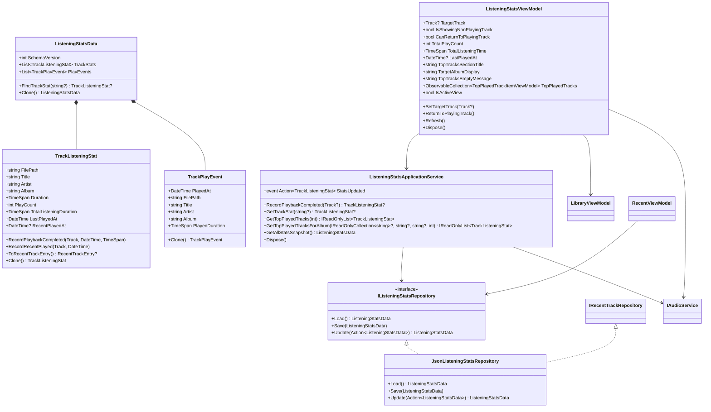
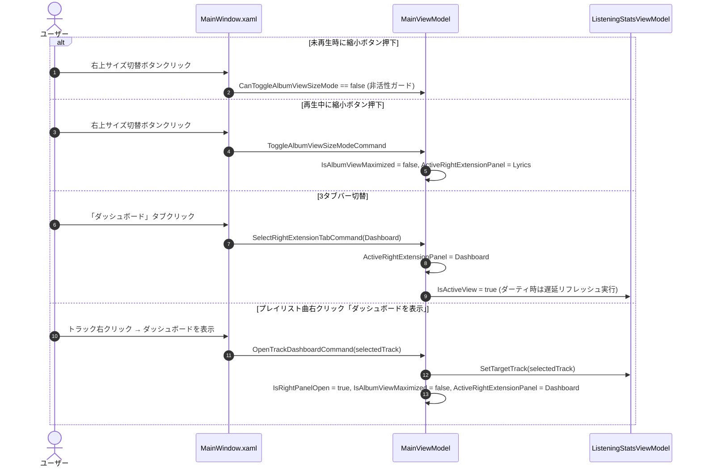

# リスニング統計ダッシュボード 詳細設計書

## 1. 概要

本ドキュメントは、右側パネルの共通 3 タブ切替基盤（`歌詞` / `ダッシュボード` / `タグ`）、楽曲向けリスニング統計ダッシュボード、および旧 `RecentTracks.json` を統合した `ListeningStats.json` 永続化基盤（曲別累計統計＋日時毎再生イベント履歴）の技術仕様とクラス設計を定義します。

- **上位ドキュメント**:
  - 機能仕様書: [リスニング統計ダッシュボード.md](../機能仕様/リスニング統計ダッシュボード.md)
  - UI 仕様書: [リスニング統計ダッシュボードUI仕様書.md](../画面設計/リスニング統計ダッシュボード/リスニング統計ダッシュボードUI仕様書.md)
- **対象 Issue**: #121, #123, #470（後続連携: #452, #453, #454）

---

## 2. アーキテクチャとクラス構造

### 2.1 4 層クラス構成図 (Mermaid)

---

## 3. 永続化・マイグレーション設計 (`ListeningStats.json`)

### 3.1 JSON スキーマ
保存先は `IDataDirectoryProvider.GetFilePath("ListeningStats.json")`（既定: `%APPDATA%\AudioEffector\ListeningStats.json`）とし、`IJsonFileLockHelper` によるプロセス間ファイルロック（`.lock`）および一意一時ファイル経由の原子的書き込み（`WriteAllTextAtomic`）を適用します。

- `SchemaVersion`: スキーマバージョン（現行 `1`）
- `TrackStats`: 楽曲単位の累計統計配列（`FilePath`, `Title`, `Artist`, `Album`, `DurationSeconds`, `PlayCount`, `TotalListeningSeconds`, `LastPlayedAt`, `RecentPlayedAt`）
- `PlayEvents`: 日時毎の再生完了イベント配列（`PlayedAt`, `FilePath`, `Title`, `Artist`, `Album`, `PlayedDurationSeconds`）

### 3.2 旧 `RecentTracks.json` からの自動マイグレーション
- `ListeningStats.json` が未存在かつ同一ディレクトリに旧 `RecentTracks.json` が存在する場合、初回 `Load()` / `Update()` 時に自動で読み込み、以下へ変換して `ListeningStats.json` へ原子保存します。
  - 各有効エントリから `TrackListeningStat` を生成（`PlayCount = 1`、`TotalListeningDuration = Duration`、`LastPlayedAt = PlayedAt`、`RecentPlayedAt = PlayedAt`；重複 `FilePath` は合算）。
  - 同エントリを `TrackPlayEvent` として `PlayEvents` へ登録。
  - 破損 JSON・`null` 要素・空 `FilePath` は安全にスキップし、例外で起動を妨げません。
- `RecentViewModel` は統合後の `IListeningStatsRepository` を参照し、表示時のみ `RecentPlayedAt != null` を日時降順・上位 100 件（`MaxHistoryCount`）に絞ることで、全曲統計・`PlayEvents` を切り捨てません。履歴の個別削除・全消去では `RecentPlayedAt = null` のみ設定し、累計統計と `PlayEvents` を保護します。
- `DataDirectoryMigrationService.DefaultManagedFileNames` へ `"ListeningStats.json"` を追加し、保存先フォルダ変更時のコピー／移動移行に対応します。

---

## 4. 右側 3 タブ切替・未再生ガード・右クリック導線設計

### 4.1 状態遷移シーケンス (Mermaid)

### 4.2 アルバム内 TOP 5 集計と同名アルバム混入防止アルゴリズム
- 右側タブ「ダッシュボード」の TOP 5 ランキングは `ListeningStatsApplicationService.GetTopPlayedTracksForAlbum(albumTrackFilePaths, albumName, artistName, count)` を使用して**対象楽曲が所属するアルバム内の楽曲のみ**を集計します（ライブラリ全体向け `GetTopPlayedTracks` は #453 等向けに維持）。
- **所属アルバム解決の優先順位（`ListeningStatsViewModel.ResolveAlbumForTrack`）**:
  1. `LibraryViewModel.Albums` から対象楽曲の `FilePath` 一致（大文字小文字無視）を最優先で探索し、見つからない場合は `AlbumId.Value != Guid.Empty` の場合に `Album.Id == Track.AlbumId` で解決します。
  2. アルバム実体が解決できた場合は、その `Album.Tracks` に含まれる全 `FilePath` 集合（非 `null`）を `GetTopPlayedTracksForAlbum` へ渡して `HashSet<string>`（大文字小文字無視）で厳密フィルタリングします（有効パス 0 件の場合はメタデータフォールバックへ落とさず空一覧を返却）。これにより、コンピレーションアルバムの別アーティスト曲を含めつつ、同名・別アーティストの別アルバム楽曲の混入を完全に防ぎます。
  3. ライブラリ未登録曲などアルバム実体を解決できない場合（`albumTrackFilePaths == null`）は、有効な `Album` 名（空および `"Unknown Album"` を除く）と `Artist` 名の併用一致へフォールバックします。`artistName` が空または `"Unknown Artist"` の場合も同様にアーティスト不明曲のみと一致させ、別アーティスト作品の同名アルバム曲が混入しないよう保護します。
- **TOP 5 行クリック時の同アルバム維持**: `SelectTopTrackCommand` 実行時は `LibraryViewModel` から該当 `FilePath` の最新 `Track` 実体（`AlbumId` 保持）を優先取得して `SetTargetTrack` へ渡すことで、クリック後も同アルバム内ランキングを維持します。
- `TargetTrack == null` の場合は `TopPlayedTracks` を空とし、未選択向けエンプティメッセージを表示します。また `TargetTrack` 変更時は即座に内部の解決済みアルバム名キャッシュをリセットし、非アクティブ時の不整合を防ぎます。

### 4.3 ライフサイクルと描画最適化
- `ListeningStatsApplicationService`・`ListeningStatsViewModel` とも `IDisposable` を実装し、`IAudioService.TrackPlaybackEnded` / `TrackChanged`、`StatsUpdated`、および `LibraryViewModel` の同期・削除イベント（`LibrarySynced` / `TrackRemoved` / `AlbumRemoved`）の購読を確実に解除します。
- 統計更新・ライブラリ同期/削除の連続発火による不要なファイル I/O と UI 再構築を防ぐため、`Interlocked.Exchange` フラグで UI スレッドへの `BeginInvoke` を 1 回にコアレッシングします。
- `MainWindow.xaml` の下部拡張領域（`Grid.Row="1"`）は `IsRightExtensionAreaVisible` で `Collapsed` 制御し、さらに各タブホスト（`Lyrics`, `LrcGenerator`, `Dashboard`, `Tags`）も個別に `Visibility="Collapsed"` で制御します。
- `ListeningStatsViewModel.IsActiveView == false` の間に発生した統計更新・ライブラリ更新は `_isDirty = true` のみ記録し、次回アクティブ化時にまとめて再描画します。

---

## 5. 関連ドキュメント・Issue
- 機能仕様書: [リスニング統計ダッシュボード.md](../機能仕様/リスニング統計ダッシュボード.md)
- UI 仕様書: [リスニング統計ダッシュボードUI仕様書.md](../画面設計/リスニング統計ダッシュボード/リスニング統計ダッシュボードUI仕様書.md)
- アーキテクチャ詳細設計書: [ドメイン層](アーキテクチャ/ドメイン層詳細設計書.md) / [アプリケーション層](アーキテクチャ/アプリケーション層詳細設計書.md) / [インフラストラクチャ層](アーキテクチャ/インフラストラクチャ層詳細設計書.md) / [プレゼンテーション層](アーキテクチャ/プレゼンテーション層詳細設計書.md)
- 関連 Issue: [#121](https://github.com/taketonnbo/Audio_Effector/issues/121), [#123](https://github.com/taketonnbo/Audio_Effector/issues/123), [#470](https://github.com/taketonnbo/Audio_Effector/issues/470)
