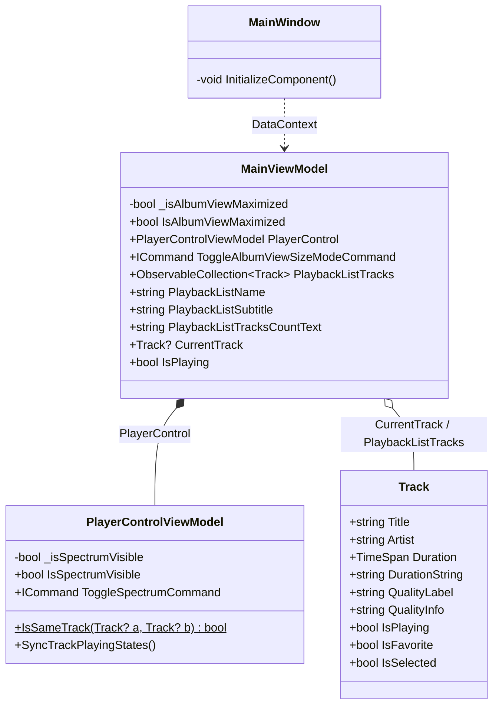
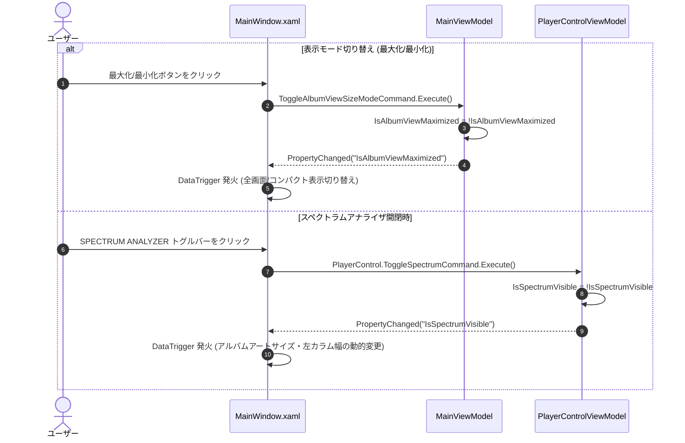

# 右側アルバム情報表示サイズ切り替え機能 詳細設計書

## 1. 概要
本ドキュメントは、メイン画面右側パネルにおけるアルバム情報・プレイヤー表示領域の表示サイズを「最大化（全画面）」と「最小化（コンパクト）」の2値トグルで切り替える機能、およびスペクトラムアナライザの開閉状態と連動した動的サイズ最適化・トラックリスト視認性向上の技術仕様と実装詳細を定義します。

- **上位ドキュメント**:
  - 機能仕様書: [右側アルバム情報表示サイズ切り替え機能.md](../機能仕様/右側アルバム情報表示サイズ切り替え機能.md)
  - UI画面仕様書: [右側アルバム情報表示サイズ切り替え機能UI仕様書.md](../画面設計/右側アルバム情報表示サイズ切り替え機能/右側アルバム情報表示サイズ切り替え機能UI仕様書.md)
- **対象Issue**: #122, #172

---

## 2. アーキテクチャとクラス構造

### 2.1 クラス構成図 (Mermaid)

### 2.2 主要クラスと責務
| クラス名 | レイヤー | 責務・役割 |
| :--- | :--- | :--- |
| `MainViewModel` | Presentation (ViewModel) | 表示モード状態（`IsAlbumViewMaximized`）の保持、`ToggleAlbumViewSizeModeCommand`（`IsAlbumViewMaximized = !IsAlbumViewMaximized`）の提供、トラックリスト・再生ステータスのプロキシ集約。 |
| `PlayerControlViewModel` | Presentation (ViewModel) | スペクトラムアナライザ表示状態（`IsSpectrumVisible`）と開閉コマンド（`ToggleSpectrumCommand`）の管理、および再生中トラック表示の排他同期（`SyncTrackPlayingStates`）。 |
| `MainWindow.xaml` | Presentation (View) | 右側パネルのGrid構成、左右2カラムレイアウト、`PlayerControl.IsSpectrumVisible` に応じた動的サイズ切り替え（`DataTrigger`）、トラックリストのゼブラストライプ・`MarqueeTextBlock`・インラインアイコン切り替えの描画。 |
| `Track` | Domain (Entity) | 楽曲メタデータ（トラック番号、曲名、再生時間、フォーマット、再生中/お気に入り/選択フラグ）の保持。 |

---

## 3. データフローと処理パイプライン

### 3.1 モード切り替え & アナライザ連動シーケンス図 (Mermaid)

### 3.2 状態管理とイベント連携
- `IsAlbumViewMaximized` の初期値は `true`（最大化・アルバム鑑賞モード）。
- `PlayerControl.IsSpectrumVisible` の初期値は `true`（アナライザ表示）。
- それぞれのプロパティ変更通知（`INotifyPropertyChanged`）を受け、`MainWindow.xaml` 内の `Style` / `DataTrigger` により、各UI要素の寸法・可視性が協調して切り替わります。

---

## 4. アルゴリズム・ロジック詳細

### 4.1 定数・パラメータ一覧
| 定数・プロパティ名 | 型 / 既定値 | 役割・説明 |
| :--- | :--- | :--- |
| `IsAlbumViewMaximized` | `bool = true` | 最大化モード（`true`）か最小化モード（`false`）かのフラグ。 |
| `PlayerControl.IsSpectrumVisible` | `bool = true` | スペクトラムアナライザ表示フラグ。 |
| `ArtSizeNormal` | `260 x 260px` | アナライザ表示時（`IsSpectrumVisible = True`）のアルバムアート外枠サイズ（外枠 `CornerRadius="10"` / 内枠 `CornerRadius="5"` / ベゼル `Padding="7"`）。 |
| `ArtSizeExpanded` | `330 x 330px` | アナライザ非表示時（`IsSpectrumVisible = False`）のアルバムアート外枠サイズ。 |
| `LeftColumnWidthNormal` | `340px` | アナライザ表示時の左カラム固定幅。 |
| `LeftColumnWidthExpanded` | `380px` | アナライザ非表示時の左カラム固定幅。 |
| `SpectrumTransitionDuration` | `0:0:0.3` (300ms) | アナライザ連動時のリサイズアニメーション時間。 |
| `EasingFunction` | `CubicEase (EaseInOut)` | 伸縮時のイージング関数。 |
| `ZebraOddBackgroundBrush` | Dark: `#12FFFFFF` (約7.1%) Light: `#0C000000` (約4.7%) | 奇数行ゼブラストライプのテーマ連動ブラシ。 |

### 4.2 再生中トラック表示の排他制御ロジック (Issue #172)
トラックリスト内の再生中表示（`Track.IsPlaying` による再生アイコン `▶` / 一時停止アイコン `⏸` / シアンハイライト表示）は、現在再生中の単一楽曲のみが `true` となり、それ以外の楽曲はすべて `false` となるよう厳密に排他同期されます。

1. **同一楽曲判定 (`PlayerControlViewModel.IsSameTrack`)**:
   - `ReferenceEquals`（同一インスタンス判定）
   - `FilePath`（大文字小文字を区別しないパス文字列比較）
   - `Id`（`TrackId` の等価性比較）
   上記3段階のフォールバック判定により、異なる経路で生成された別インスタンスであっても同一楽曲を正しく特定します。

2. **排他同期処理 (`PlayerControlViewModel.SyncTrackPlayingStates`)**:
   - `PlaybackListTracks` 内の全トラックを反復処理し、現在再生中トラックと一致する1曲のみ `IsPlaying = true`、それ以外を `IsPlaying = false` に設定します。
   - `if (track.IsPlaying != shouldBePlaying) track.IsPlaying = shouldBePlaying;` のガード条件により、値に差分がある場合のみ代入を行い、不要な `PropertyChanged` 通知を抑止します。

3. **同期実行トリガー**:
   - `PlayerControlViewModel.CurrentTrack` のセッター変更時
   - `PlayerControlViewModel.PlaybackListTracks` のセッター変更時
   - `PlayerControlViewModel.SetPlaybackList` によるトラックリスト一括設定時
   - `MainViewModel.OnTrackChanged` によるトラック変更通知時

---

## 5. UIレイアウトおよびレンダリング設計 (`MainWindow.xaml`)

### 5.1 左カラム: 多層メタリックベゼル・アルバムアート ＆ Player Pod カード
- **左カラム幅アニメーション**: `DataTrigger Binding="{Binding PlayerControl.IsSpectrumVisible}" Value="False"` により、`Width` を `340` ⇔ `380`（300ms `CubicEase`）でアニメーション伸縮します。
- **アルバムアート多層ベゼル**: 外側 `Border`（`CornerRadius="10"`, `BorderBrush="{DynamicResource MetallicFrameOuterEdgeBrush}"`, `Background="{DynamicResource MetallicCardBackgroundBrush}"`, `Padding="7"`, `Effect="{DynamicResource AlbumArtDropShadowEffect}"`）と内側 `Border`（`CornerRadius="5"`, `BorderBrush="{DynamicResource MetallicFrameInnerEdgeBrush}"`）で構成し、`260×260` ⇔ `330×330` で伸縮します。
- **アルバム基本情報**: `PlaybackListName`（24pt Bold）および `PlaybackListSubtitle`（13pt）は `controls:MarqueeTextBlock` により見切れ時のホバー連動ループスクロールに対応し、その下に音質ラベル（`QualityLabel` / `QualityInfo`）を表示します。
- **Player Pod カード**: `Background="{DynamicResource MetallicCardBackgroundBrush}"`, `BorderBrush="{DynamicResource MetallicCardBorderBrush}"`, `CornerRadius="12"`, `Padding="18,16"`, `Effect="{DynamicResource CardDropShadowEffect}"` を適用し、現在曲タイトル（`MarqueeTextBlock` 16pt）、クイックアクション3種、再生制御5ボタン（中央再生ボタン 48×48px）、ワイドシークバー、再生時間/総時間を縦5段で配置します。

### 5.2 右カラム: メタリックコンテナ ＆ 動的ゼブラトラックリスト
- **コンテナ**: Player Pod と同一の `MetallicCardBackgroundBrush` / `MetallicCardBorderBrush` / `CardDropShadowEffect`（`CornerRadius="12"`, `Padding="16,14"`）で統一。
- **ヘッダー**: 左側に `Playlist: <PlaybackListName>`、右端に `<Count> Tracks` を表示します。`PlaybackListTracks.Count == 0` の場合は中央に空状態メッセージ（「プレイリストは空です」）を表示します。
- **トラック行**:
  - `AlternationCount="999"` と `IndexConverter` によりトラック連番（`01.` 等）を生成し、奇数行には `{DynamicResource ZebraOddBackgroundBrush}` を適用します。
  - 左列（幅 28px）で非再生時は曲番号、再生中は `▶`（`AlwaysNeonCyanBrush`）、一時停止中は `⏸` をインラインで排他切り替えします。
  - 曲名列は `controls:MarqueeTextBlock`（親ボタンの `IsMouseOver` に `IsTriggered` を連動）で描画し、再生中トラックは `AlwaysNeonCyanBrush` + `SemiBold` で強調します。

---

## 6. 関連ドキュメント・Issue
- 機能仕様書: [右側アルバム情報表示サイズ切り替え機能.md](../機能仕様/右側アルバム情報表示サイズ切り替え機能.md)
- UI仕様書: [右側アルバム情報表示サイズ切り替え機能UI仕様書.md](../画面設計/右側アルバム情報表示サイズ切り替え機能/右側アルバム情報表示サイズ切り替え機能UI仕様書.md)
- 関連Issue: [#121](https://github.com/taketonnbo/Audio_Effector/issues/121), [#122](https://github.com/taketonnbo/Audio_Effector/issues/122), [#172](https://github.com/taketonnbo/Audio_Effector/issues/172)
